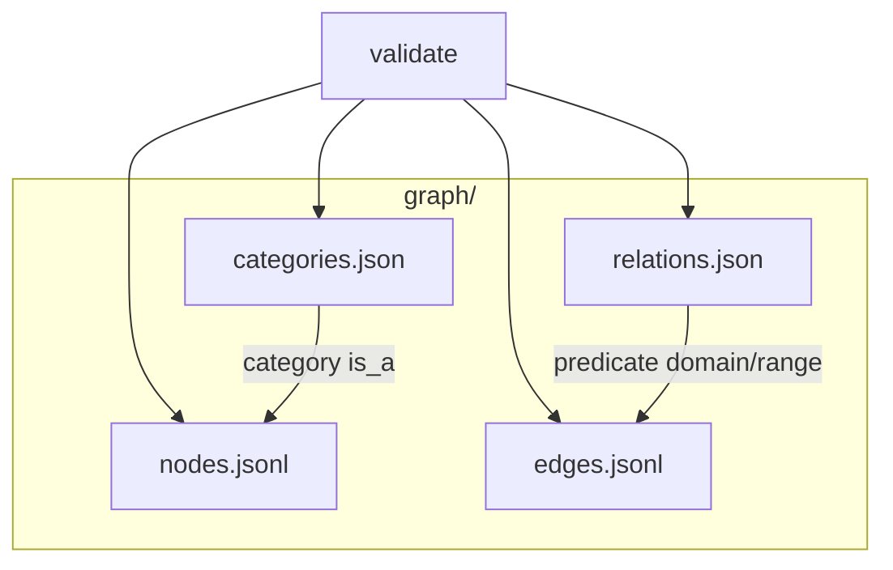

# Graph catalog

A minimal KGX-style graph catalog: nodes and edges as JSON Lines, vocabulary in JSON, and a small validator.

## Layout



| File | Role |
|------|------|
| `nodes.jsonl` | `{ id, category[], properties{}, sources[] }` |
| `edges.jsonl` | `{ subject, predicate, object, qualifiers{}, sources[] }` |
| `relations.json` | Predicates with `domain_range` pairs and `transitive` flag |
| `categories.json` | Category `is_a` hierarchy (parent lists), acyclic |

Each `sources` entry is `{ source, date, licence }`. Set arrays (`category`, every `sources` list) are sorted, deduplicated strings/objects in canonical files.

## Canonical JSON lines

One line = `JSON.stringify` on recursively key-sorted objects: no extra whitespace, UTF-8, no ASCII escaping (`ensure_ascii=false` in Python). Equivalent:

`json.dumps(obj, sort_keys=True, separators=(",", ":"), ensure_ascii=False)`

Nodes sort by `id`; edges by `(subject, predicate, object, qualifiers)` using plain code-unit string order.

## Checks

- Edge endpoints exist; predicates are declared; domain/range holds via category ancestry
- Every node category appears in `categories.json` (including isolated nodes)
- `categories.json` has no cycles or dangling parents
- Sources present and well-formed; lines match the canonical serializer above

`mergeGraphs` unions node `id` / edge identity, merging categories and all source lists (including per-property sources).

## Commands

```bash
npm test
node src/check.js graph/
```

The CLI prints validation errors to stderr and exits `1` on failure (exit `0` when valid).

## License

MIT — see [LICENSE](LICENSE).
