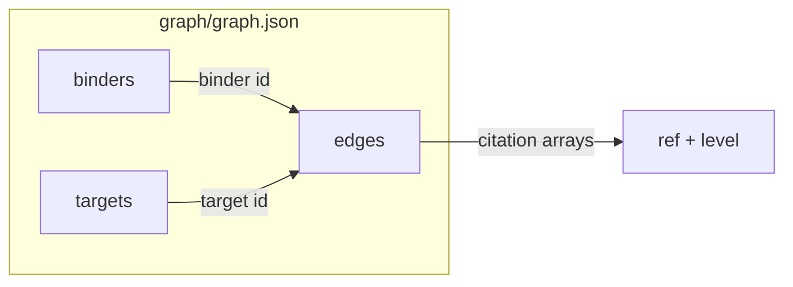

# Graph catalog

A minimal **bigraph** catalog: binders and targets linked by evidence-backed edges, stored as one canonical JSON object.

## Layout



| Key | Shape |
|-----|--------|
| `binders` | `{ "<binder-id>": { "status": "approved" \| "investigational" \| "unapproved" } }` |
| `targets` | `{ "<uniprot-accession>": {} }` |
| `edges` | `{ "<binder-id>": { "<target-id>": [ citations… ] } }` |

Binder ids are ChEMBL ids (`CHEMBL…`) or `seq:<UPPERCASE sequence>`. Target ids are UniProt accessions. Each citation is `{ "ref": "<pubmed id or DOI>", "level": "human" \| "animal" \| "in_vitro" \| "claim" }`.

Pairs appear in `edges` only with at least one citation (empty arrays are invalid). Unconfirmed candidates are omitted.

## Canonical JSON

The whole file is one line: `JSON.stringify` on recursively key-sorted objects — no extra whitespace, UTF-8, no ASCII escaping. Python equivalent:

`json.dumps(obj, sort_keys=True, separators=(",", ":"), ensure_ascii=False)`

JSON numbers must be safe integers; write decimals as strings. Citation arrays are sorted, deduplicated sets (by `ref` and `level`).

## Checks

- Every `edges` binder/target exists in `binders` / `targets`
- Valid id formats, status/level enums, non-empty citation lists
- On-disk bytes match the canonical serializer

`mergeGraphs` recursively unions dictionaries; citation lists union as sets. Same binder id merges status by lexicographic minimum (commutative).

## Commands

```bash
npm test
npm run check
```

`node src/check.js graph/graph.json` validates a file and exits `1` on error.

## License

MIT — see [LICENSE](LICENSE).
