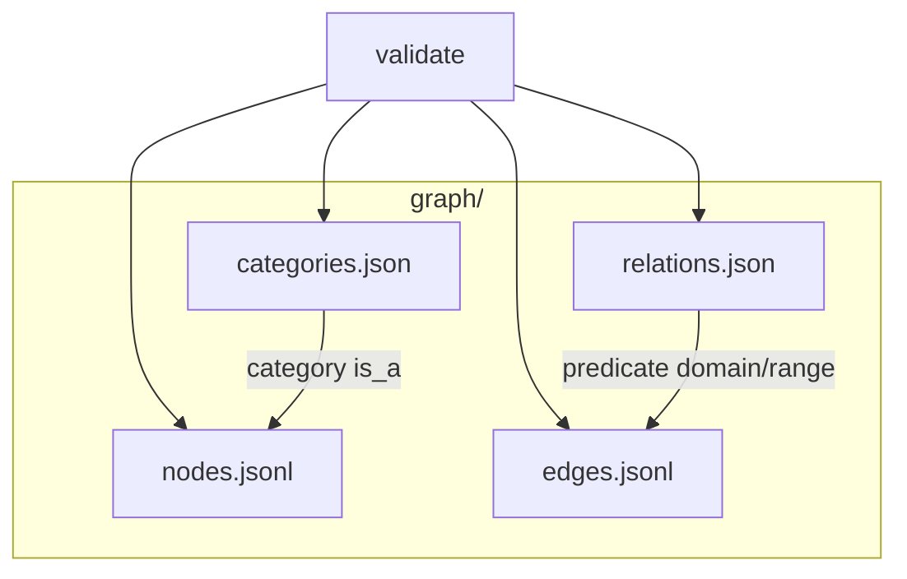

# Graph catalog

A minimal KGX-style graph catalog: nodes and edges as JSON Lines, vocabulary in JSON, and a small validator.

## Layout



| File | Role |
|------|------|
| `nodes.jsonl` | `{ id, category[], properties{}, sources[] }` |
| `edges.jsonl` | `{ subject, predicate, object, qualifiers{}, sources[] }` |
| `relations.json` | Predicates with `domain_range` pairs and `transitive` flag |
| `categories.json` | Category `is_a` hierarchy (parent lists) |

Each `sources` entry is `{ source, date, licence }`.

## Checks

The validator (`src/check.js`) reports errors when:

- An edge endpoint is missing
- A predicate is absent from `relations.json`
- Subject/object categories do not subsume an allowed domain/range pair
- A node or edge has no sources (or a malformed source)
- Lines are not in canonical form (sorted JSON keys; nodes by `id`, edges by subject/predicate/object/qualifiers)

`mergeGraphs` combines two graphs by set union on node `id` and edge identity.

## Commands

```bash
npm test
```

Shipped graph files are empty; add lines and re-run tests after editing.

## License

MIT — see [LICENSE](LICENSE).
