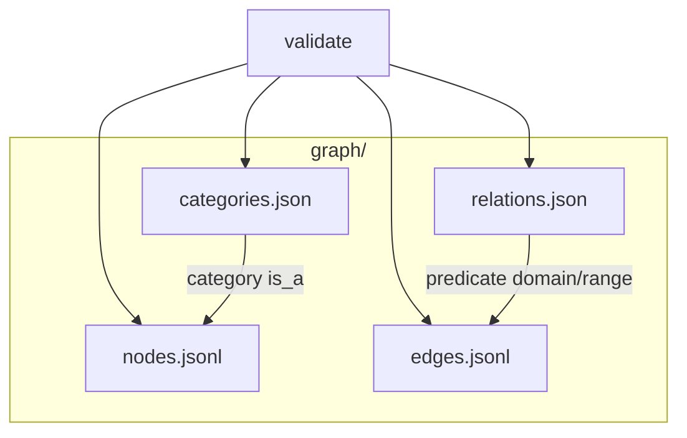

# Graph catalog

A minimal KGX-style graph catalog: nodes and edges as JSON Lines, vocabulary in JSON, and a small validator.

## Layout



| File | Role |
|------|------|
| `nodes.jsonl` | `{ id, category[], sources[] }` |
| `edges.jsonl` | `{ subject, predicate, object, qualifiers{}, sources[] }` |
| `relations.json` | Predicates with `domain_range` pairs and `transitive` flag |
| `categories.json` | Category `is_a` hierarchy (parent lists), acyclic |

Each `sources` entry is `{ source, date, licence }`. Set arrays (`category`, every `sources` list) are sorted and deduplicated in canonical files.

**Attributes** are edges, not node fields. The `object` is either another node id or a literal `{"value": ...}`. Literal endpoints use the `literal` category for domain/range checks. Conflicting values become separate edges and merge by set union.

## Canonical JSON lines

One line = `JSON.stringify` on recursively key-sorted objects: no extra whitespace, UTF-8, no ASCII escaping. Python equivalent:

`json.dumps(obj, sort_keys=True, separators=(",", ":"), ensure_ascii=False)`

Nodes sort by `id`; edges by `(subject, predicate, object, qualifiers)` with plain code-unit string order (literals included in `object`).

## Checks

- Edge endpoints exist (node ids) or are literal objects; predicates declared; domain/range via category ancestry
- Node categories appear in `categories.json`; no `properties` on nodes
- Acyclic `categories.json`; sources present; lines match the canonical serializer

`mergeGraphs` unions node ids (categories + sources) and edge identity (sources).

## Commands

```bash
npm test
node src/check.js graph/
```

The CLI prints validation errors to stderr and exits `1` on failure.

## License

MIT — see [LICENSE](LICENSE).
