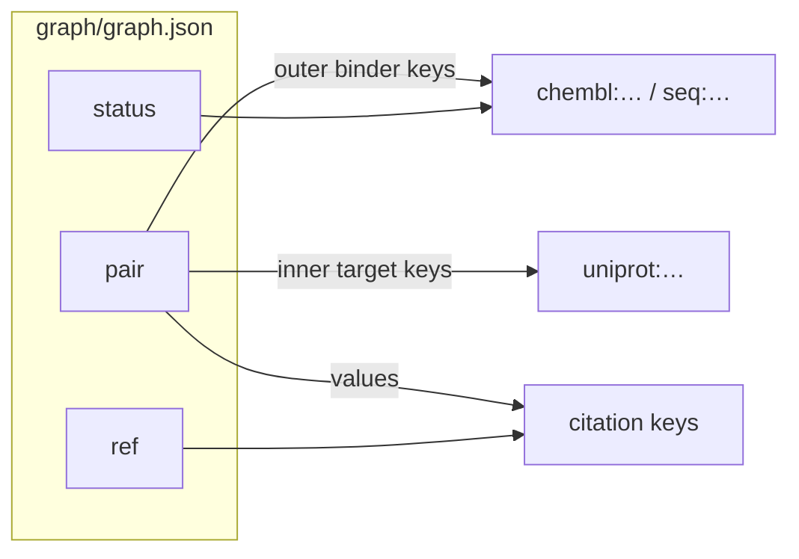

# Graph catalog

A minimal **bigraph** catalog stored as one canonical JSON object: binder→target pairs, binder status, and citation grades.

## Layout



| Key | Shape |
|-----|--------|
| `pair` | `{ "<binderKey>": { "<targetKey>": [ "<citationKey>", … ] } }` |
| `status` | `{ "<binderKey>": "<status>" }` |
| `ref` | `{ "<citationKey>": "<grade>" }` |

Binder keys: `chembl:CHEMBL…` or `seq:<UPPERCASE sequence>`. Target keys: `uniprot:<accession>`. Citation keys: `pmid:<id>` or `doi:<id>`. No unprefixed ids.

Each inner citation list is non-empty, sorted, and deduplicated. Every binder in `pair` appears in `status`; every citation in `pair` appears in `ref`.

**Matchmaking** (strongest grade per pair, then citation count) is computed at read time and is not stored.

## Canonical JSON

One line: `JSON.stringify` on recursively key-sorted objects — no extra whitespace, UTF-8, no ASCII escaping. Python:

`json.dumps(obj, sort_keys=True, separators=(",", ":"), ensure_ascii=False)`

JSON numbers must be safe integers; write decimals as strings.

## Checks

- Prefix rules and bipartite structure (no binder keys under targets, no target keys as binders)
- Status and grade enums (`STATUS_ORDER` / `GRADE_ORDER` in `src/check.js`: meta → … → claim)
- On-disk bytes match the canonical serializer

`mergeGraphs` deep-unions `pair` (citation set union) and merges `status` / `ref` by taking the **weaker** value (later in the order arrays), independent of merge order.

## Commands

```bash
npm test
npm run check
```

`node src/check.js graph/graph.json` exits `1` on validation failure.

## License

MIT — see [LICENSE](LICENSE).
