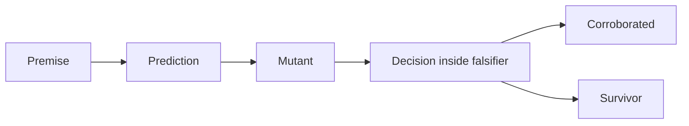
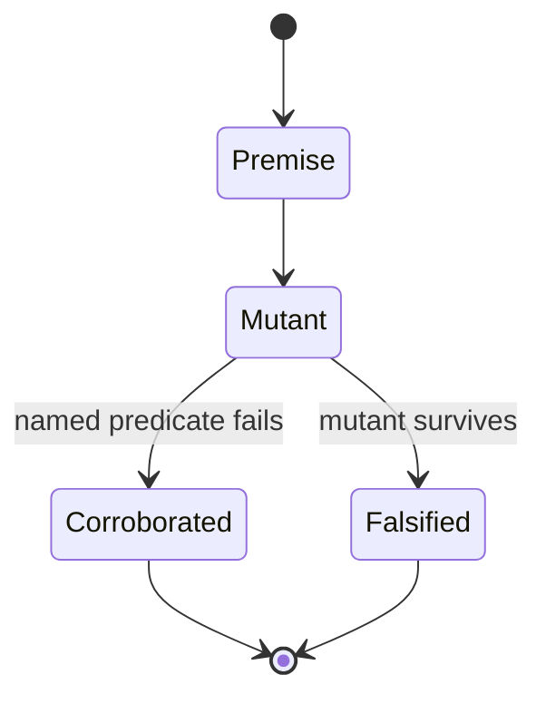

⚠️ ACADEMIC RESEARCH PURPOSES ONLY; NOT FOR MEDICAL USE WITHOUT LICENSED OVERSIGHT

# falsify the system

`type: resource.reference` · `spec: agent.swarm` · subordinate to `docs/follow-agent-contract.md`.

The falsifier holds the decision procedure and attacks the premises of this catalogue. The Prolog fence is the swarm structure image; other code fences are an example framework for a runtime written outside this repository. A caught attack corroborates a prediction and is not clinical proof.

## Specification

```json
{
  "id": "docs/falsify.md",
  "type": "resource.reference",
  "role": "attack premises with the folded decision procedure",
  "reads": ["docs/follow-agent-contract.md", "graph.json", "systems/record-traces.md"],
  "writes": [],
  "must": ["name the premise", "name the predicted break", "record a survivor", "keep the swarm image a DAG"],
  "check": ["runtime exit status", "E1", "E5", "E6", "E7"]
}
```

## Graph

- ← [follow-agent-contract.md](follow-agent-contract.md)
- → [pin-references.md](pin-references.md)

## Composition

```toml
method = "Popper"
instrument = "falsifier"
folded = "decision procedure"
carrier = "markdown"
fences = "example framework"
compression = "details wrapper"
audience = "user AI at runtime"
run_unit = "fleet.campaign"
swarm = "agent.swarm"
structure = "prolog dag"
image = "agent_swarm"

[workers]
bytes = "canonical bytes and the committed catalogue"
grammar = "keys, HELM scope, and HELM monomers"
identity = "one molecule and one triple"
relation = "add-only and merge"
oracle = "predicate 16 stays undischarged"
document = "banner, registry, identity, and graph"
trace = "act-log refusals"
```

## Indications

- Write the runtime outside this repository from this file and from the contract.
- Read a code fence as an example of the framework. Fill the procedure from the prose laws at runtime.
- Attack a premise before treating a passing decision as evidence.
- Keep a `PEPTIDE` scope failure distinct from a monomer failure.
- Carry `spec: agent.swarm` on this file, and show that any other header carrying it is refused.
- Read the expanded Prolog fence as the swarm structure image. It matches `checker literals`.
- Expand `checker literals`, `attacks`, and `carrier sets` when writing the runtime. Leave those labels closed when reading a premise.

## Contraindications

- This is not a formulary, a prescription, or a design campaign. Grammar fixtures such as `aa:ACD` are not binder designs.
- The seven workers are members of one falsification run. They do not vote. `spec: agent.swarm` is valid on this file only. `agent.fleet` is not a spec. The swarm structure image is the Prolog DAG in this file. It does not schedule a cluster.
- A corroborated attack is not predicate 16, not a measurement, and not permission to write `graph.json` or `proposals.json`.
- Do not commit the generated program, a workflow, or a package manifest into this repository. The specbase is Markdown.
- The profile maps falsifiers to `.bend` and terminal tools to `.py`. The example below is Python because that is the terminal tool language and the folded instrument is one program. No Bend program is claimed, and no Rust crate is claimed.
- This repository does not run the instrument. A green forge check does not mean these attacks ran.
- Naming `agent.swarm` as the spec of a skill or a run, or naming `agent.fleet` as a spec, is a document attack. The contract refuses both readings.

## Algorithm

### Variables

```toml
objective = "corroborate a predicted break or record a survivor"

[independent]
premise = "claim the system treats as given"
prediction = "observation that claim forbids"

[dependent]
verdict = "corroborated or falsified"

[controlled]
oracle = "not-discharged"
workers = "independent and unvoted"
program = "written at runtime, outside this repository"
```

### Process





```csv
operator,law
controls,oracle stays not-discharged
design,each worker names one forbidden observation
transport,decide inside the falsifier
stopping,exit 1 when a survivor remains
search,attack only the premise that worker names
filters,a different predicate is not corroboration
recovery,record the survivor and do not commit a program
```

The question the old verifier asked — whether the checked assertions hold — is now inside this falsifier. Each premise forbids an observation. A worker builds that observation and asks the same program that decides the catalogue, the repository, and a trace. If the named predicate fails, the prediction is corroborated. If the mutant is accepted, or if a different predicate is the only failure, the prediction is falsified and the survivor stands. Corroboration is not a probability of clinical truth.

Workers run concurrently and share no verdict. The run reports the set of verdicts. There is no majority. Exit `0` means every named prediction was corroborated. Exit `1` means at least one survivor. Exit `2` means the harness did not finish the decision.

### Structure

The fence below is the swarm structure image. Each worker depends on `decide` and on no other worker. `decide` and `document` both depend on `literals`, so `literals` has two parents and the image is a DAG. The workers do not vote. E7 checks this fence equal to the rendering of `agent.swarm` in `checker literals`. The fence stays outside compression. It does not schedule a cluster.

```prolog
image(agent_swarm).
shape(dag).
node(bytes).
node(decide).
node(document).
node(grammar).
node(identity).
node(literals).
node(oracle).
node(relation).
node(trace).
edge(bytes, decide).
edge(decide, literals).
edge(document, decide).
edge(document, literals).
edge(grammar, decide).
edge(identity, decide).
edge(oracle, decide).
edge(relation, decide).
edge(trace, decide).
```

### Framework

The swarm structure image is the Prolog fence in the previous section. The fences in this section are an example of the framework and nothing else. A user AI reads them to see the shape of one runtime, then writes that runtime from the laws. A fence is not a program this repository contains, and running one as if it were is a misread. Each example fence is collapsible under an `example framework` label. Expand that label when writing the runtime. Closed lists stay in their Markdown fences. The runtime loads them and does not copy them into source.

<details>
<summary>example framework: python</summary>

```python
"""Example only. Framework only. One program, written at runtime, outside this repository.
Fill every stub from the named prose. Do not commit the result here."""

WORKERS = ("bytes", "grammar", "identity", "relation", "oracle", "document", "trace")
# Swarm structure: the expanded prolog fence in this file. E7 checks that fence.


def load_json_fence(markdown, heading):
    """Return the object in the first json fence after a column-zero heading line.
    A details wrapper around that fence is compression, not part of the object."""


def literals(repo):
    """Contract section 0f, the fence labelled checker literals. Banner is that file's first non-blank line."""


def carriers(repo):
    """systems/record-traces.md, the fence labelled carrier sets."""


def attacks(repo):
    """The attacks object in this file, the fence labelled attacks. Do not restate it."""


def decide(catalogue, predecessor=None, repo=None, trace=None, online=False):
    """Folded decision procedure.

    Laws: contract sections 2, 3, 5, 6, and 8, plus E1 through E7.
    Predicate 16 is reported not discharged and never passes.
    E3 does not change the exit status.
    Merge of two catalogues is contract section 6 and writes canonical bytes.
    Trace judgement is systems/record-traces.md and loads carriers().
    Text, when a caller asks for text: a PASS or FAIL line, the predicate label,
    indented rows on a failure, an oracle line that says NOT DISCHARGED when a
    catalogue was checked, then RESULT PASS or RESULT FAIL.
    This function exits 0 when every evaluated predicate holds, 1 on a violation, and 2 on usage.
    The campaign exits are separate: 0 corroborated, 1 survivor, 2 harness error.
    """


def build(repo, attack):
    """Build the mutant the attack's premise and prediction name. Use a temporary directory.
    Do not edit the repository when a prediction dies."""


def judge(attack, report):
    """A named failure corroborates.
    Acceptance, or a different failure alone, falsifies.
    A missing report is a harness error, not a survivor."""


def campaign(repo, only=None):
    """Seven workers, one run, no vote. Sort by worker, then id.
    only restricts the set. An unknown name is exit 2."""
```
</details>

<details>
<summary>example framework: rust</summary>

```rust
// Example only. Framework only. Vocabulary, not a crate in this repository.
// Implement these names inside the one runtime. Do not shell out to a second checker.
enum Verdict {
    Corroborated,
    Falsified,
    Error,
}
```
</details>

<details>
<summary>example framework: bash</summary>

```bash
# Example only. The program is whatever the user AI wrote outside this repository.
falsify
falsify --decide graph.json
falsify --prev OLD.json graph.json
falsify --merge A.json B.json
falsify --repo .
falsify --trace core.trace worker.trace
falsify --online graph.json
falsify --json
falsify --worker bytes
```
</details>

<details>
<summary>example framework: text</summary>

```text
# Example only. Framework only. Not a workflow of this repository.
# The language profile admits a yaml fence only for a Kubernetes manifest,
# and a manifest is not a fleet or swarm structure image. This sketch stays
# text. A user AI may emit it outside the repository
# after the runtime exists. A forge check is not the instrument.
name: falsify
on: workflow_dispatch
jobs:
  falsify:
    runs-on: ubuntu-latest
    steps:
      - run: falsify --json
```
</details>

### Attacks

Eighty-three attacks, seven workers, no vote. This object is the closed list, in the collapsible fence `attacks`. Expand that label to load it. The runtime loads it and does not restate it. Each prediction is the observation that corroborates the premise. A hold that the pure predicates pass still leaves predicate 16 undischarged.

<details>
<summary>attacks</summary>

```json
{
  "attacks": [
    {
      "worker": "bytes",
      "id": "empty-holds",
      "premise": "the five-line empty catalogue is valid",
      "prediction": "predicates 1-15, 17, and 18 pass"
    },
    {
      "worker": "bytes",
      "id": "base-holds",
      "premise": "one canonical aa row is a valid catalogue",
      "prediction": "the pure predicates pass and 16 stays open"
    },
    {
      "worker": "bytes",
      "id": "utf8-rejected",
      "premise": "invalid UTF-8 is not repaired",
      "prediction": "predicate 1 fails and parsing does not continue"
    },
    {
      "worker": "bytes",
      "id": "overlong-utf8",
      "premise": "an overlong UTF-8 sequence is not a character",
      "prediction": "predicate 1 fails"
    },
    {
      "worker": "bytes",
      "id": "nul-is-utf8",
      "premise": "NUL is a UTF-8 code unit and is still not JSON",
      "prediction": "predicate 1 passes and predicate 3 fails"
    },
    {
      "worker": "bytes",
      "id": "bom",
      "premise": "a UTF-8 BOM is not part of the catalogue",
      "prediction": "predicate 1 passes and predicate 3 fails"
    },
    {
      "worker": "bytes",
      "id": "missing-newline",
      "premise": "exactly one final newline is required",
      "prediction": "predicate 2 fails"
    },
    {
      "worker": "bytes",
      "id": "extra-newline",
      "premise": "a second trailing newline is not canonical",
      "prediction": "predicate 2 fails"
    },
    {
      "worker": "bytes",
      "id": "crlf",
      "premise": "CRLF is not the default byte convention",
      "prediction": "predicate 2 fails"
    },
    {
      "worker": "bytes",
      "id": "compact-empty",
      "premise": "a compact empty catalogue is not the empty catalogue",
      "prediction": "predicates 6 and 18 fail"
    },
    {
      "worker": "bytes",
      "id": "swapped-root-keys",
      "premise": "reordering root keys does not change the members",
      "prediction": "predicate 3 passes; predicates 6 and 18 fail"
    },
    {
      "worker": "bytes",
      "id": "duplicate-version-key",
      "premise": "a repeated JSON key is not a second version",
      "prediction": "predicate 3 sees one version and predicate 6 fails"
    },
    {
      "worker": "bytes",
      "id": "version-string",
      "premise": "version is the number 2, not the string 2",
      "prediction": "predicate 4 fails and the bytes can still be canonical for that string"
    },
    {
      "worker": "bytes",
      "id": "version-float",
      "premise": "version is the integer 2, not 2.0",
      "prediction": "predicate 4 fails and predicate 6 still passes"
    },
    {
      "worker": "bytes",
      "id": "version-bool",
      "premise": "version is not a boolean",
      "prediction": "predicate 4 fails and predicate 6 still passes"
    },
    {
      "worker": "bytes",
      "id": "rank-root",
      "premise": "a stored rank is a forbidden write and an extra root key",
      "prediction": "predicates 3 and 17 fail; predicate 6 passes on the sorted object"
    },
    {
      "worker": "bytes",
      "id": "note-root",
      "premise": "predicate 17 is the named denylist; predicate 3 rejects any other root key",
      "prediction": "predicate 3 fails, predicate 17 passes, and predicate 6 passes"
    },
    {
      "worker": "bytes",
      "id": "null-dictionary",
      "premise": "a null dictionary is not an object",
      "prediction": "predicate 5 fails; canonical bytes of null can still match"
    },
    {
      "worker": "bytes",
      "id": "committed-catalogue-holds",
      "premise": "the committed catalogue satisfies the pure predicates",
      "prediction": "predicate 6 passes and the oracle stays open"
    },
    {
      "worker": "bytes",
      "id": "committed-one-space",
      "premise": "one changed canonical byte of the committed catalogue is a different file",
      "prediction": "predicate 6 fails and predicate 4 still passes"
    },
    {
      "worker": "grammar",
      "id": "decreasing-segments",
      "premise": "aa segments out of byte order are invalid, not a sorting task",
      "prediction": "predicate 7 fails and predicate 6 still passes"
    },
    {
      "worker": "grammar",
      "id": "repeated-segments-hold",
      "premise": "a repeated segment is a multiset member",
      "prediction": "aa:ACD/ACD passes predicate 7"
    },
    {
      "worker": "grammar",
      "id": "cyrillic-residue",
      "premise": "a lookalike letter is not the residue alphabet",
      "prediction": "predicate 7 fails"
    },
    {
      "worker": "grammar",
      "id": "pmid-zero-holds",
      "premise": "pmid:0 is the grammar's zero, not a padded identifier",
      "prediction": "predicate 10 passes"
    },
    {
      "worker": "grammar",
      "id": "pmid-leading-zero",
      "premise": "pmid:01 is not pmid:1",
      "prediction": "predicate 10 fails"
    },
    {
      "worker": "grammar",
      "id": "isoform-holds",
      "premise": "uniprot:P12345-1 is a distinct well-formed target",
      "prediction": "predicate 9 passes"
    },
    {
      "worker": "grammar",
      "id": "isoform-leading-zero",
      "premise": "an isoform suffix does not take a leading zero",
      "prediction": "predicates 9 and 12 fail"
    },
    {
      "worker": "grammar",
      "id": "chem-scope",
      "premise": "a CHEM block is out of scope and is not a monomer error",
      "prediction": "8-scope fails; predicate 8 and 8-monomer pass"
    },
    {
      "worker": "grammar",
      "id": "rna-scope",
      "premise": "an RNA block is the same scope refusal",
      "prediction": "8-scope fails and 8-monomer passes"
    },
    {
      "worker": "grammar",
      "id": "smiles-monomer",
      "premise": "[CCO] inside PEPTIDE is a monomer refusal, not a scope refusal",
      "prediction": "8-monomer fails; predicate 8 and 8-scope pass"
    },
    {
      "worker": "grammar",
      "id": "empty-monomers",
      "premise": "an empty monomer list is not a peptide",
      "prediction": "8-monomer fails"
    },
    {
      "worker": "grammar",
      "id": "control-character",
      "premise": "a control character in HELM is ill-formed, not a scope or monomer class",
      "prediction": "predicate 8 fails; 8-scope and 8-monomer pass"
    },
    {
      "worker": "grammar",
      "id": "leading-zero-index",
      "premise": "a polymer index has no leading zero",
      "prediction": "predicate 8 fails; scope and monomer stay passing"
    },
    {
      "worker": "grammar",
      "id": "doi-citation",
      "premise": "a citation is bare pmid digits",
      "prediction": "predicate 10 fails"
    },
    {
      "worker": "grammar",
      "id": "binder-uses-target-prefix",
      "premise": "prefixes do not cross roles",
      "prediction": "predicate 14 fails"
    },
    {
      "worker": "grammar",
      "id": "target-uses-citation-prefix",
      "premise": "a pmid is not a target",
      "prediction": "predicates 9, 12, and 14 fail"
    },
    {
      "worker": "identity",
      "id": "helm-index-alias",
      "premise": "polymer index digits do not make a second molecule",
      "prediction": "predicate 13 fails and predicate 8 passes"
    },
    {
      "worker": "identity",
      "id": "aa-helm-same-chain",
      "premise": "a plain L-chain HELM is the same molecule as aa:, and only aa: is valid",
      "prediction": "predicate 13 fails"
    },
    {
      "worker": "identity",
      "id": "unsorted-multiset",
      "premise": "two aa strings with one sorted multiset are one molecule",
      "prediction": "predicates 7 and 13 fail"
    },
    {
      "worker": "identity",
      "id": "duplicate-triple",
      "premise": "one triple cannot occupy both dictionaries",
      "prediction": "predicate 15 fails"
    },
    {
      "worker": "identity",
      "id": "unsorted-citations",
      "premise": "citation order is canonical, not decorative",
      "prediction": "predicates 6 and 12 fail"
    },
    {
      "worker": "identity",
      "id": "duplicate-citations",
      "premise": "a repeated citation is not two papers",
      "prediction": "predicates 6 and 12 fail"
    },
    {
      "worker": "identity",
      "id": "empty-citations",
      "premise": "a target with no citations is not a row",
      "prediction": "predicate 12 fails and the empty array can still be canonical"
    },
    {
      "worker": "identity",
      "id": "empty-binder-row",
      "premise": "a binder that maps to nothing is not a row",
      "prediction": "predicate 11 fails and predicate 6 passes"
    },
    {
      "worker": "relation",
      "id": "delete-citation",
      "premise": "add-only forbids removing a citation",
      "prediction": "predicate 19 fails and the successor's pure bytes still pass"
    },
    {
      "worker": "relation",
      "id": "move-between-dictionaries",
      "premise": "moving a triple is removal from the dictionary that had it",
      "prediction": "predicate 19 fails and predicate 15 does not, because it is not in both"
    },
    {
      "worker": "relation",
      "id": "add-citation-holds",
      "premise": "adding a citation keeps every predecessor row",
      "prediction": "predicate 19 passes"
    },
    {
      "worker": "relation",
      "id": "identical-successor-holds",
      "premise": "an unchanged successor is add-only",
      "prediction": "predicate 19 passes"
    },
    {
      "worker": "relation",
      "id": "version-bump-add-only-holds",
      "premise": "predicate 19 checks rows, not the schema version",
      "prediction": "predicate 4 fails and predicate 19 passes"
    },
    {
      "worker": "relation",
      "id": "merge-commutes",
      "premise": "merge is commutative",
      "prediction": "merge(A,B) and merge(B,A) are the same bytes"
    },
    {
      "worker": "relation",
      "id": "merge-idempotent",
      "premise": "merge is idempotent",
      "prediction": "merge(A,A) equals A"
    },
    {
      "worker": "relation",
      "id": "merge-refuses-version",
      "premise": "different versions are not coerced",
      "prediction": "merge exits non-zero and names the version refusal"
    },
    {
      "worker": "oracle",
      "id": "base-oracle-open",
      "premise": "a passing pure run does not read the papers",
      "prediction": "the oracle line stays NOT DISCHARGED"
    },
    {
      "worker": "oracle",
      "id": "broken-file-oracle-open",
      "premise": "a failing file does not discharge predicate 16 either",
      "prediction": "the oracle line stays NOT DISCHARGED while predicates 6 and 18 fail"
    },
    {
      "worker": "oracle",
      "id": "no-reliability-predicate",
      "premise": "one re-run is not evidence of reliability",
      "prediction": "no predicate id is 16 or a reliability claim"
    },
    {
      "worker": "document",
      "id": "committed-tree-holds",
      "premise": "the committed tree meets the pure predicates and E1, E2, E4, E5, E6, and E7",
      "prediction": "those predicates pass and E3 is not consulted"
    },
    {
      "worker": "document",
      "id": "swarm-spec-refused",
      "premise": "agent.swarm is the falsifier spec and no other header may carry it",
      "prediction": "E5 refuses the spec outside docs/falsify.md"
    },
    {
      "worker": "document",
      "id": "falsifier-spec-required",
      "premise": "the falsifier header carries spec agent.swarm",
      "prediction": "dropping the spec fails E5"
    },
    {
      "worker": "document",
      "id": "swarm-as-type",
      "premise": "agent.swarm is a spec, not a type",
      "prediction": "putting it in the type slot fails E5"
    },
    {
      "worker": "document",
      "id": "fleet-spec-refused",
      "premise": "agent.fleet is not a spec and not a type",
      "prediction": "E5 names that refusal"
    },
    {
      "worker": "document",
      "id": "unregistered-skill",
      "premise": "a skill file outside section 10 is not a procedure of this contract",
      "prediction": "E2 reports it missing and E5 still accepts the skill header"
    },
    {
      "worker": "document",
      "id": "unregistered-system",
      "premise": "a system file outside section 11 is not a run of this contract",
      "prediction": "E4 reports it missing and E5 still accepts the campaign header"
    },
    {
      "worker": "document",
      "id": "one-sided-edge",
      "premise": "every Markdown edge is declared at both ends",
      "prediction": "E6 fails on the falsify edge"
    },
    {
      "worker": "document",
      "id": "banner-removed",
      "premise": "the banner is byte-identical on every Markdown file",
      "prediction": "E1 fails"
    },
    {
      "worker": "document",
      "id": "html-in-body",
      "premise": "a line that begins with < and is not the compression wrapper is not a language escape, and a late HTML line is not an H2",
      "prediction": "E7 fails and E6 still passes"
    },
    {
      "worker": "document",
      "id": "compression-wrapper-holds",
      "premise": "one details wrapper around one canonical fence is in-place compression",
      "prediction": "E7 passes"
    },
    {
      "worker": "document",
      "id": "compression-two-fences",
      "premise": "a compression wrapper holds one fence",
      "prediction": "E7 fails"
    },
    {
      "worker": "document",
      "id": "compression-around-prose",
      "premise": "a compression wrapper is not a prose container",
      "prediction": "E7 fails"
    },
    {
      "worker": "document",
      "id": "compression-hides-process",
      "premise": "the process CSV and both diagrams stay outside every wrapper",
      "prediction": "E7 fails"
    },
    {
      "worker": "document",
      "id": "compression-attribute",
      "premise": "a details tag with an attribute is not the compression wrapper",
      "prediction": "E7 fails and E6 still passes"
    },
    {
      "worker": "document",
      "id": "compression-duplicate-label",
      "premise": "a compression label is unique in its file",
      "prediction": "E7 fails"
    },
    {
      "worker": "document",
      "id": "fleet-image-not-tree",
      "premise": "the fleet structure image is the Prolog tree rooted at core",
      "prediction": "E7 fails when that fence is missing, cyclic, or rooted elsewhere"
    },
    {
      "worker": "document",
      "id": "swarm-image-not-dag",
      "premise": "the swarm structure image is the Prolog DAG of the seven workers",
      "prediction": "E7 fails when a worker is dropped, a cycle is added, or the shape fact is tree"
    },
    {
      "worker": "document",
      "id": "structure-image-moved",
      "premise": "each structure image is allowed only on its path",
      "prediction": "E7 fails when the fleet fence is copied onto docs/falsify.md"
    },
    {
      "worker": "document",
      "id": "structure-image-wrapped",
      "premise": "a prolog structure image stays outside every compression wrapper",
      "prediction": "E7 fails"
    },
    {
      "worker": "document",
      "id": "yaml-not-structure",
      "premise": "a Kubernetes manifest is not a fleet or swarm structure image",
      "prediction": "E7 fails when the fleet fence is replaced by yaml"
    },
    {
      "worker": "trace",
      "id": "valid-trace-holds",
      "premise": "a resolve-key call and one halt is a result",
      "prediction": "the trace code is result"
    },
    {
      "worker": "trace",
      "id": "oracle-discharged",
      "premise": "a trace cannot discharge the paper oracle",
      "prediction": "admit refuses value:oracle"
    },
    {
      "worker": "trace",
      "id": "stale-hash",
      "premise": "changing oracle without recomputing the id breaks the hash first",
      "prediction": "admit refuses hash"
    },
    {
      "worker": "trace",
      "id": "score-field",
      "premise": "a score has no production in the act grammar",
      "prediction": "admit refuses fields"
    },
    {
      "worker": "trace",
      "id": "two-pins",
      "premise": "one run has at most one pin",
      "prediction": "R5 reports the pin count"
    },
    {
      "worker": "trace",
      "id": "repeated-halt-collapses",
      "premise": "a repeated halt line is the same content-addressed act",
      "prediction": "the trace remains result"
    },
    {
      "worker": "trace",
      "id": "emit-without-control",
      "premise": "an emission without a passing control is not a result",
      "prediction": "R10 reports the missing control"
    }
  ]
}
```
</details>

## Citations

| Pin | Claim used | Boundary |
|---|---|---|
| [Falsifiability](https://en.wikipedia.org/wiki/Falsifiability) | lead: the language must be able to describe a contradicting observation; a verification has no value in itself. Survival here corroborates and does not prove | lead read 3 Nov 2026 (Australia/Sydney); living page; no Popper edition; not clinical proof |
| [NIST conformance guidance](https://www.nist.gov/itl/ai/applied-ai-research-group/what-thing-called-conformance) | a failed falsification proves nonconformance; a pass proves only checked assertions | same URL as the contract; this file did not re-download it |
| [`follow-agent-contract.md`](follow-agent-contract.md) | predicates 1–19, E1–E7, and `agent.swarm` as this file's spec | governs on any conflict with this file |

Stated 3 Nov 2026 (Australia/Sydney). The decision procedure was folded into this falsifier the same day.

## Falsification

| Challenge | Expected break |
|---|---|
| Change one canonical byte of the committed catalogue | predicate 6 fails |
| Use a compact empty catalogue, or swap root keys without changing members | predicates 6 and 18 fail |
| Repeat a JSON key | predicate 3 still passes; predicate 6 fails |
| Set `version` to a string, a float, or a boolean | predicate 4 fails; predicate 6 can still pass |
| Store root `rank` | predicates 3 and 17 fail |
| Store root `note` | predicate 3 fails; predicate 17 passes |
| Decrease `aa:` segments | predicate 7 fails; predicate 6 still passes |
| Use a `CHEM` or `RNA` block | `8-scope` fails; `8-monomer` passes |
| Put `[CCO]` in a `PEPTIDE` block | `8-monomer` fails; `8-scope` passes |
| Put a control character in HELM, or a leading-zero polymer index | predicate 8 fails; scope and monomer pass |
| Alias one chain by two HELM indexes, or by `aa:` plus plain HELM | predicate 13 fails |
| Put one triple in both dictionaries | predicate 15 fails |
| Delete a citation, or move it to the other dictionary | predicate 19 fails; the move does not trip 15 |
| Bump `version` and keep every row | predicate 4 fails; predicate 19 passes |
| Merge two catalogues in both orders | bytes match; unequal versions are refused |
| Declare `spec: agent.swarm` outside this file | E5 |
| Declare `agent.swarm` as a type, or drop the spec from this file | E5 |
| Declare `spec: agent.fleet` | E5 |
| Add an unregistered skill or system | E2 or E4 |
| Delete one side of a Markdown edge | E6 |
| Remove the banner | E1 |
| Put an HTML line outside a compression wrapper | E7 fails; E6 still passes |
| Give `<details>` an attribute, wrap two fences or prose, wrap the process CSV or a diagram, or repeat a label | E7 fails |
| Wrap one canonical fence in one `<details>` block with a new plain label | E7 passes |
| Drop a swarm worker, add a cycle, move the image, or wrap it | E7 |
| Replace the image with a Kubernetes manifest | E7 |
| Set trace `oracle` to `discharged` | `value:oracle` |
| Add `score` to an act | `fields` |
| Pin twice | R5 |
| Repeat one identical halt line | content identity keeps a single act |
| Emit a binder with no passing control | R10 |
| Treat a green pure run as closing the paper oracle | the oracle line stays not discharged |
| Treat one re-run as reliability | no predicate id supports that inference |
| Commit a checker or a workflow into this repository | the specbase is no longer Markdown only |
| Treat a fence as a run that already happened | no mutant was decided |

The attack object is the closed list. This table names the same premises in groups. The runtime does not edit the repository when a prediction dies.

## Licence

MIT
