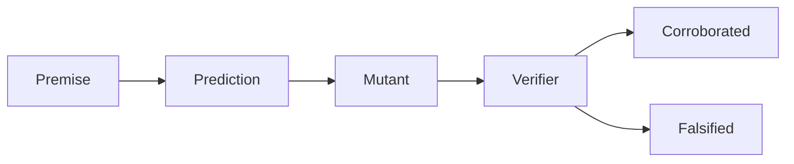
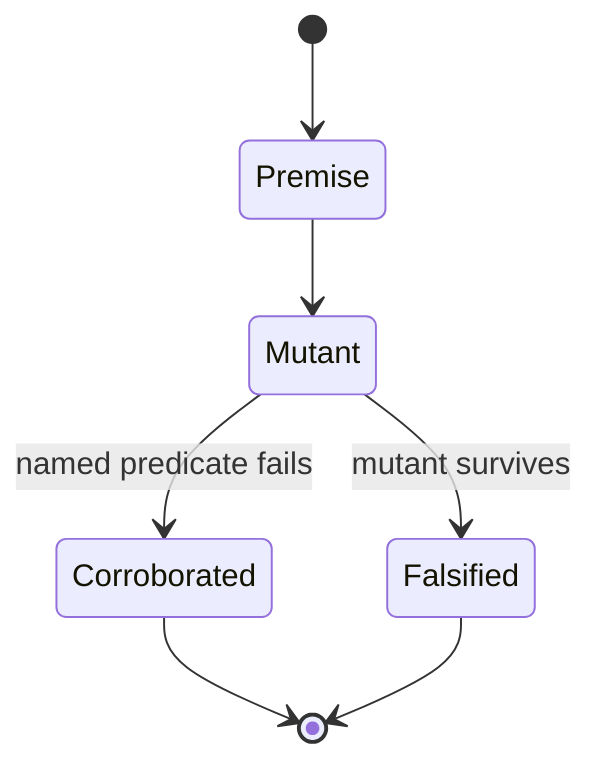

⚠️ ACADEMIC RESEARCH PURPOSES ONLY; NOT FOR MEDICAL USE WITHOUT LICENSED OVERSIGHT

# falsify the system

`type: resource.reference` · `spec: agent.swarm` · subordinate to `docs/follow-agent-contract.md`.

Independent workers attack the premises and predictions of this agentic catalogue. A caught attack corroborates that prediction. It is not clinical proof.

## Specification

```json
{
  "id": "docs/falsify.md",
  "type": "resource.reference",
  "role": "attack premises and predictions of the agent system",
  "reads": ["docs/follow-agent-contract.md", "verifier/verify.py", "graph.json"],
  "writes": [],
  "must": ["name the premise", "name the predicted break", "record a survivor"],
  "check": ["falsifier exit status", "E1", "E5", "E6", "E7"]
}
```

## Graph

- ← [follow-agent-contract.md](follow-agent-contract.md)
- → [pin-references.md](pin-references.md)

## Composition

```toml
method = "Popper"
instrument = "falsifier"
language = ".rs"
run_unit = "fleet.campaign"
swarm = "agent.swarm"

[workers]
bytes = "canonical bytes and the committed catalogue"
grammar = "keys, HELM scope, and HELM monomers"
identity = "one molecule and one triple"
relation = "add-only and merge"
oracle = "predicate 16 stays undischarged"
document = "banner, registry, identity, and graph"
trace = "act-log refusals"
```

## Indications

- Attack a premise before treating a verifier pass as evidence.
- Keep a `PEPTIDE` scope failure distinct from a monomer failure.
- Carry `spec: agent.swarm` on this file, and show that any other header carrying it is refused.

## Contraindications

- This is not a formulary, a prescription, or a design campaign. Grammar fixtures such as `aa:ACD` are not binder designs.
- The seven workers are members of one falsification run. They do not vote. `spec: agent.swarm` is valid on this file only. `agent.fleet` is not a spec. The profile name `swarms = "Kubernetes"` does not schedule a cluster.
- A corroborated attack is not predicate 16, not a measurement, and not permission to write `graph.json` or `proposals.json`.
- `falsifier/` is a human-directed instrument beside `verifier/`. It does not widen §0 for a catalogue agent.
- The profile maps falsifiers to `.bend` and tracers to `.rs`. This instrument is Rust. No Bend program is claimed.
- The GitHub workflow does not run this crate. A green check does not mean these attacks ran.

## Algorithm

### Variables

```toml
objective = "corroborate a predicted break or record a survivor"

[independent]
premise = "claim the system treats as given"
prediction = "observation that claim forbids"

[dependent]
verdict = "corroborated or falsified"

[controlled]
oracle = "not-discharged"
workers = "independent and unvoted"
```

### Process





```csv
operator,law
controls,oracle stays not-discharged
design,each worker names one forbidden observation
transport,hand the mutant to verifier/verify.py
stopping,exit 1 when a survivor remains
search,attack only the premise that worker names
filters,a different predicate is not corroboration
recovery,record the survivor and do not edit the verifier
```

The verifier asks whether the checked assertions hold. The falsifier inverts the question. Each premise forbids an observation. A worker builds that observation and hands it to `verifier/verify.py`. If the named predicate fails, the prediction is corroborated. If the mutant is accepted, or if a different predicate is the only failure, the prediction is falsified and the survivor stands. Corroboration is not a probability of clinical truth.

Workers run concurrently and share no verdict. The run reports the set of verdicts. There is no majority.

```rust
enum Verdict {
    Corroborated,
    Falsified,
}
```

```bash
cargo run --manifest-path falsifier/Cargo.toml --locked
```

Exit `0` means every named prediction was corroborated. Exit `1` means at least one survivor. Exit `2` means the harness did not run the verifier.

## Citations

| Pin | Claim used | Boundary |
|---|---|---|
| [Falsifiability](https://en.wikipedia.org/wiki/Falsifiability) | lead: the language must be able to describe a contradicting observation; a verification has no value in itself. Survival here corroborates and does not prove | lead read 3 Nov 2026 (Australia/Sydney); living page; no Popper edition; not clinical proof |
| [NIST conformance guidance](https://www.nist.gov/itl/ai/applied-ai-research-group/what-thing-called-conformance) | a failed falsification proves nonconformance; a pass proves only checked assertions | same URL as the contract; this file did not re-download it |
| [`follow-agent-contract.md`](follow-agent-contract.md) | predicates 1–19, E1–E7, and `agent.swarm` as this file's spec | governs on any conflict with this file |

Stated 3 Nov 2026 (Australia/Sydney).

## Falsification

| Challenge | Expected break |
|---|---|
| Change one canonical byte of the committed catalogue | predicate 6 fails |
| Use a compact empty catalogue, or swap root keys without changing members | predicates 6 and 18 fail |
| Repeat a JSON key | predicate 3 still passes; predicate 6 fails |
| Set `version` to a string, a float, or a boolean | predicate 4 fails; predicate 6 can still pass |
| Store root `rank` | predicates 3 and 17 fail |
| Store root `note` | predicate 3 fails; predicate 17 passes |
| Decrease `aa:` segments | predicate 7 fails; predicate 6 still passes |
| Use a `CHEM` or `RNA` block | `8-scope` fails; `8-monomer` passes |
| Put `[CCO]` in a `PEPTIDE` block | `8-monomer` fails; `8-scope` passes |
| Put a control character in HELM, or a leading-zero polymer index | predicate 8 fails; scope and monomer pass |
| Alias one chain by two HELM indexes, or by `aa:` plus plain HELM | predicate 13 fails |
| Put one triple in both dictionaries | predicate 15 fails |
| Delete a citation, or move it to the other dictionary | predicate 19 fails; the move does not trip 15 |
| Bump `version` and keep every row | predicate 4 fails; predicate 19 passes |
| Merge two catalogues in both orders | bytes match; unequal versions are refused |
| Declare `spec: agent.swarm` outside this file | E5 |
| Declare `agent.swarm` as a type, or drop the spec from this file | E5 |
| Declare `spec: agent.fleet` | E5 |
| Add an unregistered skill or system | E2 or E4 |
| Delete one side of a Markdown edge | E6 |
| Remove the banner | E1 |
| Put raw HTML in a section body | E7 fails; E6 still passes |
| Set trace `oracle` to `discharged` | `value:oracle` |
| Add `score` to an act | `fields` |
| Pin twice | R5 |
| Repeat one identical halt line | content identity keeps a single act |
| Emit a binder with no passing control | R10 |
| Treat a green pure run as closing the paper oracle | the oracle line stays not discharged |
| Treat one re-run as reliability | no predicate id supports that inference |

The executable list is the Rust workers. This table names the premises. The program does not edit the verifier when a prediction dies.

## Licence

MIT
