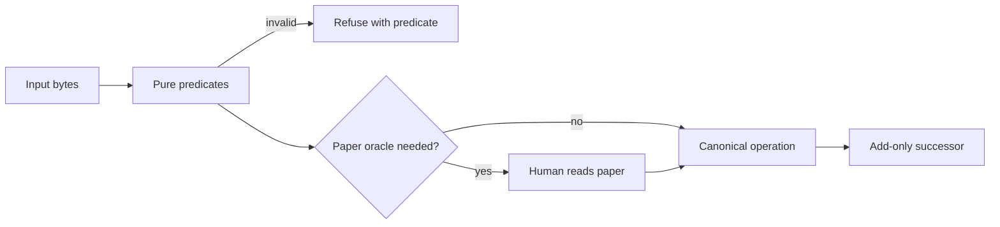
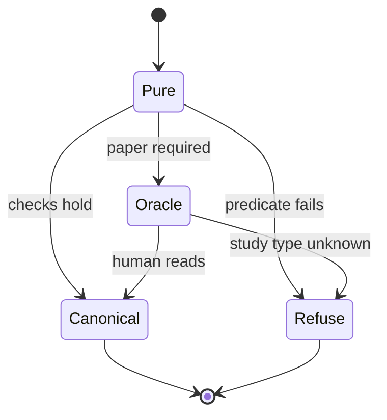

# `graph.json` — agent contract

`type: resource.reference` · **normative**. `docs/read-repository.md` is `type: initialization` and non-normative; on conflict this file governs.

Define the catalogue schema, evidence boundary, executable agent organization, and campaign-system registry. Markdown cells carry the normative reasoning model; the Rust crate, container recipes, Kubernetes manifest, and archive schema carry its executable organization.

## Specification

```json { type: notebook.cell }
{
  "id": "docs/follow-agent-contract.md",
  "type": "resource.reference",
  "role": "normative catalogue and agent-system contract",
  "reads": ["graph.json", "registered Markdown", "Rust crate", "Kubernetes manifest", "paper evidence"],
  "writes": ["graph.json under human supersession", "proposals.json under section 9"],
  "must": ["preserve canonical bytes", "leave the paper oracle explicit", "publish typed agents", "keep code cells definitive"],
  "check": ["predicates 1-19", "E1-E7"]
}
```

## Graph

- → [../skills/resolve-key.md](../skills/resolve-key.md)
- → [../systems/use-bench.md](../systems/use-bench.md)
- → [falsify.md](falsify.md)
- ← [read-repository.md](read-repository.md)

## Composition

```toml { type: notebook.cell }
law = ["0", "0b", "0c", "0d", "0e", "1", "2", "3", "4", "5", "6", "7", "8", "9", "10", "11"]
graph = "Graph section; reciprocal relative paths; read before"
registry = ["10 Skills", "11 Systems"]
embeds = ["toml", "json", "csv", "stateDiagram-v2", "flowchart", "GFM tables", "typescript", "tla", "lisp", "lean", "bend"]
compression = "details wrapper around one canonical fence"
```

## Indications

- Reading or ranking catalogue rows.
- Validating, merging, or extending catalogue bytes.
- Resolving keys, proposing pairs, or launching de novo design.
- Implementing a registered campaign system or interpreting its outputs.
- Reading a fleet DAG, a swarm DAG, the Merkle tree derived at traces, or the context seal.
- Reading the symbolic playground for the design agent or the proof agent.

## Contraindications

- This is not a formulary, prescription, clinical recommendation, or proof of patient benefit.
- Automation cannot discharge predicate 16; admission requires reading the cited paper.
- `pair` and `preclinical` are study types, not evidence grades, and are never pooled.
- A missing row is unknown coverage, not evidence that no binder exists.
- Repository-local `agent.skill` and `fleet.campaign` are not claims of conformance with external Agent Skills or A2A.
- A Prolog structure image is the symbolic projection of the typed Rust graph. Kubernetes executes that organization but does not alter its edges.
- A symbolic playground is a shape check. It is not a discharged proof, not a TLC run, and not predicate 16.

## Algorithm

### Variables

```toml { type: notebook.cell }
objective = "canonical rows whose paper reports utility for that pair"

[independent]
binder = "aa: chains or helm: PEPTIDE payload"
target = "uniprot: accession, optional isoform"
citation = "pmid:<digits>"
dictionary = "pair | preclinical"

[dependent]
admitted = "boolean after the paper is read"
bytes = "canonical UTF-8 of version, pair, preclinical"

[controlled]
version = 2
segment_order = "non-decreasing UTF-8"
helm_scope = "every block PEPTIDE"
oracle = "not discharged by automation"
```

### Process





```csv { type: notebook.cell }
operator,law
controls,version 2 and canonical bytes stay fixed
design,separate pair from preclinical by study type
transport,proposals.json then a reader into graph.json
stopping,halt when a predicate fails or the oracle is required
search,resolve keys and rank inside one dictionary
filters,refuse bad grammar scope and duplicate triples
recovery,retry unavailable and never cache it as unresolved
```

Symbolic reasoning. `type: sandbox.playground`.

```tla
---- MODULE Catalogue ----
\* model agent. source of nature.
\* A Lisp variation is a proposal only when this module grounds it.
\* version is the number 2. The paper oracle stays not-discharged.
\* Not a TLC run and not predicate 16.
EXTENDS Integers
CONSTANTS version, oracle
Safe == version = 2 /\ oracle = "not-discharged"
====
```

```lisp
;; write agent. executable image. grounded in the tla module only.
(defun safe (version oracle)
  (and (= version 2) (string= oracle "not-discharged")))
```

```lean
-- model agent. forward pass. discharge and refinement check.
-- autoproof: tla source -> lisp image -> Ti -> bend breakpoint -> tla
-- E7 does not compile this fence.
def lispSafe (version : Nat) (oracle : String) : Bool :=
  decide (version = 2) && decide (oracle = "not-discharged")

theorem Ti :
    lispSafe 2 "not-discharged" = true ∧
    lispSafe 2 "discharged" = false ∧
    lispSafe 1 "not-discharged" = false := by
  decide
```

```bend
# proof agent. backward pass. search under Ti.
# ti_holds is a number. 0 takes the refuse branch.
# breakpoint: version 2 with the paper oracle not-discharged
# This value is not a .trace file. E7 does not run this fence.
object Trace { name, holds }

def backward(ti_holds):
  if ti_holds:
    return Trace { name: "breakpoint", holds: 1 }
  else:
    return Trace { name: "refuse", holds: 0 }
```

### 0. Scope

- **Read:** `DISCLAIMER`, `graph.json`, live Markdown, `ooc/*.og` (§0g), `Cargo.toml`, `src/**/*.rs`, `*.dockerfile`, `k8s/*.yaml`, `sql/*.sql`, and `LICENSE`.
- **Write:** catalogue procedures still write only `graph.json` and `proposals.json` under §9. The traversal index `ooc/*.og` is the other named write. Maintainers may change the executable organization only with its Rust, image, Kubernetes, SQL, and Markdown projections in one revision.
- **Refuse:** stored ranks, scores or grades; citations other than bare `pmid:<digits>`; empty citation arrays; pairs without qualifying evidence (§4); removal or rewriting of existing rows absent explicit human supersession; an untyped agent, an unvalidated organization edge, or an archive format outside `.jsonl` and `.sql`. The specbase is the Markdown in `docs/`, `skills/`, and `systems/`, and its top-level notice is `DISCLAIMER`. `graph.json` remains the catalogue, not executable configuration and not a DSL. The Rust crate configures agent identity, topology, lifecycle actions, and archiving. The semantic decision procedure stays in this Markdown. Neither automates predicate 16 nor adds a catalogue write path.

### 0b. Disclaimer

`DISCLAIMER` is the top-level notice of the specbase. The file sits at the repository root. It is one line and a terminating newline, about the length of `LICENSE`, with no quotation mark and no ASCII control. That line states who may act: academic research only, and no medical use without licensed oversight. It is distinct from §1, which states what the catalogue records. The two are not merged. No Markdown file repeats the line, and no header carries it. A report that emits a sequence copies the line onto that sequence. This is a normative documentation invariant. It is **not** one of the nineteen §8 predicates and does not renumber them. Extension predicate E1 ([`falsify.md`](falsify.md)) checks the file and refuses a copy in any Markdown header.

### 0c. Identity line

Every file in `skills/` and `systems/` names itself once, in the header, before the first section heading. Extension predicate E5 checks that line. E5 is not a §8 predicate and does not renumber them.

| directory | what the line says |
|---|---|
| `skills/` | a `resource.procedure`, spec `agent.skill`. The one skill §10 marks `special` also says so. The others do not. |
| `systems/` | an `agent.system`, spec `fleet.campaign`. No class. |

`agent.skill` is the spec of a procedure. `fleet.campaign` is the spec of one run. `agent.swarm` is the spec of the falsifier [`falsify.md`](falsify.md), and of no other Markdown file. A header on any other path that carries `agent.swarm` fails E5. `agent.fleet` is not a spec and not a type. A header that carries it fails E5. `sandbox.playground` is the symbolic-playground fence type in §0e. It is not a spec and not a header type. A header that carries `sandbox.playground` fails E5. A header outside `skills/` and `systems/` that carries `agent.skill` or `fleet.campaign` fails E5: that file is an orphan. `e5_spec_allowlist` in §0f is empty: no fixture is exempt, and no path outside `skills/` is a skill. `docs/falsify.md` is the only entry of `e5_swarm_paths`. The campaign semantics remain in [`systems/run-campaign.md`](../systems/run-campaign.md); `catalog-agent` publishes typed identities and lifecycle actions but supplies no target, provider, or scientific default. The Rust graph in `src/organization/mod.rs` is the executable `agent.swarm`; the Prolog fences are deterministic symbolic projections for downstream reasoning. Neither image is a header.

### 0d. Scientific Markdown profile and documentation DAG

**Live Markdown** is every repository `*.md`. The specbase is that set: `docs/`, `skills/`, and `systems/`. Its top-level notice is the root file `DISCLAIMER`, which is not Markdown and is not a header. There is no fixture tree and no exempt path. `e6.fixture_paths` and `e1_allowlist` in §0f are empty. E1 checks that notice and refuses it on every Markdown header.

The header has exactly one column-zero H1, an optional one-line block containing `` `type: ...` ``, and one functional-description paragraph; no other pre-H2 prose is allowed. It does not carry the notice line. The description has one to three sentences and at most 384 UTF-8 bytes. It is followed by exactly these column-zero H2 headings, in order: `Specification`, `Graph`, `Composition`, `Indications`, `Contraindications`, `Algorithm`, `Citations`, `Falsification`, `Licence`. Fenced content never supplies headings; indented or setext H2s are refused.

`Specification` contains one fenced JSON object of at most 2,048 UTF-8 bytes with these unique ordered fields: `id`, `type`, `role`, `reads`, `writes`, `must`, `check`. `id` is the repository-relative path; scalar values and array items are non-empty and at most 128 UTF-8 bytes, while `writes` may be an empty array. Outside fenced content, `Algorithm` contains `### Variables` followed by `### Process`, each exactly once. Every section is non-empty; the exact `Licence` body is one blank line followed by `MIT`.

`Variables` names three TOML tables. `independent` is a factor the procedure sets. `dependent` is an outcome it records. `controlled` is a condition held fixed so it is not confounded with the factors. Each table has at least one assignment. `Process` carries one CSV law table with header `operator,law` and exactly these rows, in order: `controls`, `design`, `transport`, `stopping`, `search`, `filters`, `recovery`. Those operators are the fixed limits, the configuration chosen before the outcome, the movement of artifacts, the halt rule, the place searched, the hard exclusions, and the failure return. The same `Algorithm` section embeds one `stateDiagram-v2` statechart and one `flowchart` diagram. Those two Mermaid fences are the inline figures. JSON, TOML, and that CSV are the serialization. GFM tables compare rows for a reader. A derived view that only repeats the card or the neighbor list does not earn its tokens. A closed list a runtime loads keeps its bytes in one collapsible fence. The summary stays in the read, and the fence is expanded only when the task names its label. None of these views overrides prose.

`Falsification` names an observation that would contradict the claim. A pass, one stochastic sample, or a green check of a different predicate is not such an observation.

The document graph is a directed read-before DAG rooted at `docs/read-repository.md`. `Graph` contains only a column-zero unordered list of relative neighbor links:

- `← [relative.md](relative.md)` declares `neighbor → this file`.
- `→ [relative.md](relative.md)` declares `this file → neighbor`.

Every edge is declared at both endpoints, so each file lists all and only its incoming and outgoing neighbors; labels equal canonical paths relative to that file and are path-sorted. The graph has one root and one sink, `systems/run-campaign.md`; it is root-reachable, acyclic, transitively reduced, and has at most `|V| + 1` edges. Self-edges, broken or external targets, annotations, duplicate local items, and one-sided declarations are invalid. Links elsewhere are not graph edges.

The initialization file is at most 6,144 UTF-8 bytes, including its symbolic playground. It stays a router. JSON cards and graph lists are canonical routing data. The CSV laws, statechart, and diagram are derived views and never override prose law.

E6 checks the functional paragraph, H2 profile, JSON card, variable/process headings, MIT name, relative reciprocal links, single root and sink, reachability, acyclicity, edge budget, and transitive reduction. Representation sources are in `docs/pin-references.md`.

### 0e. Formal language profile

The profile selects a language when that artifact exists. It does not require a placeholder fence for an absent artifact. The symbolic playground is required in every live Markdown file, and this repository does not run that loop. Extensions below name standalone artifacts. Inside Markdown, use the canonical lowercase fence tag for that language. Exact `.trace` and `.bench` protocol bytes are `text`. Terminal command wrappers are `bash`. Terminal tools are `python`, extension `.py`. Interfaces are `typescript`, extension `.ts`. The cybernetics channels are `AI2A` (frontier, agent to agent) and `A2H` (HITL, agent to human). In this profile, `frontier` names the caller-supplied model on channel `AI2A`. The Pareto reading of that word stays in `skills/design-binder.md`. Structure images of `agent.fleet` and `agent.swarm` are `prolog`, extension `.pl`, and each image is a DAG. A preferred extension with no committed fence remains the selector for that artifact. Agent definitions and their module-tree organization are public Rust items. `agent.dockerfile` and `tracer.dockerfile` are the committed agent images, `k8s/organization.yaml` executes that DAG, and the Rust tracer archives Kubernetes logs as `.jsonl` and idempotent `.sql`. Prolog remains the symbolic projection of that graph. Outside the playground, every opening fence is a notebook cell with the metadata `{ type: notebook.cell }`.

```toml { type: notebook.cell }
[preferred]
tools = ".py"
browser_templates = ".js"
interfaces = ".ts"
tracers = ".rs"
falsifiers = ".bend"
theories = ".lean"
machines = ".tla"

[symbolic]
type = "sandbox.playground"
loop = "autoproof"
source = ".tla"
executable = ".lisp"
forward = ".lean"
backward = ".bend"
upstream = ".rs and programming-language fences"
design = "skills/design-binder.md"
proof = "docs/falsify.md"

[terminal]
tools = "python"
wrappers = "bash"

[images]
agents = ".dockerfile"
organization = "Kubernetes .yaml"

[agents]
definition = "one public Rust type per .rs file"
organization = "Rust module tree plus validated DAG"
actions = ".jsonl"
archive = ".sql"

[structures]
agent_fleet = "dag"
agent_swarm = "dag"
trace_merkle = "tree"
og_merkle = "tree"

[cybernetics]
ai2a = "frontier"
a2h = "hitl"

[embedded]
math = ".wl"
diagrams = ".mermaid"
flows = ".json"
analyses = ".R"
tables = ".csv"
config = ".toml"

[inline]
serialization = ["json", "toml", "csv"]
statecharts = "stateDiagram-v2"
diagrams = "flowchart"
figures = "mermaid"
tables = ["gfm", "csv"]
compression = "details"
cell = "{ type: notebook.cell }"

[prettification]
equations = ".tex"
blueprints_2d = ".svg"
blueprints_3d = ".stl"
code_demos = "Marimo (.py)"
animations = "Three.js"
```

The symbolic playground has type `sandbox.playground`. It is the read for the design agent, `skills/design-binder.md`, and the proof agent, `docs/falsify.md` (spec `agent.swarm`). Model, write, and proof are roles inside the playground. They are not header specs.

The playground is upstream of `.rs` tracer definitions and of the programming-language fences `python`, `rust`, `typescript`, `bash`, `javascript`, `prolog`, `wolfram`, `r`, and `tex`. A `.rs` definition may implement a discharged `Ti`. It does not originate the spec. A programming-language fence does not ground a variation. When one of those fences occurs, it follows the playground.

The column-zero marker line equals `e7.symbolic.marker`. It is the next non-blank line after the process views. The process views are the operator CSV and the two Mermaid diagrams. Four fences follow, in order, with only blank lines between them: `tla`, `lisp`, `lean`, `bend`. That is the one playground. A file has one `lisp` fence. A later `tla`, `lean`, or `bend` fence is an example and is not a second playground. The tree-cardinality fence and the merge-sketch fence are examples. The playground stays outside every compression wrapper.

The loop is autoproof. The `tla` fence is the model agent's source of nature. The `lisp` fence is the write agent's executable image of that spec. A variation there is a proposal only when the `tla` fence grounds it. The image is a predicate. It writes neither `graph.json` nor `proposals.json` nor a trace store. The `lean` fence is the forward pass. It discharges the obligations the `tla` fence names and checks that the Lisp image refines that spec. The strongest discharged statement is the theorem named `Ti`. The `bend` fence is the proof agent's backward pass. It searches only under `Ti`. It returns `Trace { name: "breakpoint", holds: 1 }` when `Ti` holds and `Trace { name: "refuse", holds: 0 }` otherwise. `ti_holds` is a number, and `0` takes the refuse branch. That breakpoint is the next input to the TLA+ spec. It is not a new source of nature, not a `.trace` file, and not `merkle.trace`.

E7 checks the marker, the four tags in that order, a single `lisp` fence, the identifier `Ti` in the `lean` fence, the identifier `breakpoint` in the `bend` fence, that the named programming-language fences do not precede the marker, and that the playground is unwrapped. E7 does not compile TLA+, Lisp, Lean, or Bend, and it does not run the loop. A playground does not discharge §8.16. It is not the off-repository TLC model recorded in `systems/use-bench.md` §9. A dated check of the `lean` fences is recorded in the citations. It is not E7 and it does not discharge §8.16.

Canonical fence tags are `python`, `prolog`, `javascript`, `typescript`, `rust`, `bend`, `lean`, `lisp`, `tla`, `dockerfile`, `yaml` for Kubernetes manifests only, `wolfram`, `mermaid`, `json`, `r`, `csv`, `toml`, `tex`, `svg`, `stl`, `text`, and `bash`. GFM cards, registries, and comparison tables are Markdown structure; machine-consumed embedded tables use `csv`.

Every repository Markdown fence is a column-zero triple backtick fence with one explicit canonical tag. The four playground fences are tag-only. Every other opening fence adds one space and the exact metadata `{ type: notebook.cell }`; its closing fence is exactly three backticks. A notebook cell is definitive serialization, a checked projection, or a runnable invocation. Raw HTML is not a language escape; the compression wrapper below is the only admitted form. In live Markdown, `Composition` and `Variables` each contain exactly one mapping in the line-oriented, JSON-value subset of TOML 1.1.0: lowercase bare keys, single-component tables, no escapes, and no duplicate table or key. Mermaid starts with `stateDiagram-v2` or `flowchart`; CSV uses minimal quoting and LF. Where live Markdown contains `### Process`, E7 requires the three variable tables, that seven-row CSV inside `Process`, and both Mermaid kinds inside `Algorithm`. E7 enforces notebook metadata outside the playground, parses TOML, JSON, and CSV, checks Mermaid kind, admits YAML only for Kubernetes manifests, and admits raw HTML only as one in-place compression wrapper. A YAML fence is a Kubernetes manifest and is never a structure image. E7 checks the symbolic playground as this section states and checks both Prolog projections against `e7.structure_images`. It also compiles and tests the Rust crate and checks that Kubernetes and SQL name the same published agents. E7 does not compile TLA+, Lisp, Lean, or Bend, does not run the playground, and does not discharge §8.16. The crate is the committed organization runtime. It does not originate the playground spec.

#### Structure images

The documentation DAG stays in the `Graph` sections (§0d). The executable swarm is the type-safe `AGENT_SWARM` constant in `src/organization/mod.rs`; every individual definition is a public item in one leaf `.rs` file, and the Rust module tree records its hierarchy. `k8s/organization.yaml` must name exactly those agents and edges. A structure image is the symbolic membership of one fleet or dependency of one swarm. `agent.fleet` stays out of the header (§0c, §11). The atoms `agent_fleet` and `agent_swarm` name downstream Prolog projections in the Markdown notebook. Each image is one expanded `prolog` cell on the path in `e7.structure_images`, and no other `prolog` cell occurs.

The fence body is LF lines. The facts, in order, are `image(Atom).`, `shape(tree).` or `shape(dag).`, then `node(Atom).` in ascending byte order, then `edge(Atom, Atom).` in ascending byte order of the pair. An atom matches `^[a-z][a-z0-9_]*$`. One space follows the comma in an edge. The body has no comment, blank line, or extra fact. E7 rebuilds that body from `e7.structure_images` and refuses a difference.

A fleet record stores `nodes` and `edges`. Its shape is `dag`. Its unique indegree-zero node is `root`. The directed graph is acyclic, every node is reachable from the root, and at least one node has indegree greater than one. The fleet image is that DAG. `core` roots the run, `halt` ends it, `worker` is the member role, and `bench` and `trace` are the stores a member appends. `trace` has parents `core` and `worker`, because the core file and the worker files are one store. The manifest names the heads. The DAG is membership. The bench Merkle DAG stays the store inside `bench`.

A swarm record stores `workers`, `join`, `sink`, and `second_parent`. Its shape is `dag`. The nodes are the workers plus `join` and `sink`. The edges are one edge from each worker to `join`, one edge from `join` to `sink`, and one edge from `second_parent` to `sink`. `second_parent` is one of the workers. `join` and `sink` are not workers. The directed graph is acyclic, every node reaches the sink, and each edge shares at least one published/consumed Rust capability. The swarm image is that DAG: the seven workers feed `decide`, and `decide` and `document` both feed `literals`. Kubernetes runs one container per definition; the workers do not vote.

Both images are DAGs. `shape(tree)` on either image fails E7. The profile key `trace_merkle` is `tree`. A trace ramifies each image into one Merkle tree under [`systems/record-traces.md`](../systems/record-traces.md). That tree is `text`, not a Prolog fence, and it is not the bench Merkle DAG. Tree cardinality binds the ramified tree only. The profile key `og_merkle` is `tree`. [`systems/seal-og.md`](../systems/seal-og.md) seals a context tree to that root. That tree is `text`. It is not the trace tree.

The two cells below are definitive interface and cardinality declarations. E7 checks that the TypeScript cell contains `AI2A` and `A2H`; the Lean cell fixes the cardinality proposition independently of reachability and unique-parent checks. It is not the symbolic playground.

<details>
<summary>cybernetics interface</summary>

```typescript { type: notebook.cell }
/** Definitive local interface vocabulary. Not an A2A Agent Card. */
export type Channel = "AI2A" | "A2H";

/** AI2A, frontier: agent to agent. The caller names the model. */
export interface FrontierTurn {
  readonly channel: "AI2A";
  readonly from: string;
  readonly to: string;
  readonly artifact: string;
}

/** A2H, HITL: agent to human. The human act is a paper read or a refusal. */
export interface HitlTurn {
  readonly channel: "A2H";
  readonly agent: string;
  readonly human: "read" | "refuse";
}
```
</details>

<details>
<summary>tree cardinality</summary>

```lean { type: notebook.cell }
-- Definitive proposition. Reachability and unique parents are separate checks.
def treeCardinality (v e : Nat) : Prop := v ≥ 1 ∧ e + 1 = v
```
</details>

#### In-place compression

In-place compression is a collapsible code block. The payload stays in the file. The summary stays in the read. Expand the fence only when the task names its label.

The wrapper is the only raw HTML live Markdown admits. It is column-zero: `<details>`, then `<summary>LABEL</summary>`, then one blank line, then one canonical fence, then `</details>` on the line after the fence's closing backticks. `LABEL` is 1 to 128 ASCII bytes, with no ASCII control and no `<`, no `>`, no backtick, and no `#`. The tags have no attributes. Labels are unique in a file. The wrapper holds one fence and no prose.

The expanded set in `e7.compression.expanded` stays outside every wrapper: the specification card, the composition mapping, the variables mapping, the process CSV, both Mermaid diagrams, every Prolog structure image, and the symbolic playground. A closed list a runtime loads may sit inside one. The labels are `e7.compression.labels`: `checker literals`, `attacks`, `carrier sets`, `decision notebook: python`, `organization notebook: rust`, `runtime notebook: bash`, `workflow notebook: text`, `witness: a1.trace`, `agent card`, `cybernetics interface`, `tree cardinality`, `pose distance`, and `merge sketch`.

E7 admits that wrapper and refuses every other line that, outside a fence, begins with optional whitespace and then `<`. A second fence, prose inside the wrapper, a wrapped fence from the expanded set, an attribute on `<details>`, a repeated label, and any other HTML line fail E7. E6 does not read the summary as a heading. The wrapper is not a graph edge, a second copy, or a language tag.

The delimiters, the expanded-fence names, and the label inventory are recorded under `e7.compression` in §0f. This prose is the law. E7 refuses a label inventory that differs from the summaries in the repository.

### 0f. Checker literals

Closed lists and normative patterns live in the collapsible cell `checker literals` below. Expand that label to load them. The falsifier semantics remain in [`falsify.md`](falsify.md); the compiled Rust program publishes the agent organization, lifecycle action schema, and archive transport without claiming predicate 16. Notebook cells are definitive declarations or invocations, and the standalone files named by `e7.executable` are their execution boundary. The expanded Prolog cells render `e7.structure_images`; E7 refuses a difference from the Rust and Kubernetes graph.

| class | parent | where the list lives |
|---|---|---|
| catalogue grammar, predicate labels, profile bounds, allowlists | this file | the fence `checker literals` |
| trace carrier sets | [`systems/record-traces.md`](../systems/record-traces.md) | the fence `carrier sets` |
| attack manifest | [`falsify.md`](falsify.md) | the fence `attacks` |
| bench line grammar | [`systems/use-bench.md`](../systems/use-bench.md) | section 3; the crate does not widen the bench write scope |
| campaign runtime | [`systems/run-campaign.md`](../systems/run-campaign.md) | the manifest table plus typed lifecycle organization |
| fleet and swarm structure images | this file §0e and `e7.structure_images` | Rust/Kubernetes source with expanded Prolog projections |
| action archive | `e7.executable` | Rust tracer, JSONL schema, and idempotent SQLite SQL |

`DISCLAIMER` is the file a checker reads, and its single line is the notice. `e1_allowlist` is empty, so E1 skips nothing. The edge cap in §0d is `|V| + 1`, stored here as `edge_surplus_max` of 2 because a tree has `|V| - 1` edges. A bracketed HELM symbol matches `monomer_symbol` and is refused when it is an all-uppercase run of length at least `monomer_uppercase_run_min_length`. Polymer-index normalisation applies `helm_index_normalise` and replaces each matched digit run with `#`.

<details>
<summary>checker literals</summary>

```json { type: notebook.cell }
{
  "version": 2,
  "root_keys": [
    "version",
    "pair",
    "preclinical"
  ],
  "dictionaries": [
    "pair",
    "preclinical"
  ],
  "residues": "ACDEFGHIKLMNPQRSTVWY",
  "prefixes": {
    "binder": [
      "aa:",
      "helm:"
    ],
    "target": [
      "uniprot:"
    ],
    "citation": [
      "pmid:"
    ]
  },
  "patterns": {
    "aa": "^aa:[ACDEFGHIKLMNPQRSTVWY]+(/[ACDEFGHIKLMNPQRSTVWY]+)*$",
    "uniprot": "^uniprot:((?:[OPQ][0-9][A-Z0-9]{3}[0-9])|(?:[A-NR-Z][0-9](?:[A-Z][A-Z0-9]{2}[0-9]){1,2}))(?:-[1-9]\\d*)?$",
    "pmid": "^pmid:(?:0|[1-9]\\d*)$",
    "helm_block": "^([A-Z]+)([0-9]+)\\{(.*)\\}$",
    "helm_version": "V[0-9]+\\.[0-9]+",
    "helm_index_normalise": "([A-Za-z\\]])([0-9]+)",
    "monomer_symbol": "[A-Za-z0-9]+"
  },
  "monomer_uppercase_run_min_length": 2,
  "forbidden_root_keys": [
    "grade",
    "grades",
    "rank",
    "ranks",
    "ref",
    "score",
    "scores",
    "status"
  ],
  "special_class": "special",
  "folders": [
    {
      "folder": "skills",
      "type": "resource.procedure",
      "spec": "agent.skill"
    },
    {
      "folder": "systems",
      "type": "agent.system",
      "spec": "fleet.campaign"
    }
  ],
  "fleet_token": "agent.fleet",
  "swarm_spec": "agent.swarm",
  "e5_swarm_paths": [
    "docs/falsify.md"
  ],
  "predicates": {
    "1": [
      "pure",
      "UTF-8"
    ],
    "2": [
      "pure",
      "Final newline"
    ],
    "3": [
      "pure",
      "Root"
    ],
    "4": [
      "pure",
      "version"
    ],
    "5": [
      "pure",
      "Dictionary shape"
    ],
    "6": [
      "pure",
      "Canonical bytes"
    ],
    "7": [
      "pure",
      "aa: grammar and order"
    ],
    "8": [
      "pure",
      "helm: well-formedness"
    ],
    "8-scope": [
      "pure",
      "helm: block-type scope (PEPTIDE only)"
    ],
    "8-monomer": [
      "pure",
      "helm: monomer"
    ],
    "9": [
      "pure",
      "uniprot:"
    ],
    "10": [
      "pure",
      "pmid:"
    ],
    "11": [
      "pure",
      "Binder rows"
    ],
    "12": [
      "pure",
      "Target rows"
    ],
    "13": [
      "pure",
      "One molecule, one key"
    ],
    "14": [
      "pure",
      "Cross-prefix hygiene"
    ],
    "15": [
      "pure",
      "No duplicate triple"
    ],
    "16": [
      "oracle",
      "Inclusion and study type"
    ],
    "17": [
      "pure",
      "Forbidden writes"
    ],
    "18": [
      "pure",
      "Empty catalogue"
    ],
    "19": [
      "relational",
      "Add-only"
    ]
  },
  "extensions": {
    "E1": [
      "pure-ext",
      "DISCLAIMER at repo root; absent from Markdown headers"
    ],
    "E2": [
      "pure-ext",
      "Skill registry (skills <-> docs/follow-agent-contract.md section 10)"
    ],
    "E3": [
      "online-ext",
      "pmid: resolves via NCBI E-utilities (non-blocking)"
    ],
    "E4": [
      "pure-ext",
      "System registry (systems/*.md <-> docs/follow-agent-contract.md section 11)"
    ],
    "E5": [
      "pure-ext",
      "Identity line (docs/follow-agent-contract.md section 0c)"
    ],
    "E6": [
      "pure-ext",
      "Live Markdown scientific profile and navigable DAG"
    ],
    "E7": [
      "pure-ext",
      "Markdown formal language profile, compression, and structure images"
    ]
  },
  "e1_allowlist": [],
  "untracked_dirs": [
    ".git",
    ".pytest_cache",
    "__pycache__",
    ".mypy_cache",
    ".ruff_cache"
  ],
  "e5_spec_allowlist": [],
  "e6": {
    "fixture_paths": [],
    "root": "docs/read-repository.md",
    "sink": "systems/run-campaign.md",
    "root_max_bytes": 6144,
    "edge_surplus_max": 2,
    "section_names": [
      "Specification",
      "Graph",
      "Composition",
      "Indications",
      "Contraindications",
      "Algorithm",
      "Citations",
      "Falsification",
      "Licence"
    ],
    "card_fields": [
      "id",
      "type",
      "role",
      "reads",
      "writes",
      "must",
      "check"
    ],
    "card_value_max_bytes": 128,
    "card_max_bytes": 2048,
    "description_max_sentences": 3,
    "description_max_bytes": 384
  },
  "e7": {
    "cell_metadata": "{ type: notebook.cell }",
    "fence_tags": [
      "bash",
      "bend",
      "csv",
      "dockerfile",
      "javascript",
      "json",
      "lean",
      "lisp",
      "mermaid",
      "prolog",
      "python",
      "r",
      "rust",
      "stl",
      "svg",
      "tex",
      "text",
      "tla",
      "toml",
      "typescript",
      "wolfram",
      "yaml"
    ],
    "mermaid_kinds": [
      "stateDiagram-v2",
      "flowchart"
    ],
    "variable_tables": [
      "independent",
      "dependent",
      "controlled"
    ],
    "process_operators": [
      "controls",
      "design",
      "transport",
      "stopping",
      "search",
      "filters",
      "recovery"
    ],
    "terminal": {
      "extension": ".py",
      "fence": "python",
      "path": "docs/falsify.md"
    },
    "cybernetics": {
      "extension": ".ts",
      "fence": "typescript",
      "path": "docs/follow-agent-contract.md",
      "label": "cybernetics interface",
      "channels": [
        "AI2A",
        "A2H"
      ]
    },
    "executable": {
      "crate": "Cargo.toml",
      "definition": "src/definition.rs",
      "organization": "src/organization/mod.rs",
      "agent_binary": "src/bin/catalog-agent.rs",
      "tracer": "src/bin/catalog-tracer.rs",
      "agent_image": "agent.dockerfile",
      "tracer_image": "tracer.dockerfile",
      "kubernetes": "k8s/organization.yaml",
      "sql": "sql/actions.sql",
      "jsonl_extension": ".jsonl"
    },
    "symbolic": {
      "type": "sandbox.playground",
      "loop": "autoproof",
      "marker": "Symbolic reasoning. `type: sandbox.playground`.",
      "order": [
        "tla",
        "lisp",
        "lean",
        "bend"
      ],
      "roles": {
        "tla": "model",
        "lisp": "write",
        "lean": "model",
        "bend": "proof"
      },
      "passes": {
        "tla": "source",
        "lisp": "executable",
        "lean": "forward",
        "bend": "backward"
      },
      "lean_token": "Ti",
      "bend_token": "breakpoint",
      "upstream": ".rs and programming-language fences",
      "design": "skills/design-binder.md",
      "proof": "docs/falsify.md",
      "header_refused": "sandbox.playground"
    },
    "structure_images": [
      {
        "name": "agent.fleet",
        "atom": "agent_fleet",
        "extension": ".pl",
        "fence": "prolog",
        "shape": "dag",
        "path": "systems/run-campaign.md",
        "root": "core",
        "nodes": [
          "bench",
          "core",
          "halt",
          "trace",
          "worker"
        ],
        "edges": [
          [
            "core",
            "halt"
          ],
          [
            "core",
            "trace"
          ],
          [
            "core",
            "worker"
          ],
          [
            "worker",
            "bench"
          ],
          [
            "worker",
            "trace"
          ]
        ]
      },
      {
        "name": "agent.swarm",
        "atom": "agent_swarm",
        "extension": ".pl",
        "fence": "prolog",
        "shape": "dag",
        "path": "docs/falsify.md",
        "join": "decide",
        "sink": "literals",
        "second_parent": "document",
        "workers": [
          "bytes",
          "grammar",
          "identity",
          "relation",
          "oracle",
          "document",
          "trace"
        ]
      }
    ],
    "compression": {
      "open": "<details>",
      "summary_open": "<summary>",
      "summary_close": "</summary>",
      "close": "</details>",
      "label_max_bytes": 128,
      "expanded": [
        "specification json",
        "composition toml",
        "variables toml",
        "process csv",
        "stateDiagram-v2",
        "flowchart",
        "prolog structure image",
        "symbolic playground"
      ],
      "labels": [
        "checker literals",
        "attacks",
        "carrier sets",
        "decision notebook: python",
        "organization notebook: rust",
        "runtime notebook: bash",
        "workflow notebook: text",
        "witness: a1.trace",
        "agent card",
        "cybernetics interface",
        "tree cardinality",
        "pose distance",
        "merge sketch"
      ]
    }
  }
}
```
</details>

### 0g. ObjectGraph traversal index

`ooc/*.og` is a derived index for frontier traversal. It is not the specbase, not live Markdown, not catalogue bytes, and not a second contract. The specbase remains the Markdown in `docs/`, `skills/`, and `systems/`.

An intermediate node is one compressed `.og` file. It carries `::meta`, `::schema`, and `::index`, then nodes with `::dense` keywords, short `::full` routing lines, `::warning` lines, and typed edges. It does not copy a closed list, a Prolog structure image, or a predicate. Each file's entry node carries the §0b banner as a `::warning`. A terminal node is an uncompressed Markdown file. A `:requires` edge loads its target. A `:precedes` edge orders stages and does not load them. The root is `ooc/catalog.og`. Select one route from its index, then open a terminal only when the selected node names that file. On any conflict this file governs. The index does not discharge §8.16, does not write `graph.json`, and does not admit a row.

### 1. Purpose

Single-file bipartite database: biological binders → protein targets. An edge lists PubMed identifiers for that pair, in one of two dictionaries separated by **study type**: `pair` for clinical benefit in humans, `preclinical` for non-human or in-vitro utility. Protein-only (§3, §8.8). The two are never merged and never ranked against each other (§7).

### 2. Schema

Root: a non-array object with **exactly** `version`, `pair`, `preclinical`, in that order.

| key | type | meaning |
|---|---|---|
| `version` | `number` | schema version; currently `2` |
| `pair` | `Record<binder, Record<target, string[]>>` | binder → target → citations reporting **clinical benefit in humans** |
| `preclinical` | same shape as `pair` | citations reporting **non-human or in-vitro utility** |

- Both dictionaries obey every rule in this file identically; where a rule names `pair`, it binds `preclinical` too unless stated otherwise.
- Either dictionary may be empty (`{}`). A binder may appear in both; the same `(binder, target, pmid)` triple must not.
- Every binder key maps to a non-empty object; every target key to a non-empty array.
- Citations: bare `pmid:<digits>`, sorted ascending, deduplicated.
- One molecule, one key (§8.13), across both dictionaries.
- Absent by design: `status`, `ref`, evidence grades, ranks, scores. The `pair`/`preclinical` split is **study type, not strength**: it orders nothing and asserts nothing about weight of evidence.

### 3. Key grammar

**Binder** — biological only.

- `aa:` + one or more canonical L-chain segments over `ACDEFGHIKLMNPQRSTVWY`, `/`-separated. Segments **non-decreasing** by UTF-8 byte order — a sorted multiset, repeats allowed (`aa:ACD/ACD`). Non-decreasing violated → **invalid**, not merely non-canonical.
  `^aa:[ACDEFGHIKLMNPQRSTVWY]+(/[ACDEFGHIKLMNPQRSTVWY]+)*$` plus that order constraint.
- `helm:` + HELM copied verbatim from the source record, no surrounding whitespace, well-formed per §8.8. SMILES or other non-HELM linear notation → **invalid**.

**Target** — one protein.

- `uniprot:` + accession, optional isoform suffix `-` + positive integer, no leading zeros. `uniprot:P12345` and `uniprot:P12345-1` are **distinct keys**; pick one form per target and do not treat them as interchangeable.
  `^uniprot:((?:[OPQ][0-9][A-Z0-9]{3}[0-9])|(?:[A-NR-Z][0-9](?:[A-Z][A-Z0-9]{2}[0-9]){1,2}))(?:-[1-9]\d*)?$`

**Citation**

- `^pmid:(?:0|[1-9]\d*)$`. No `doi:`, URLs or other forms.

Prefixes do not cross roles: no target or citation prefix on a binder key, and none of the reverse.

The four namespace prefixes — `aa:`, `helm:`, `uniprot:`, `pmid:` — are **grammar, not style**: fixed, case-sensitive tokens with no synonyms and no abbreviations. Re-casing or renaming one invalidates every row that uses it. Files in this repository may be renamed; a key prefix may not.

### 4. Citation admission

- `pair[binder][target]` **iff** the paper reports **clinical benefit in humans** for that binder against that target.
- `preclinical[binder][target]` **iff** the paper reports utility in a non-human or in-vitro system for that pair, and makes no human-benefit claim.
- A paper reporting both belongs in `pair` only. If the study type cannot be determined from the paper, **refuse the row**; do not default to either dictionary.
- Exclude null results, harm-only results and anything short of utility for the pair.
- No qualifying paper → do not write the pair. Empty arrays are never valid.

Admission is **semantic** and is an **oracle** step (§8.16): verify against the paper. No grammar check, record lookup, or crawl substitutes for it, and no automated run discharges it — see §9.

### 5. Canonical serialisation

- Encoding: valid UTF-8. Invalid byte sequences are invalid and must not be repaired lossily (no U+FFFD, no stripping).
- Root key order: `version`, `pair`, `preclinical`. Every object: keys sorted ascending. Every citation array: sorted ascending, deduplicated.
- Indentation two spaces per level, one key or element per line, `": "` between key and value, `,` with no trailing space.
- Exactly one terminating `\n` (`0x0A`); no other trailing whitespace; missing final newline → **invalid**. `\r\n` only if the whole file convention is explicitly CRLF; default is `\n`.
- On-disk text = `JSON.stringify(obj, null, 2)` of the canonical object + that newline.

### 6. Merge

Merge valid `A`, `B` → `M`:

- `version`: must be equal in both. Different versions → **refuse**, never coerce.
- `pair` and `preclinical`: per dictionary, per binder and target, citations are the sorted deduplicated union. Never union across dictionaries.

Re-serialise per §5. Commutative, associative, idempotent.

### 7. Read contract

For a consumer reading the catalogue at runtime:

- **Pin the read.** Fetch `graph.json` at a commit SHA or a tag, never at a branch name. A branch tip moves; an agent that reads `main` twice may get two catalogues and cannot tell which it had. Read through the repository contents API at that SHA, not a CDN mirror — mirrors serve stale bytes.
- **Refuse an unknown `version`** outright (§8.4). Never read the recognised part of a newer file.
- **The reverse index belongs to the reader.** `pair` is keyed binder → target; the runtime question, target → binders, is derivable from those bytes and is the consumer's to build at read time. It is never stored: a second copy of the same facts has no merge law.
- **Absence is not a negative.** A missing pair means no qualifying paper has been entered. At present coverage that is not evidence that no such binder exists.
- **Absence is not a resolve failure.** Key resolution ([`skills/resolve-key.md`](../skills/resolve-key.md)) has exactly two failure verdicts: `unresolved`, the record answered and matched zero or more than one entry — final, cacheable — and `unavailable`, the service did not answer — retry, cache nothing. Catalogue absence is neither. It is a read-layer fact about these bytes, reported by the reader's reverse index and never by the resolver: a binder can resolve perfectly and still not be entered. Mapping absence onto `unresolved` reads not-yet-entered as resolve-failed.

#### Ranking

Never stored. Rank **within one dictionary only**; a `preclinical` row and a `pair` row are not comparable and must not appear in one ordering. For target `t` in dictionary `D`:

1. Binders `b` where `D[b][t]` is non-empty.
2. Rank by `|D[b][t]|` descending.
3. Tie-break: binder key ascending.

### 8. Validation predicates

Implement from this section alone. Tags: **pure** = decidable from one file's bytes; **relational** = needs a predecessor file; **oracle** = needs an external source. A passing run of the decision procedure proves **only the pure conditions**.

1. **[pure] UTF-8.** Bytes decode as valid UTF-8.
2. **[pure] Final newline.** Exactly one `\n`, nothing after it.
3. **[pure] Root.** Parses as JSON; root is a non-array object with exactly `version`, `pair` and `preclinical`.
4. **[pure] `version`.** The number `2`. Any other value, or a string → **invalid**. An unknown version is **refused**, never partially read.
5. **[pure] Dictionary shape.** `pair` and `preclinical` are each a non-null object, not an array; either may be empty.
6. **[pure] Canonical bytes.** Re-serialising the parsed object per §5 reproduces the file byte for byte.
7. **[pure] `aa:` order.** Chain segments non-decreasing by byte order.
8. **[pure] `helm:` well-formedness.** Payload is bare HELM1/HELM2, optionally with a version suffix such as `V2.0` after the `$…$` sections.
   - Polymer blocks separated by `|`, each `<TYPE><index>{<monomers>}`; `index` a positive integer without leading zeros.
   - `TYPE` is `PEPTIDE`, the only admissible block type. **Per block, not per molecule:** `PEPTIDE1|PEPTIDE2|PEPTIDE3|PEPTIDE4` is valid; one non-`PEPTIDE` block invalidates the key.
   - `{<monomers>}` non-empty, dot-separated; each monomer one uppercase standard residue or a bracketed symbol `[...]`. A bracketed inner token is a monomer when it matches §0f `monomer_symbol` and is not an all-uppercase run of length at least `monomer_uppercase_run_min_length`. `[CCO]` fails that rule.
   - After the polymer section: `$<connections>$<groupings>$<ext>$`. `$` opens connections; it is not a polymer separator.
   - **Invalid:** `{}`; SMILES or other non-monomer text inside `PEPTIDE{…}`; ASCII control characters or NUL anywhere; a wholly non-HELM payload.
   - Two refusals, two predicates: a non-`PEPTIDE` block fails **scope**; `[CCO]` inside `PEPTIDE1{…}` fails **monomer**. Do not collapse them.
   - Protein-only is settled. `RNA`, `CHEM`, `BLOB` are out of scope by block type, which closes the ADC and multi-polymer question independently of block count.
9. **[pure] `uniprot:`.** Every target key matches §3.
10. **[pure] `pmid:`.** Every citation matches §3.
11. **[pure] Binder rows.** In each dictionary, every binder maps to a non-empty object with ≥1 target key.
12. **[pure] Target rows.** Inner keys satisfy §3; values are non-empty arrays, sorted, duplicate-free, elements satisfying condition 10.
13. **[pure] One molecule, one key.** Across both dictionaries. Decidable identity: (a) two `aa:` keys are the same molecule iff their sorted chain multisets are equal; (b) two `helm:` keys iff their payloads are equal after normalising polymer index digits only (§0f `helm_index_normalise`, each matched digit run replaced by `#`); (c) an `aa:` and a `helm:` key denoting the same plain L-chain sequence are the same molecule and only the `aa:` form is valid. No two distinct binder keys in `pair` or `preclinical` may share a molecule.
14. **[pure] Cross-prefix hygiene.** No role's prefix on another role's key; citations only inside citation arrays.
15. **[pure] No duplicate triple.** No `(binder, target, pmid)` triple appears in both `pair` and `preclinical`.
16. **[oracle] Inclusion and study type.** Every `(binder, target, pmid)` triple satisfies §4, in the dictionary it occupies. Requires reading the paper. **No falsifier run and no automated intake discharges this condition.**
17. **[pure] Forbidden writes.** No stored ranks, grades or non-`pmid:` citations.
18. **[pure] Empty catalogue.** The empty catalogue is `{`, `  "version": 2,`, `  "pair": {},`, `  "preclinical": {}`, `}` on five lines with one trailing newline, and satisfies conditions 1–15 and 17. Any compact one-line form **fails** condition 6 and is invalid.
19. **[relational] Add-only.** Given predecessor `P` and successor `S`, every binder, target and citation in `P` is present unchanged in `S`, in the same dictionary, except under human-directed supersession outside this spec. **A decision over one catalogue file cannot implement this.**

### 9. Background update contract

1. Satisfy §8.19 against the prior committed `graph.json`; add only rows satisfying §2–§4 and §8.1–§8.18.
2. Re-serialise to §5 before persisting.
3. **File boundary.** Autonomous intake writes `proposals.json` only, and never writes `graph.json` on any branch. Admission is the act of reading the paper, and that act is what moves bytes from `proposals.json` into `graph.json`, choosing the dictionary per §4. **Trust is carried by the file, not by a branch:** a branch name is mutable and has no merge law, so a fence of the form "unverified rows live on branch X" dissolves at the first merge and relaunders those rows as verified, while `proposals.json` merges into `proposals.json` on every branch. Condition 16 is therefore discharged at the file move, by a reader, and never by the run that proposed the row.
4. **`proposals.json`.** Root: a non-array object with exactly `version` (the number `2`) and `proposal` (an array). Each element has exactly `binder`, `target`, `pmid`, each satisfying §3. A proposal carries **no dictionary assignment**: `pair` versus `preclinical` is part of the oracle and is chosen when the paper is read. Serialise per §5; add-only per §8.19. It is not catalogue-shaped and must not be read as one.
5. Intake procedure: [`skills/propose-pairs.md`](../skills/propose-pairs.md). It enumerates structured authorities; it does not crawl prose, and its own acceptance test is rediscovery of the rows already committed.
6. This repository ships no catalogue updater, cron intake, or automated paper oracle. The Rust crate configures the agent organization and archives its typed actions; it is not the semantic falsifier. A user AI supplies the decision procedure from [`falsify.md`](falsify.md) and may drive the published agents without gaining a `graph.json` or `proposals.json` write path. A run proves only the pure conditions (§8) and extension predicates E1, E2, E4, E5, E6, and E7. It never proves §8.16. A green build confirms executable consistency, not paper truth.

A proposed row failing any rule above is **refused**, naming the condition that failed.

### 10. Skills

`skills/*.md` are procedures subordinate to this file; on any conflict this file governs (§0). Each skill declares its own description at its head and this file does not restate it: read the skill for what it does, read this section for where it may act.

| skill | namespaces (§3) | signature | write scope |
|---|---|---|---|
| [`skills/resolve-key.md`](../skills/resolve-key.md) | `aa:` `helm:` `uniprot:`; never `pmid:` | `Key -> Identity \| unresolved \| unavailable`; verdicts per §7 | none; read-only |
| [`skills/propose-pairs.md`](../skills/propose-pairs.md) | binder `aa:` `helm:`, target `uniprot:`, citation `pmid:` | candidate pairs -> `proposals.json` per §9.4 | `proposals.json` only, never `graph.json` |

**Special class.** The classes are defined by what a skill does to claims. A **catalogue** skill is conservative: it relocates facts that already exist, and is bound by §4. A **`class: special`** skill originates a claim no source has reported; it writes nothing, its output is categorically ineligible for `graph.json` and for `proposals.json`, and its oracle is not a read paper. Classify the next skill by that test, not by precedent.

No separate directory is needed, and none is used: a `special` skill has **no output file**, so there is no boundary to erode. That write-nothing contract is what the class rests on, and it is checkable — **a `class: special` row declares write scope `none`**, and a skill whose output could reach either dictionary is not `special`, it is a catalogue skill and §4 binds it.

The reader-facing warning is not a skill output file. The line lives in `DISCLAIMER`. The **emitted report** copies that line on the same block as every sequence (see the skill's §7), because the report is the only thing that leaves.

| skill | class | namespaces (§3) | signature | write scope |
|---|---|---|---|---|
| [`skills/design-binder.md`](../skills/design-binder.md) | `special` | target `uniprot:` (human only); emits binder `aa:` `helm:`; never `pmid:` | `(Target, Indication) -> Binder \| unranked candidates`; refusals per the skill's §3 and §7 | **none**; writes no file in this repository |


- A skill may refuse more than this file requires, never less: it never admits a key §3 rejects.
- No skill discharges §8.16. `propose-pairs` proposes; a reader admits (§9.3).
- `design-binder` is `special` and writes nothing (§4, §9.4): a de novo design has no qualifying paper, so no element of `graph.json` or `proposals.json` can hold it. There is no designs file either — its oracle is a measured Kd, which makes its output an experimental worklist rather than a database. A designed molecule enters only once a paper exists, by `propose-pairs` and a reader.
- A skill does not widen §0. One needing to write anything else requires a change to this file first.
- Three skills, named here exactly — two catalogue procedures and one `special`. A procedure not listed in this section is not part of this contract.

### 11. Systems

`systems/*.md` are executable specifications of machinery a skill may run, not procedures a skill follows: §10 governs what a skill may do to claims, this section governs what a system is. A system is subordinate to this file on the same terms as a skill (§0), and holds no element of `graph.json` or `proposals.json`. Every `fleet.campaign` specification lives in this directory. A header outside `systems/` that carries that spec is an orphan and fails E5. The bench store and the trace store do not share a header, an extension, or a query. `systems/run-campaign.md` is the fleet runtime authority; an executor materializes both stores outside the repository directly from the Markdown specifications.

#### Terms

`agent.skill`, `fleet.campaign`, `agent.swarm`, and `agent.fleet` are four strings. This contract uses the first as the spec of a procedure, the second as the spec of one run, and `agent.swarm` as the spec of the falsifier `docs/falsify.md`. Retrieved 31 Oct 2026 (Australia/Sydney). Re-checked 1 Nov 2026 (Australia/Sydney): Wikidata last revisions Q529909 `2516060604`, Q863960 `2515886205`, Q47311934 `2520618032`, Q205961 `2541591399`, and Q831663 `2552201427` were unchanged. `wbsearchentities` for `agent.skill`, `fleet.campaign`, `agent.fleet`, and `agent.swarm`, language `en`, limit 10, each returned an empty `search` array. arXiv:2502.14743 was still v2, arXiv:2411.11616 was still v2, and arXiv:2510.10379 was still v1. The three PDF byte hashes matched the pins below. The ten arXiv ids in `docs/pin-references.md` were still at the versions pinned there; those PDFs were not re-downloaded. The Wikidata items are live entities, pinned by last revision, with no byte hash. Each arXiv row is pinned by versioned id plus the SHA-256 of the PDF bytes downloaded that day from `https://arxiv.org/pdf/<id>`. A quoted sentence was read off that PDF's text layer (`pdftotext -layout`, poppler 24.02.0). The remainder of each paper was not read for this repository. These records describe the ordinary words. They do not replace the sentences below.

`sandbox.playground` is not a fifth string. It is the fence type in §0e. A header that carries `sandbox.playground` fails E5.

**`agent.skill` is a procedure.** It is the spec on every skill in §10. It is not a run. Wikidata `wbsearchentities` for `agent.skill`, language `en`, limit 5, returned an empty `search` array on this retrieval. The ordinary word is [Q205961](https://www.wikidata.org/wiki/Q205961), English label "skill", English description "learned ability and competence to carry out an action", last revision 2541591399, modified 2026-09-07T08:25:55Z.

**`fleet.campaign` is one run.** It is the spec on every system in the table below. The run has one core. `run` is the SHA-256 of `core.trace`. That file carries `bound-n` and `bound-tok`. The run ends on one `halt`. `core.bench` hashes its own bytes, and the executor writes this `run` into that file as the parameter `trace`. Workers that append bench lines or trace lines are members of that run. Set-union merge with no coordinator is a property of the bench store inside the run. Wikidata `wbsearchentities` for `fleet.campaign`, language `en`, limit 5, returned an empty `search` array on this retrieval.

**`agent.swarm` is the spec of a falsifier.** The only header that carries it is `docs/falsify.md`. The decision laws are part of that falsifier; the Rust crate publishes its typed individuals, topology, lifecycle, and archive transport. It is not a run and not a header type. A run of this contract is a `fleet.campaign`. A header on any other path that carries `agent.swarm` fails E5. Dropping the spec from the falsifier fails E5. Its executable graph is `AGENT_SWARM`; the expanded Prolog DAG is its symbolic notebook projection (§0e).

**`agent.fleet` is not a spec and not a type.** The folder sort retired it. A header that carries it fails E5. The name of the run is `fleet.campaign`. The members of that run are its workers. Its structure image is the expanded Prolog projection in [`systems/run-campaign.md`](../systems/run-campaign.md) (§0e); Kubernetes does not turn that local term into a header spec. Wikidata `wbsearchentities` for `agent.fleet`, language `en`, limit 10, returned an empty `search` array on this retrieval, the same result as the query for `agent.swarm`.

**One reading in a skill.** "The campaign" names the one `fleet.campaign` run. "Workers" names the members of that run. The phrase "fleet and design architectures" in `skills/design-binder.md` §5 names methods in the literature. It does not name this run.

**The ordinary words sit next to those strings, and they are not the same object.**

- Wikidata [Q529909](https://www.wikidata.org/wiki/Q529909), English label "multi-agent system", English description "built of multiple interacting agents", last revision 2516060604, modified 2026-07-10T21:47:04Z. Instance of [Q96116695](https://www.wikidata.org/wiki/Q96116695) "type of system". Subclass of [Q2429814](https://www.wikidata.org/wiki/Q2429814) "software system". arXiv:2502.14743v2 (Sun, Yang, Duan, Shi, Lyu, Chang, Lin, Shen), byte sha256 `de8fbdff90b586fdd478ef5009e7584a5a1e7d37fd3c15eeab5d66fd495aab8e`. Definition 1, read off that PDF: "The multi-agent system is a system consisting of multiple independent interactive decision makers called agents, where an agent may be a person, a robot, a robotic subsystem, a manipulator's finger, a distributed computing unit, a language model, a satellite, etc."
- Wikidata has no item labelled `agent.swarm`. The nearest item names a behaviour. [Q863960](https://www.wikidata.org/wiki/Q863960), English label "swarm intelligence", English description "collective behavior of decentralized, self-organized systems", last revision 2515886205, modified 2026-07-10T14:01:57Z. Instance of [Q125161275](https://www.wikidata.org/wiki/Q125161275) "type of intelligence", [Q609408](https://www.wikidata.org/wiki/Q609408) "auto-organisation", [Q188961](https://www.wikidata.org/wiki/Q188961) "decentralization", and [Q2548752](https://www.wikidata.org/wiki/Q2548752) "collective behavior". Subclass of [Q83500](https://www.wikidata.org/wiki/Q83500) "intelligence". Facet of [Q17156857](https://www.wikidata.org/wiki/Q17156857) "decentralised system" and of [Q4406838](https://www.wikidata.org/wiki/Q4406838) "self-organizing system". arXiv:2411.11616v2 (Cazenille, Toquebiau, Lobato-Dauzier, Loi, Macabre, Aubert-Kato, Genot, Bredeche), byte sha256 `e5072b74c4a622c95f7996607b3e17b2566dbc248f35dbd854a7836a65fe38bb`. The definition that paper adopts, read off that PDF: "swarm robotics involves deploying robotic agents that coordinate in a decentralized manner to achieve a common goal, with each robot limited to sensing and acting within its immediate environment." On the 1 Nov 2026 re-check, arXiv `journal_ref` for this id was still empty. The Royal Society HTML for DOI `10.1098/rsta.2024.0148` was retrieved the same day: Philosophical Transactions of the Royal Society A, volume 383, article 20240148, published online 30 Jan 2025, title "Signalling and social learning in swarms of robots". That HTML contains the definition sentence quoted here. The journal version is a different artefact. No hash of its PDF was taken. The pin remains the arXiv v2 bytes above.
- [Q47311934](https://www.wikidata.org/wiki/Q47311934), English label "fleet", English description "group of vehicles operated by an organization", last revision 2520618032, modified 2026-07-21T11:05:03Z. Subclass of [Q16887380](https://www.wikidata.org/wiki/Q16887380) "group". arXiv:2510.10379v1 (Gupta, Asbery, Merchant, Anwar, Thomason), byte sha256 `e6494d40cf75e7cdc60cd7713960f58e30b515b144b243d580feb690148e79d8`. System Design, read off that PDF: "At its core, the system employs a centralized fleet manager that orchestrates robot operations through a planning and allocation framework."
- [Q831663](https://www.wikidata.org/wiki/Q831663), English label "military campaign", English alias "campaign", English description "large scale, long duration, significant military strategy plan", last revision 2552201427, modified 2026-10-02T15:17:09Z.

A procedure of this contract is an `agent.skill`. A run of this contract is one `fleet.campaign`: one core, one hash, bounds, one halt. A falsifier of this contract is `docs/falsify.md`, spec `agent.swarm`. Q205961 is a learned ability. Q863960 is collective behaviour of decentralized, self-organized systems, in the item's own spelling. Q47311934 is a group of vehicles operated by an organization. Q831663 is a military campaign. arXiv:2510.10379v1 describes a centralized fleet manager. Those items remain different objects from the procedure, from the run, and from the falsifier. The fleet structure image is a membership DAG rooted at `core`, a different object from the centralized fleet manager in arXiv:2510.10379v1. A trace ramifies that DAG, and the swarm DAG, into Merkle trees. Those trees are not the bench Merkle DAG.

| system | what it holds | write scope |
|---|---|---|
| [`systems/use-bench.md`](../systems/use-bench.md) | a run-scoped append-only commons where a campaign's workers read and write partial work concurrently | its own `.bench` store only; never `graph.json`, never `proposals.json` |
| [`systems/record-traces.md`](../systems/record-traces.md) | the act log of one `fleet.campaign` run, its Merkle tree, and the typed lifecycle archive | `.trace`, `.jsonl`, and `.sql` stores outside this repository; never `graph.json`, `proposals.json`, or `.bench` |
| [`systems/seal-og.md`](../systems/seal-og.md) | one context tree sealed to one Merkle root | its own `og.root` file only, outside this repository; never `graph.json`, never `proposals.json`, never `.bench`, never `.trace` |
| [`systems/run-campaign.md`](../systems/run-campaign.md) | one campaign's scientific manifest, calibration, and handoff to the typed organization | no scientific file in this repository; executors append run stores outside it |

- A system is not a skill and is not listed in §10. It originates nothing and admits nothing: §4 is untouched by anything written to a scratchpad or an act log, and a record in a `.bench` or `.trace` store is not a claim this file recognises.
- `bench` is scoped to a single run and is discarded with it. It is not a second catalogue, and it is not a cache of `graph.json`.
- Every `.bench` record declares an evidence tier, and no query pools across tiers — the same refusal §1 makes between clinical and preclinical, one layer down. A tier that is declared is not thereby honest; the line can only require the declaration.
- The trace records acts, not evidence. The record has no tier, no study type, and no score. A `.trace` file is not a proposal and is not a bench. It is discarded with the run. The specification is `systems/record-traces.md`. That file also ramifies each structure DAG into one Merkle tree. The runtime falsifier decides it from that file and does not keep a second carrier list. That decision is pure and does not discharge §8.16.
- The context seal commits one tree to one Merkle root. The root file is written outside this repository. It is not a bench store, not a trace store, and not ciphertext. The specification is `systems/seal-og.md`.
- The rows of this table and the files `systems/*.md` are in bijection. That bijection is extension predicate E4. It is not a §8 predicate and it does not renumber them.
- Four systems, named here exactly. A specification not listed in this section is not part of this contract.

## Citations

| Pin | Claim used here | Boundary |
|---|---|---|
| [Multi-Agent Coordination, arXiv:2502.14743v2](https://arxiv.org/abs/2502.14743v2) | a multi-agent system has multiple independent interactive decision-makers | does not require a swarm or define this repository |
| [Agent Skills specification at `69ef37e`](https://github.com/agentskills/agentskills/blob/69ef37e9424c0a7ea9dd2293b559e43ec8176379/docs/specification.mdx) | external skills are directories with frontmatter-bearing `SKILL.md` files | this repository's flat `agent.skill` documents are not conformant packages |
| [MCP `2026-07-28` at `5f5440b`](https://github.com/modelcontextprotocol/modelcontextprotocol/tree/5f5440bb26a62e2cf3440b92da5a667efa03b267) | MCP separates host, client, server, tools, resources, and prompts | MCP does not define this internal campaign topology |
| [A2A `v1.0.1` at `3303592`](https://github.com/a2aproject/A2A/tree/3303592588e388e62e0f69f701af531d2f4e3991) | Agent Cards describe services; Tasks carry state; Artifacts carry outputs | A2A `AgentSkill` metadata is not an Agent Skills package |
| [MAST, arXiv:2503.13657v3](https://arxiv.org/abs/2503.13657v3) | observed multi-agent failures include system design, inter-agent, and verification failures | its taxonomy is not exhaustive or biomedical validation |
| [NIST conformance guidance](https://www.nist.gov/itl/ai/applied-ai-research-group/what-thing-called-conformance) | a failed falsification proves nonconformance; passing tests prove only checked assertions | supports, but does not widen, predicates 1–19 and E1–E7 |
| [Swarm Skills, arXiv:2605.10052v2 HTML](https://arxiv.org/abs/2605.10052v2) | a portable skill can describe a workflow DAG, including with Mermaid, apart from a runtime | HTML of §5.1.2 read 3 Nov 2026 (Australia/Sydney); no PDF hash; does not define this `agent.swarm` |
| [Sequential stopping, arXiv:2509.21734v3 HTML](https://arxiv.org/abs/2509.21734v3) | stop when terminal reward meets expected continuation value; a fixed threshold is myopic | abstract read from HTML the same day; no PDF hash; not a clinical protocol and not this halt rule |
| [Falsifiability](https://en.wikipedia.org/wiki/Falsifiability) | a claim is falsifiable when its language can describe a contradicting observation | lead read 3 Nov 2026 (Australia/Sydney); living page; no Popper edition; verification is not corroboration |
| [Bend syntax `9a4223d`](https://github.com/HigherOrderCO/Bend/blob/9a4223d577ba56a0cb53d1fd952d2b481c38930f/docs/syntax.md) | `def` ends in `return`; `if` requires `else` and treats `0` as that branch; `#` starts a line comment; an object is `Point { x: 1, y: 2 }` | sections Def, If, Comments, and Open, read 9 Nov 2026 (Australia/Sydney); the playground was not executed |
| [Lean 4.35.0 `eb6cafb`](https://github.com/leanprover/lean4/commit/eb6cafb7290e8bd5f2937522d8d804f58f02bafc) | each playground `lean` fence typechecks under this compiler | fence body extracted and run with `lean` on 9 Nov 2026 (Australia/Sydney); not E7; not predicate 16 |

Rows that name neither 3 Nov 2026 nor 9 Nov 2026 were retrieved 1 Nov 2026 (Australia/Sydney). Exact artifact pins otherwise live in [`pin-references.md`](pin-references.md). External terminology never overrides the local definitions above.

## Falsification

| Challenge | Expected break |
|---|---|
| Change one canonical byte without changing meaning | predicate 6 fails |
| Move one triple between `pair` and `preclinical` | predicates 15 or 19 fail; predicate 16 still needs a paper |
| Supply a compact one-line empty catalogue | predicates 6 and 18 fail |
| Remove one reciprocal Markdown edge | E6 fails even when the target exists |
| Add an unregistered skill or system | E2 or E4 fails |
| Label a prediction as a paper-backed row | pure checks may pass; predicate 16 remains explicitly undischarged |
| Re-run a stochastic agent once and call it reliable | no contract predicate supports that inference |
| Wrap the process CSV or a diagram, or put an HTML line outside a compression wrapper | E7 fails |
| Wrap one closed-list fence in one compression wrapper | E7 holds |
| Replace a fleet or swarm Prolog image with a cycle, a tree shape, or a YAML manifest, or wrap that image | E7 |
| Run the workers in [`falsify.md`](falsify.md) | a survivor falsifies that prediction; a catch is not clinical proof |
| Remove the Catalogue playground, wrap it, or put sandbox.playground in a header | E7 or E5 |
| Treat playground Ti as predicate 16 or as the 2026-10-29 TLC model | the oracle stays not-discharged, and that TLC model stays off-repository |
| Treat `ooc/*.og` as the contract or as catalogue bytes | this file still governs; the index admits nothing |

A user AI writes the falsifier from [`falsify.md`](falsify.md) and runs it outside this repository, including the predecessor check when a predecessor exists. A passing result is scoped evidence, never proof of clinical truth.

## Licence

MIT
