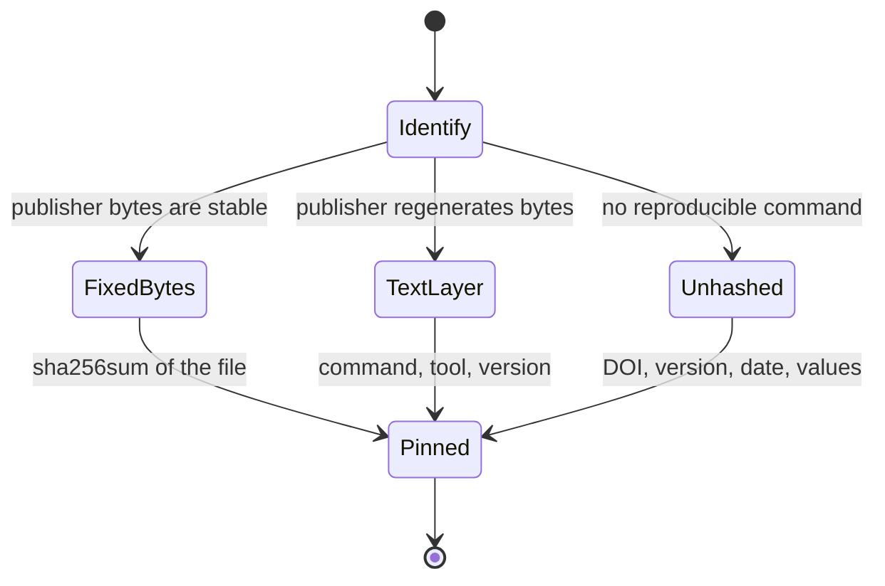
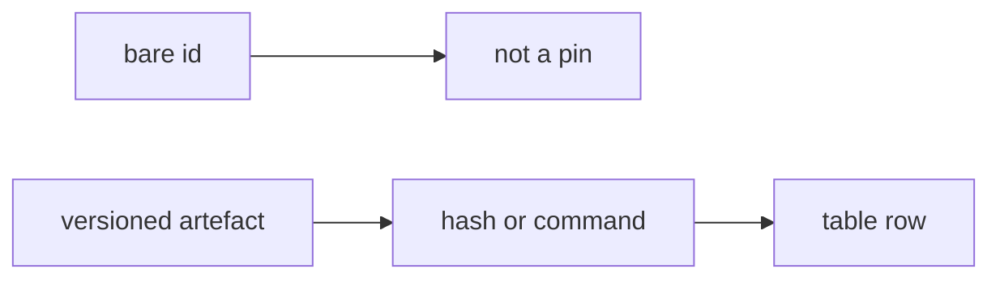

⚠️ ACADEMIC RESEARCH PURPOSES ONLY; NOT FOR MEDICAL USE WITHOUT LICENSED OVERSIGHT

# `pin-references` — pinned reference table

This file pins external artefacts used as method or representation evidence. A pin is a versioned id, a retrieval date, and either a byte hash or a reproducible text-layer command. A bare arXiv or DOI id is not a pin.

## Document graph

- → [skills/design-binder.md](../skills/design-binder.md)

## Specification card

| Role | Does | Must |
|---|---|---|
| Reference | Pin method claims and read status | Resolved is not read |
| Reads: versioned external artifacts | Writes: none | Check: hash replay; marked second reads |

## composition

```yaml
rows: 11
pin: "versioned id + retrieval date + byte hash or reproducible text-layer command"
read_status: ["resolved, not read", "second-read"]
graph: "Document graph above"
```

## indications

Use a row when a method, cost, or failure-mode claim needs a reproducible artefact. Row 9 is the only row that measures experimental binder-design success.

## contraindications

- Rows other than 9 were measured on reasoning, coding, chat, or maths benchmarks.
- Those rows say nothing about molecular or binder design quality.
- No clinical benchmark for de novo binder design is recorded in this file.

## algorithm

### variables

```yaml
independent:
  artefact: "versioned id"
  retrieved: "date"
dependent:
  hash: "byte sha256, text-layer sha256, or none"
  claim: "sentence read off that artefact"
controlled:
  command: "exact extraction command and tool version, when bytes are regenerated"
  url: "URL downloaded"
objective: "a later reader recomputes the recorded hash"
```

### processes

Control refuses a bare id. Design records version, date, and either bytes or a command. Transport stores the hash beside the command that produced it. Stopping: where no reproducible command exists, record no hash. Search re-derives venue from `journal_ref`, the PDF running head, proceedings, or OpenReview. Filter: resolved is not read, except row 9's second read. Recovery is a deliberate re-pin, written down.





### Pinning rule

Repo: `wetware-hq/catalog` · Compiled 30 Oct 2026 (Australia/Sydney) · Every PDF below was downloaded on the box on that date.

**Pinning rule.** A bare arXiv or DOI id is *not* a pin. A pin is: versioned id + retrieval date + either (a) a SHA-256 of the delivered bytes, where the publisher serves a fixed file per version (arXiv does), or (b) where the bytes are regenerated per request (bioRxiv does), a SHA-256 of the normalised **text layer**, recorded together with the **exact runnable extraction command and tool version**, because the flags change the hash. Where neither a stable byte hash nor a reproducible command can be given, record **no hash at all** and pin DOI + version + date + the extracted values. Re-pinning is a deliberate, recorded act.

**Scope warning, which applies to every row except #9.** All of the LLM/orchestration references below were measured on reasoning, coding, chat or maths benchmarks (MMLU, GSM8K, MATH, HumanEval, MBPP, DROP, MGSM, SWE-bench Lite, AlpacaEval 2.0, Arena-Hard, MT-Bench, FLASK, HotpotQA, and constructed reasoning tasks). **They say nothing whatever about molecular or binder design quality.** They bound orchestration cost and failure modes and nothing else. Nothing in them says a cheaper rung designs a worse molecule, or a heavier one a better molecule. **No clinical benchmark exists for de novo binder design.**

**READ STATUS column.** "resolved, not read" means the id, version, venue and hash were machine-verified but no human has read the paper for this repo. "second-read" means a second reader independently read the claim off the pinned text.

---

### Hash note — why the extraction command, not just the tool, is part of the pin

bioRxiv regenerates the PDF per request: it embeds a dynamic `/ModDate`, so the delivered bytes differ between downloads of the identical document. Verified on 30 Oct 2026 by downloading row 9's v2 PDF twice. Both files were **28,299,252 bytes**, and the byte hashes differed:

- download A: `a6e8033f2121f4b0cbbb41e0693082a8a00e110610faa201313da227efcadfab`
- download B: `1521968b901bf7d8eb52ebfea8a943b0dd64ec0be256cf9556b6214496ce9a24`

The normalised text layer is stable across both downloads, but **only for a fixed command**. Verified, same document, pdftotext 25.03.0:

| extraction command | sha256 (both downloads) | status |
|---|---|---|
| `pdftotext -layout "$PDF" - \| sha256sum` | `f08e6762775084dcd1ef867a3911c70ccce15cd1db5ada5109592a2b545ea4e8` | **CANONICAL** — reproduced by three readers |
| `pdftotext "$PDF" - \| tr -s '[:space:]' ' ' \| sha256sum` | `fac2bece4168ef74be6fa8c4fc2cb52dd2c90b65a5f888e175f25c1163f77551` | reproduced cross-check, two readers |
| `pdftotext "$PDF" - \| tr -s ' \t\r\n' ' ' \| sed 's/^ *//;s/ *$//' \| sha256sum` | `0812eb9db6bd7f554a0830a6ebdd5cb77657a1fbf254bc5ee0dd0c7c89b43be2` | reproduced, two readers; not the pin |
| `pdftotext -layout "$PDF" - \| tr -s '[:space:]' ' ' \| sha256sum` | `bb0116ff35f60762cee13b82b6c1417a241a0f8f05953fcde68fb224caa93684` | one reader only; withdrawn |

Four hashes for one document, every one of them correct for its own command. The canonical one was chosen because it has no normalisation stage at all, so there is no unwritten step for a later reader to get wrong; the third command above differs from the second only by a hand-listed whitespace set that omits the form feed `pdftotext` emits between pages, which two commands reading identically by eye do not reveal. A hash is admissible only once a second reader has reproduced it from the written-out command, not merely because the command was written down.

**The rule, therefore:**

1. Where the publisher serves fixed bytes per version (arXiv does — its per-version ModDates are fixed), hash the delivered bytes: `sha256sum "$PDF"`.
2. Where the publisher regenerates the file (bioRxiv does), hash the normalised text layer and record **the command verbatim, the extraction tool and its version, and the source URL**. A different extractor, or the same extractor with a different flag, yields a different hash of the same document.
3. Where no reproducible command can be given, record **no hash at all** and pin DOI + version + date + the extracted values. An invented or unreproducible hash is worse than none, because it looks checkable.

Every arXiv byte hash in the citation table was re-downloaded and recomputed independently on 30 Oct 2026 and reproduced the value previously recorded.

---


## citations

The table is the citation record.

### Documentation graph basis

[CommonMark 0.31.2](https://spec.commonmark.org/0.31.2/) supplies headings, lists, and links; [GFM 0.29](https://github.github.com/gfm/#tables-extension-) supplies cards; [AgentKit v2](https://arxiv.org/pdf/2404.11483v2), byte sha256 `029ebd4f7d8cec7b611a97b640ae33f2eafd6b9294f712bf6e2dc10cd3b2f351`, supplies natural-language dependency DAGs; [AGENTS.md](https://agents.md/) supplies path-local disclosure; [Mermaid](https://mermaid.ai/open-source/syntax/flowchart.html) supplies the derived view. Retrieved 1 Nov 2026 (Australia/Sydney). These are representation sources, not clinical evidence.

Statecharts in this tree are Mermaid `stateDiagram-v2` (https://mermaid.ai/open-source/syntax/stateDiagram.html). Variable blocks are fenced YAML mappings. Both were retrieved 1 Nov 2026 (Australia/Sydney). No byte hash was taken for those syntax pages.

### Table

| # | Title (exact, as the pinned artefact gives it) | Authors | Pinned ID (version) | Dates (v1 / pinned version) | Retrieved | URL downloaded | Hash + extraction command | Refereed status (source of check) | READ STATUS | What it actually measured | Binder-design relevance |
|---|---|---|---|---|---|---|---|---|---|---|---|
| 1 | Why Do Multi-Agent LLM Systems Fail? | Mert Cemri, Melissa Z. Pan, Shuyi Yang, Lakshya A. Agrawal, Bhavya Chopra, Rishabh Tiwari, Kurt Keutzer, Aditya Parameswaran, Dan Klein, Kannan Ramchandran, Matei Zaharia, Joseph E. Gonzalez, Ion Stoica | arXiv:2503.13657v3 | v1 17 Mar 2025 / v3 26 Oct 2025 | 30 Oct 2026 | https://arxiv.org/pdf/2503.13657v3 | byte sha256 `1b9e317a2a421e60ca2b2eda4a30844557a01e63286a790890c0ecef32d25460` (`sha256sum "$PDF"`) | **REFEREED** — NeurIPS 2025, Datasets & Benchmarks Track. arXiv journal-ref: NONE; arXiv comment: "ArXiv v3". Confirmed from the NeurIPS 2025 D&B proceedings page (`proceedings.neurips.cc/.../b1041e52d3be19f0a9bc491657488e4a-Abstract-Datasets_and_Benchmarks_Track.html`) and the OpenReview record `fAjbYBmonr` (venueid `NeurIPS.cc/2025/Datasets_and_Benchmarks_Track`). *Presentation format is inconsistent across sources: OpenReview says "spotlight", the neurips.cc virtual page says "Poster". Acceptance is certain; the format is not.* | resolved, not read | MAST-Data: 1600+ annotated execution traces across 7 MAS frameworks (coding, maths, general-agent tasks); MAST taxonomy of 14 failure modes in 3 categories, built from 150 traces, inter-annotator κ = 0.88. Abstract: "Despite enthusiasm for Multi-Agent LLM Systems (MAS), their performance gains on popular benchmarks are often minimal." | ⚠️ Reasoning/coding/agent benchmarks only — says nothing about binder quality |
| 2 | Are More LM Calls All You Need? Towards the Scaling Properties of Compound AI Systems *(title on the pinned PDF)* | Lingjiao Chen, Jared Quincy Davis, Boris Hanin, Peter Bailis, Ion Stoica, Matei Zaharia, James Zou | arXiv:2403.02419v2 | v1 4 Mar 2024 / v2 4 Jun 2024 | 30 Oct 2026 | https://arxiv.org/pdf/2403.02419v2 | byte sha256 `73d7d364c09484816ca4e94e4f067c54aeba5f445583fdd26e96ec0d2fe586d5` | **REFEREED** — NeurIPS 2024 (poster). arXiv journal-ref: NONE, comment: NONE. Confirmed from OpenReview record `m5106RRLgx` (venueid `NeurIPS.cc/2024/Conference`) and dblp-sourced record `O72lIh0mPf` (NeurIPS 2024). **Title drift — a second worked example of why an id is not a pin:** the arXiv *metadata* title is "Are More **LLM** Calls All You Need? Towards **Scaling Laws of Compound Inference Systems**"; the v2 PDF's own title page reads "Are More **LM** Calls All You Need? Towards **the Scaling Properties of Compound AI Systems**", which is also the published NeurIPS title. Same work, three strings. | resolved, not read | Vote and Filter-Vote majority-voting compound systems on language-reasoning tasks. Finding (abstract): performance of both "can first increase but then decrease as a function of the number of LM calls", attributed to the mix of easy and hard queries within a task; derives an analytical scaling model to pick the optimal number of calls. | ⚠️ Language/reasoning benchmarks only — nothing about binder quality |
| 3 | Inverse Scaling in Test-Time Compute | Aryo Pradipta Gema, Alexander Hägele, Runjin Chen, Andy Arditi, Jacob Goldman-Wetzler, Kit Fraser-Taliente, Henry Sleight, Linda Petrini, Julian Michael, Beatrice Alex, Pasquale Minervini, Yanda Chen, Joe Benton, Ethan Perez | arXiv:2507.14417v2 | v1 19 Jul 2025 / v2 15 Dec 2025 | 30 Oct 2026 | https://arxiv.org/pdf/2507.14417v2 | byte sha256 `d647c9d44958f89e62d4ff2eb5d4681e3d37b32285df427b902eb8363f14b2c6` | **REFEREED** — arXiv journal-ref, verbatim: "Transactions on Machine Learning Research (TMLR); 12/2025; https://openreview.net/forum?id=NXgyHW1c7M". arXiv comment, verbatim: "Published in TMLR (12/2025; Featured Certification; J2C Certification), 78 pages". The pinned PDF's running head reads "Published in Transactions on Machine Learning Research (12/2025)" and its title page cites "Reviewed on OpenReview: https://openreview.net/forum?id=NXgyHW1c7M". | resolved, not read | Constructed tasks in 4 categories (counting with distractors, regression with spurious features, deduction with constraint tracking, advanced AI risks) where **extending** reasoning length **lowers** accuracy; identifies 5 failure modes, including Claude Sonnet 4 showing increased expressions of self-preservation under extended reasoning. | ⚠️ Constructed reasoning tasks only — nothing about binder quality |
| 4 | Scaling LLM Test-Time Compute Optimally can be More Effective than Scaling Model Parameters *(arXiv title)* / Scaling LLM Test-Time Compute Optimally Can be More Effective than Scaling Parameters for Reasoning *(ICLR title)* | Charlie Snell, Jaehoon Lee, Kelvin Xu, Aviral Kumar | arXiv:2408.03314v1 (only arXiv version) | v1 6 Aug 2024 (no later arXiv version) | 30 Oct 2026 | https://arxiv.org/pdf/2408.03314v1 | byte sha256 `ded7b20b51493258c5ce2a1a024cd33dd752de1fa3373d1207620da4cfe24545` | **REFEREED** — ICLR 2025 **Oral**, under the renamed title. arXiv journal-ref: NONE, comment: NONE. Confirmed from the ICLR 2025 proceedings page (`proceedings.iclr.cc/paper_files/paper/2025/hash/1b623663fd9b874366f3ce019fdfdd44-Abstract-Conference.html`), the iclr.cc virtual oral page `/virtual/2025/oral/31924`, and OpenReview `4FWAwZtd2n` ("ICLR 2025 Oral"). | resolved, not read | Compute-optimal allocation of test-time compute on maths reasoning: PRM-based search vs adaptive response revision. Abstract: compute-optimal scaling improves efficiency "by more than 4×" over a best-of-N baseline, and in a FLOPs-matched evaluation can outperform a "14× larger model" where the small base model already has non-trivial success rates. | ⚠️ Maths reasoning only — nothing about binder quality |
| 5 | Automated Design of Agentic Systems (ADAS) | Shengran Hu, Cong Lu, Jeff Clune | arXiv:2408.08435v2 | v1 15 Aug 2024 / v2 2 Mar 2025 | 30 Oct 2026 | https://arxiv.org/pdf/2408.08435v2 | byte sha256 `32eb1c1a6888e35fae0f618e33c58698b54d9c49bc063fef91ee591719fca376` | **REFEREED** — ICLR 2025 (Poster). arXiv journal-ref: NONE; comment is only the project website. The pinned PDF's own running head reads "Published as a conference paper at ICLR 2025"; OpenReview `t9U3LW7JVX` (venueid `ICLR.cc/2025/Conference`, "ICLR 2025 Poster"). | resolved, not read | "Meta Agent Search": a meta-agent programs new code-defined agents against a growing archive, across coding, science and maths domains. Abstract claims agents that "greatly outperform state-of-the-art hand-designed agents" and transfer across domains and models. *(Per-benchmark deltas are in the body, not the abstract; not extracted here.)* | ⚠️ Coding/science/maths benchmarks only — nothing about binder quality |
| 6 | AFlow: Automating Agentic Workflow Generation | Jiayi Zhang, Jinyu Xiang, Zhaoyang Yu, Fengwei Teng, Xiong-Hui Chen, Jiaqi Chen, Mingchen Zhuge, Xin Cheng, Sirui Hong, Jinlin Wang, Bingnan Zheng, Bang Liu, Yuyu Luo, Chenglin Wu | arXiv:2410.10762v4 | v1 14 Oct 2024 / v4 15 Apr 2025 | 30 Oct 2026 | https://arxiv.org/pdf/2410.10762v4 | byte sha256 `9be15f695f11dd5bc634c1c026bd2270eff3d3c4a53c4d9b51c012b7bd03d521` | **REFEREED** — ICLR 2025 **Oral**. arXiv journal-ref: NONE, comment: NONE. The pinned PDF's running head reads "Published as a conference paper at ICLR 2025"; OpenReview `z5uVAKwmjf` (venueid `ICLR.cc/2025/Conference`, "ICLR 2025 Oral"). | resolved, not read | MCTS search over code-represented workflows across six benchmark datasets. Abstract: "a 5.7% average improvement over state-of-the-art baselines", and smaller models outperforming GPT-4o on specific tasks "at 4.55% of its inference cost in dollars". | ⚠️ Reasoning/coding/QA benchmarks only — nothing about binder quality |
| 7 | More Agents Is All You Need | Junyou Li, Qin Zhang, Yangbin Yu, Qiang Fu, Deheng Ye | arXiv:2402.05120v2 | v1 3 Feb 2024 / v2 11 Oct 2024 | 30 Oct 2026 | https://arxiv.org/pdf/2402.05120v2 | byte sha256 `d948be6a6068835cffe9b6f8b799861e188eea3a0204a90eec70e5faae0cfe57` | **REFEREED** — TMLR. arXiv comment, verbatim: "Published at Transactions on Machine Learning Research (TMLR)"; journal-ref: NONE. The pinned PDF's running head is more precise than the comment: "Published in Transactions on Machine Learning Research (**10/2024**)", and its title page cites "Reviewed on OpenReview: https://openreview.net/forum?id=bgzUSZ8aeg" (OpenReview venue: "Accepted by TMLR"). | resolved, not read | Sampling-and-voting ("Agent Forest"): LLM performance scales with the number of instantiated agents across LLM benchmarks; the method is orthogonal to other enhancement methods and the gain correlates with task difficulty. | ⚠️ Reasoning/coding benchmarks only — nothing about binder quality |
| 8 | Mixture-of-Agents Enhances Large Language Model Capabilities | Junlin Wang, Jue Wang, Ben Athiwaratkun, Ce Zhang, James Zou | arXiv:2406.04692v1 (only arXiv version) | v1 7 Jun 2024 (no later arXiv version) | 30 Oct 2026 | https://arxiv.org/pdf/2406.04692v1 | byte sha256 `b7bc82e95971e60f1ad54c8accd2d2fa101e8b43adb887511bf52c7e98e83a7d` | **REFEREED** — ICLR 2025 **Spotlight**. arXiv journal-ref: NONE, comment: NONE, and the arXiv PDF carries no venue header. Confirmed from the ICLR 2025 proceedings page (`proceedings.iclr.cc/paper_files/paper/2025/hash/5434be94e82c54327bb9dcaf7fca52b6-Abstract-Conference.html`) and OpenReview `h0ZfDIrj7T` ("ICLR 2025 Spotlight"). *Note the arXiv v1 abstract lists AlpacaEval 2.0, MT-Bench and FLASK; the ICLR version's abstract adds Arena-Hard — the pinned arXiv bytes and the published version are not word-identical.* | resolved, not read | Layered Mixture-of-Agents on instruction-following/chat benchmarks. Abstract: open-source-only MoA scores "65.1% on AlpacaEval 2.0 compared to 57.5% by GPT-4 Omni". | ⚠️ Chat/instruction-following benchmarks only — nothing about binder quality |
| 9 | Predicting Experimental Success in De Novo Binder Design: A Meta-Analysis of 3,766 Experimentally Characterised Binders | Max D. Overath†, Andreas S. H. Rygaard†, Christian P. Jacobsen, Valentas Brasas, Oliver Morell, Pietro Sormanni, Timothy P. Jenkins († equal contribution; DTU and Univ. of Cambridge) | bioRxiv doi:10.1101/2025.08.14.670059 **v2** | v1 posted 14 Aug 2025 / **v2 posted 17 Sep 2025** (PDF's own banner: "this version posted September 17, 2025"; title page dated 12 September 2025) | 30 Oct 2026 | https://www.biorxiv.org/content/biorxiv/early/2025/09/17/2025.08.14.670059.full.pdf | **NO BYTE HASH — byte hash does not reproduce.** Canonical text-layer sha256 `f08e6762775084dcd1ef867a3911c70ccce15cd1db5ada5109592a2b545ea4e8`, produced by exactly: `pdftotext -layout "$PDF" - \| sha256sum`, pdftotext **version 25.03.0** (poppler), which is a condition of the hash and not a footnote. Reproduced independently by three readers. See the hash note above — the flags matter. | **UNREFEREED PREPRINT** — bioRxiv; the PDF banner on every page reads "(which was not certified by peer review)", CC-BY-NC-ND 4.0. No journal publication found as of 30 Oct 2026; **status unestablished** beyond that. | **second-read** — the average-precision claims in the next column were independently read off this v2 text by a second reader (catalog-physician) as well as by the compiling agent | **The only binder-design paper here.** Meta-analysis of 3,766 experimentally tested binders across 15 structurally diverse targets; every binder–target complex re-predicted with AF2 (initial guess and ColabFold), AF3 and Boltz-1, extracting 200+ structural, energetic and confidence features. See the extracted findings below. | ✅ The only row that measures anything about real binder design success |
| 10 | FrugalGPT: How to Use Large Language Models While Reducing Cost and Improving Performance | Lingjiao Chen, Matei Zaharia, James Zou | arXiv:2305.05176v1 (only arXiv version) **and** the later TMLR version (OpenReview `cSimKw5p6R`, "Accepted by TMLR", Featured Certification) | arXiv v1 9 May 2023; TMLR version undated in the metadata retrieved | 30 Oct 2026 | arXiv: https://arxiv.org/pdf/2305.05176v1 · TMLR: https://openreview.net/pdf?id=cSimKw5p6R (**could not be downloaded**, see below) | arXiv v1 byte sha256 `035ae8b90333dad8b7817fc8f55e7c4cbca435368c5c1a4dbf7bba9e5db87473`. **No hash for the TMLR version** — the file could not be retrieved, so nothing is pinned for it beyond the OpenReview id. | arXiv v1: **UNREFEREED PREPRINT**. TMLR version: **REFEREED** per the OpenReview record `cSimKw5p6R` (venueid `TMLR`, venue "Accepted by TMLR", certifications: Featured Certification). An earlier ICLR 2024 submission of the same paper (`XUZ2S0JVJP`) is recorded as rejected. No TMLR issue/date confirmed — **date unestablished**. | resolved, not read | Worked example row; see "Worked example: a bare arXiv id is not a pin" below. LLM cascades for cost reduction on news classification, reading comprehension and scientific QA. | ⚠️ Cost/accuracy on text tasks only — nothing about binder quality |
| 11 | Large Language Monkeys: Scaling Inference Compute with Repeated Sampling | Bradley Brown, Jordan Juravsky, Ryan Ehrlich, Ronald Clark, Quoc V. Le, Christopher Ré, Azalia Mirhoseini | arXiv:2407.21787v3 | v1 31 Jul 2024 / v3 30 Dec 2024 | 30 Oct 2026 | https://arxiv.org/pdf/2407.21787v3 | byte sha256 `33889c6cb265ae11ed67e50070d3a31cd894036d8c9b404212a38df1783e8884` | **UNREFEREED PREPRINT — status unestablished.** arXiv journal-ref: NONE, comment: NONE. An ICLR 2025 submission exists (OpenReview `0xUEBQV54B`) and is recorded as **rejected**; the authors' own lab page lists the work as "Preprint, 2024". No peer-reviewed venue found as of 30 Oct 2026. | resolved, not read | Repeated sampling: coverage (fraction of problems solved by any sample) scales log-linearly with sample count over four orders of magnitude. Abstract: on SWE-bench Lite, DeepSeek-Coder-V2-Instruct goes from 15.9% with one sample to 56% with 250 samples, against a single-sample state of the art of 43%. Without automatic verifiers, majority voting and reward models plateau. | ⚠️ Coding/formal-proof/maths benchmarks only — nothing about binder quality |


### Venue audit (point 5) — result

Every row's refereed status was re-derived on 30 Oct 2026 from the arXiv API `journal_ref` and `comment` fields, from the venue header on the pinned PDF itself where one exists, and from a web check (conference proceedings pages and OpenReview records). Findings:

- **Only one row carries an arXiv `journal_ref` at all: row 3, Inverse Scaling in Test-Time Compute.** Every other venue above rests on the PDF's own running head and/or a proceedings or OpenReview record, which is recorded per row.
- **Rows 3 and 4 are different papers and are now separate rows.** "Inverse Scaling in Test-Time Compute" (Gema et al., arXiv:2507.14417, TMLR 12/2025) finds that *extending* reasoning length *degrades* accuracy. "Scaling LLM Test-Time Compute Optimally…" (Snell et al., arXiv:2408.03314, ICLR 2025 Oral) finds that *optimally allocated* test-time compute beats a 14× larger model. The findings point in opposite directions, the titles are a page apart in any search, and the venues (TMLR 12/2025 vs ICLR 2025 Oral) are easily swapped. They were confused in an earlier draft of this table; they are not confused here.
- **Statuses corrected in this revision:** row 3 is refereed (TMLR 12/2025, Featured + J2C Certification), not an unrefereed preprint. Row 11 (Large Language Monkeys) is **not** refereed — its ICLR 2025 submission is recorded as rejected, so "status unestablished" beyond preprint. Row 9 is an unrefereed bioRxiv preprint.
- **Where a format or date could not be confirmed it is written as unestablished rather than guessed:** row 1's presentation format (spotlight vs poster, sources disagree), row 10's TMLR issue date, row 11's venue.
- No row in this file asserts a venue, date, author, number or hash that was not read off a source retrieved on 30 Oct 2026.

---

### Status

This table was compiled and verified by **automated retrieval**. Each row's resolution, version and hash is machine-checkable: the ids resolve, the versions are explicit, the arXiv byte hashes reproduce on re-download, and the one text-layer hash reproduces across two independent downloads under the exact command recorded beside it.

But **no human has read these papers for this repo**, with the single exception noted in the READ STATUS column: row 9's average-precision claims were read off the pinned v2 text by a second reader. Everything else is "resolved, not read".

Nothing in this file has had the oracle/admission step that `graph.json` entries require. **The existence of this file does not imply that step has happened.** A citation that resolves is not a citation that says what the citing text claims it says — this repo has already produced one worked example of exactly that failure, an attributed AUROC figure that was repeated three times and became load-bearing under a falsifier before anyone opened the paper, and which the source does not report.

## falsification

A cited number is refuted when the pinned text layer does not contain it. The naive benchmark is repetition: an AUROC figure was load-bearing here before the paper was opened, and the v2 text does not report it.

### Row 9 in detail — what the de novo binder meta-analysis actually reports

**The previously circulated claim — an approximate AUROC figure for ipTM on the Adaptyv EGFR set — is not supported by this paper, and that number is deliberately not reproduced anywhere in this file.** The circulated value does not occur anywhere in the v2 text layer, and the paper explicitly argues *against* AUROC for this data.

What it says instead, from the pinned v2 text:

- **Results, section "Features that predict binding":** the authors quantify each feature's ability to separate binders from non-binders "using average precision (AP), which avoids the need to set arbitrary thresholds and is preferable to the area under the receiver operating characteristic curve (AUROC) given the strong class imbalance favouring non-binders". AUROC is mentioned once in the whole paper, in that sentence, as the metric being rejected.
- **Abstract:** interface-focused metrics, "most notably the AF3-derived interaction prediction Score from Aligned Errors (ipSAE) outperform commonly used scores such as ipAE and ipTM, with a significant 1.4-fold increase in average precision compared to ipAE."
- **Discussion:** "We found that AF3 ipSAE_min was the best-performing predictor across all targets… AF3 ipSAE_min provides a 1.4-fold increase in average precision (AP) compared to the AF2 initial guess pAE interaction (ipAE) score, which is commonly used to filter in silico designs of the state-of-the-art de novo design tool RFdiffusion."
- **Discussion, on ipTM:** "The ipTM score, another commonly used scoring metric (e.g., in BindCraft) had lower AP across targets compared to AF3 ipSAE_min, however it still performed well, especially at low recall thresholds."
- **Discussion, on variability:** "For AF3 ipSAE_min the precision ranged from 0.1 to 1.0 across targets at the maximum F1 threshold."
- The paper notes a self-inflicted bias worth carrying: "some data in this study had already been pre-selected using AF2 initial guess ipAE, potentially deflating the apparent predictive power of this metric."

**The false-exclusion rate is unknown.** This paper does not report it and nothing here establishes it. AP, and especially performance "at low recall", is a statement about the thin top of a ranking; it is silent about how many real binders sit below whatever cut a screen actually applies. A screen built on these scores can be justified as an exclusion filter, but how often it throws away a real binder has not been measured here or anywhere cited in this file.

**On "the Adaptyv EGFR set":** the paper does draw on Adaptyv Bio data (an "Adaptyv Bio R1" dataset appears among its sources, it cites the crowdsourced Adaptyv EGFR binder competition preprint, and it notes that "Antibody binders from the Adaptyv bio dataset were excluded for this analysis" in one specific analysis). But no AUROC, and no per-set AUROC for ipTM, is reported for it.

---

### Row 9 in detail — figure reads (Panels E and F, 30 Oct 2026)

**Added 30 Oct 2026 after a second read (catalog-physician), verified against the v2 text by catalog-cite:**
- Best individual feature AF3_ipSAE_min "had a maximum F1 score at 0.61" (Results, thresholding). Per-target thresholds maximising F1 for ipSAE_min "fell within the range of 0.5 to 0.8".
- The paper reports a **median expected success rate across targets** under practical thresholding strategies — the closest thing in this literature to what fraction of an ordered set will bind, and more useful for planning a bench campaign than any single discriminator value.
- **Internal inconsistency in the source, recorded rather than resolved:** the Results text names three thresholding strategies as "a recall of 0.2, a recall of 0.4, and the value that maximized the F1 score", while the Figure 3 legend describes the same panel as "recall 0.2, 0.6 and maximum F1". 0.4 and 0.6 cannot both be right. The prose says 0.4 twice — the strategy list, and then "AF3 ipTM was also outperformed at recall 0.4 and max F1, but ranked second-best at recall 0.2" describing the same panel — against one mention of 0.6 in the Figure 3E legend, which makes the legend the likely error. **RESOLVED 30 Oct 2026 by reading the panel.** Figure 3E was rendered from page 8 of the v2 PDF and its x-axis groups are labelled "Recall = 0.2", "Recall = 0.4", "Max F1" — first by catalog-occam at 600 dpi, independently reproduced by catalog-cite at 300 dpi. The prose is correct and the Figure 3 legend's "0.6" is an error in the source. The three thresholds are recall 0.2, recall 0.4 and maximum F1. Panel E median expected success rates (read off the bars, inter-quartile range across 15 targets is wide): at recall 0.2, LIS × input_interface_sc 54%, ipSAE_min × interface_ΔG/ΔSASA 61%, ipSAE_min 29%, ipTM 60%, AF2 pAE_interaction 12%. **Note for anyone citing the legend rather than the panel: the legend is wrong.**

**Panel E read at 600 dpi (catalog-cite, 30 Oct 2026), confirming catalog-occam's and catalog-systems' reads.** The panel's own legend prints each feature's median AP, and the bars are drawn in that legend order. At recall 0.2: AF3 LIS × input_interface_sc (AP 0.58) **54%**, AF3 ipSAE_min × interface_ΔG/ΔSASA (AP 0.56) **61%**, AF3 ipSAE_min (AP 0.54) **29%**, AF3 ipTM (AP 0.51) **60%**, AF2 pAE interaction (AP 0.38) **12%**. At recall 0.4: 50, 53, 48, 38, 20%. At max F1: 44, 36, 47, 31, 29%. Bar colours follow the legend order in all three groups, so the values are not transposed (checked after catalog-physician flagged a possible swap).

**The finding that matters, and it is not in the prose:** ranking by average precision does not reproduce the ranking by median experimental success rate. At recall 0.2 the AP order is 0.58 > 0.56 > 0.54 > 0.51 > 0.38 while the success-rate order is 61 > 60 > 54 > 29 > 12, so AF3 ipSAE_min is third on AP and second-worst on success rate, below ipTM which it beats on AP. The two measures answer different questions — AP scores the whole ranking, median success rate scores what you actually get at a chosen stringency — and anyone sizing a campaign needs the second.

**Dispersion kills the medians as a planning number on their own.** The inter-quartile whiskers at recall 0.2 run from roughly 9% to 90% across the 15 targets. A 61% median with that spread is not a 61% expectation for your target.

This is a read of a rendered figure, not of a data table: the percentages are the printed bar labels, which are exact, while the whisker range above is estimated off the axis and should be stated as approximate.

**Panel F, same page, read at 600 dpi — the mechanism, from the source rather than inferred.** Panel F plots precision and recall against threshold for the three best features. For AF3 ipSAE_min, precision is near-flat in roughly the 0.1–0.35 band across the permissive range and rises steeply only past threshold ≈0.6, approaching 1.0 at the far right; recall starts near 0.9 and falls away. The max-F1 marker is printed on the panel at `thr=0.61`, where the curves cross. Precision is therefore **back-loaded toward the stringent end**, which is why a feature can lead on average precision (whole-curve) and trail badly at a single low-recall operating point.

In that stringent region the precision curve is visibly jagged, falling back toward ≈0.3 before rising again — few designs clear the threshold, so each one moves the fraction. That is the mechanism behind a 29% median at recall 0.2 with a very wide inter-quartile range, and it is the reason to report the curve rather than any single operating point. Panel F also prints `thr=-1.5` for ipSAE_min × interface_ΔG/ΔSASA (lower is better for that feature) and `thr=0.42` for LIS × input_interface_sc.

**What the error bars are, and are not.** The figure states the bars as inter-quartile range **across the 15 targets**. They measure how much the success rate depends on which target you chose. They are NOT the spread you would see ordering twice against the same target, which is sampling noise on top of this and is not measured anywhere in the paper. Quoting the IQR as an expected range for one campaign conflates the two. A third caution compounds both: the paper notes the assembled binders were not drawn at random (pre-selection bias toward published, characterised designs), so the across-target spread is a lower bound on what an unseen target can do.

Read status for the Panel E/F block: figure read independently by catalog-occam (600 dpi), catalog-systems (300 and 600 dpi) and catalog-cite (300 and 600 dpi), agreeing on every printed label. Curve shapes above are described from the rendered plot and carry no printed values, so they are a reading of a graph, not a quoted number.


---

### Worked example: a bare arXiv id is not a pin (FrugalGPT, row 10)

What was **verified** on 30 Oct 2026: arXiv has only one version of FrugalGPT, v1 (9 May 2023), and a later TMLR version exists (OpenReview `cSimKw5p6R`, "Accepted by TMLR", Featured Certification, same three authors). The two abstracts describe **different experiments**: the arXiv v1 abstract reviews "popular LLM APIs—e.g. GPT-4, ChatGPT, J1-Jumbo", while the TMLR abstract reviews "popular generative LLM APIs, such as GPT-4, **Gemini 1.5, and Claude 3.5**". So "arXiv:2305.05176" and "FrugalGPT (TMLR)" do not denote the same artefact, and a citation that gives only the arXiv id does not say which set of measurements is meant.

What **could not be verified**: whether the headline *numbers* differ. Both abstracts state the same two figures — matching the best individual LLM "with up to a 98% cost reduction" or improving accuracy over GPT-4 "by 4%" at the same cost. Body-level numbers could not be compared, because the TMLR PDF could not be downloaded: `openreview.net/pdf?id=cSimKw5p6R` returns a Cloudflare Turnstile browser-verification page, and the OpenReview API returns `ChallengeRequiredError` 403 for note and attachment fetches. **The claim "the preprint and the TMLR version report different numbers" is therefore NOT established by this file.** What is established is weaker and still sufficient for the point: the same id covers two artefacts whose evaluated model sets differ.

A second, fully verified instance of the same hazard is row 2, whose arXiv metadata title, PDF title page and published title are three different strings.

---

## licence

MIT
