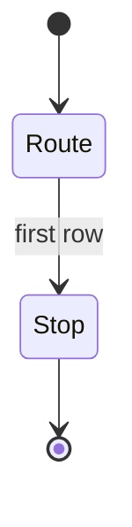
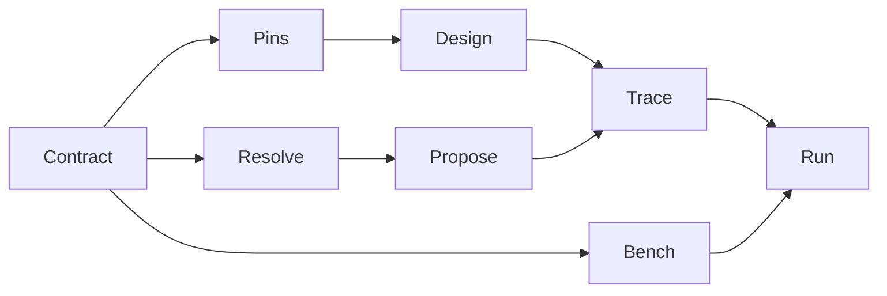

⚠️ ACADEMIC RESEARCH PURPOSES ONLY; NOT FOR MEDICAL USE WITHOUT LICENSED OVERSIGHT

# catalog

`type: initialization` and non-normative: it routes each task to the smallest sufficient spec. `docs/follow-agent-contract.md` governs on conflict. Absence is not a negative.

## Document graph

- → [docs/follow-agent-contract.md](follow-agent-contract.md)

## Specification card

| Role | Does | Must |
|---|---|---|
| Initialization | Route each task to its smallest sufficient spec | Contract wins; absence is not negative |
| Reads: `graph.json`; linked docs on demand | Writes: none | Check: E1, E6, E7 |

## composition

```toml
root = "this file"
sink = "systems/run-campaign.md"
stop = "first sufficient row"
```

## indications

| Task | Minimum read |
|---|---|
| read or rank | [§7](follow-agent-contract.md#7-read-contract) |
| resolve a key | [resolve-key](../skills/resolve-key.md) |
| propose a pair | [resolve-key](../skills/resolve-key.md), [propose-pairs](../skills/propose-pairs.md) |
| design | [§7](follow-agent-contract.md#7-read-contract), [design-binder](../skills/design-binder.md), [run-campaign](../systems/run-campaign.md) |
| verify | [§8](follow-agent-contract.md#8-validation-predicates), `python3 verifier/verify.py` |

## contraindications

- Not a formulary, prescription, rank, or recommendation.
- Do not pool `pair` with `preclinical`. Absence is not a negative.
- An unread `pair` hit stops design before spend.

## algorithm

Independent: task. Dependent: path. Controlled: contract wins.





## citations

[pin-references.md](pin-references.md). Mermaid `stateDiagram-v2`, 1 Nov 2026 (Australia/Sydney), unhashed.

## falsification

Reading every live file for one key refutes this router. Green CI leaves §8.16 undischarged.

## licence

MIT
