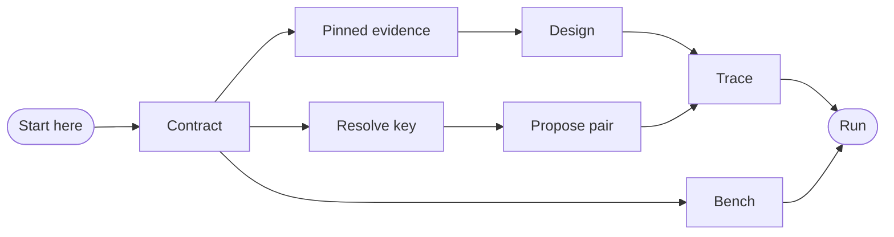

⚠️ ACADEMIC RESEARCH PURPOSES ONLY; NOT FOR MEDICAL USE WITHOUT LICENSED OVERSIGHT

# catalog

`type: initialization` · non-normative. `docs/follow-agent-contract.md` governs on any conflict.

## Document graph

- → [docs/follow-agent-contract.md](follow-agent-contract.md)

## Specification card

| Role | Does | Must |
|---|---|---|
| Initialization | Route each task to its smallest sufficient spec | Contract wins; absence is not negative |
| Reads: `graph.json`; linked docs on demand | Writes: none | Check: E1, E6 |

## Documentation architecture

Lists are canonical; arrows mean “read before”.

## Run router

| Task | Minimum read |
|---|---|
| read or rank catalogue rows | [`follow-agent-contract.md` §7](follow-agent-contract.md#7-read-contract) |
| resolve a key | [`skills/resolve-key.md`](../skills/resolve-key.md) |
| propose an evidenced pair | [`resolve-key`](../skills/resolve-key.md) → [`propose-pairs`](../skills/propose-pairs.md) |
| run de novo design | [`follow-agent-contract.md` §7](follow-agent-contract.md#7-read-contract) → [`design-binder`](../skills/design-binder.md) → [`run-campaign`](../systems/run-campaign.md) |
| verify catalogue or traces | [`follow-agent-contract.md` §8](follow-agent-contract.md#8-validation-predicates) → `python3 verifier/verify.py` |

- **Scope:** `graph.json` is evidence metadata—not a formulary, prescription, ranking, or recommendation.
- **Separation:** `pair` and `preclinical` never pool; absence is not evidence of no binder.
- **Oracle:** automation never discharges §8.16; an unread `pair` hit stops design before paid compute.
