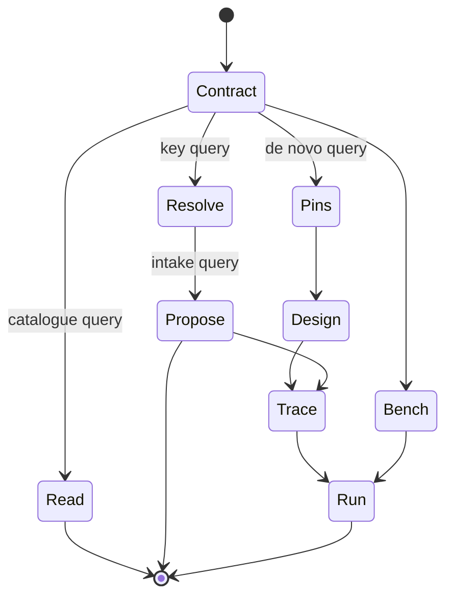

⚠️ ACADEMIC RESEARCH PURPOSES ONLY; NOT FOR MEDICAL USE WITHOUT LICENSED OVERSIGHT

# catalog

`type: initialization` · non-normative. `docs/follow-agent-contract.md` governs on any conflict.

Route a catalogue task through the smallest sufficient path in the documentation DAG. The normative contract always wins.

## Specification

```json
{
  "id": "docs/read-repository.md",
  "type": "initialization",
  "role": "route tasks through the documentation DAG",
  "reads": ["graph.json", "neighbor Markdown on demand"],
  "writes": [],
  "must": ["load the contract before any procedure", "treat absence as unknown"],
  "check": ["E1", "E6", "E7"]
}
```

## Graph

- → [follow-agent-contract.md](follow-agent-contract.md)

## Composition

```toml
root = "this file"
sink = "systems/run-campaign.md"
stop = "first sufficient route"
```

## Indications

| Task | Minimum read |
|---|---|
| read or rank catalogue rows | [`follow-agent-contract.md`](follow-agent-contract.md) |
| resolve a key | contract → [`resolve-key`](../skills/resolve-key.md) |
| propose an evidenced pair | contract → [`resolve-key`](../skills/resolve-key.md) → [`propose-pairs`](../skills/propose-pairs.md) |
| run de novo design | contract; [`pin-references`](pin-references.md) → [`design-binder`](../skills/design-binder.md) → [`record-traces`](../systems/record-traces.md); [`use-bench`](../systems/use-bench.md) → [`run-campaign`](../systems/run-campaign.md) |
| verify catalogue | contract → `python3 verifier/verify.py` |
| verify traces | contract + [`record-traces`](../systems/record-traces.md) → `python3 verifier/verify.py --trace` |

Rows may stop at their endpoint; design lists the sink closure.

## Contraindications

- **Scope:** `graph.json` is evidence metadata—not a formulary, prescription, ranking, or recommendation.
- **Separation:** `pair` and `preclinical` never pool; absence is not evidence of no binder.
- **Oracle:** automation never discharges §8.16; an unread `pair` hit stops design before paid compute.

## Algorithm

### Variables

```toml
objective = "select the smallest sufficient read-before route"

[independent]
task = "read | resolve | propose | design | verify"

[dependent]
route = "ordered Markdown path ending at the first sufficient node"

[controlled]
revision = "one pinned repository commit"
contract = "docs/follow-agent-contract.md governs every route"
```

### Process



- Pin the repository revision.
- Read the contract.
- Follow only the graph branch selected by the task table.
- Stop at a refusal, oracle boundary, or the branch sink.

## Citations

| Pin | Supports |
|---|---|
| [CommonMark 0.31.2](https://spec.commonmark.org/0.31.2/) | Markdown parsing primitives |
| [AgentKit, arXiv:2404.11483v2](https://arxiv.org/abs/2404.11483v2) | dependency-DAG execution |
| [AGENTS.md commit `d001185`](https://github.com/agentsmd/agents.md/tree/d001185d792eb6402a58e4cbef1c228b309ec25d) | path-local progressive disclosure; no required heading schema |

Retrieved 1 Nov 2026 (Australia/Sydney); these sources justify representation, not catalogue evidence.

## Falsification

| Challenge | Failure signal |
|---|---|
| Delete or reverse one graph edge | E6 rejects reachability or reciprocity |
| Route design without reading the contract | the catalogue gate and oracle boundary are absent |
| Read a moving branch twice | returned bytes can differ under one unstated revision |
| Treat a missing row as a negative | the consumer asserts information not present in the file |

## Licence

MIT
