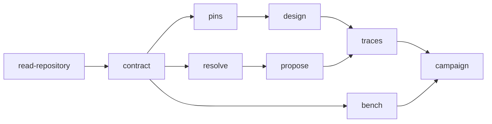

⚠️ ACADEMIC RESEARCH PURPOSES ONLY; NOT FOR MEDICAL USE WITHOUT LICENSED OVERSIGHT

# catalog

`type: initialization` · non-normative. `docs/follow-agent-contract.md` governs on any conflict.

## Document graph

- → [docs/follow-agent-contract.md](follow-agent-contract.md)

## Specification card

| role | does | reads | writes | must | check |
|---|---|---|---|---|---|
| initialization | route each task to its smallest sufficient spec | `graph.json`; linked docs on demand | none | contract wins; absence is not negative | E1, E6 |

## Documentation architecture

Lists are canonical; the diagram is derived. `A --> B` means read A before B.

## Run router

| task | minimum read |
|---|---|
| read or rank catalogue rows | [`follow-agent-contract.md` §7](follow-agent-contract.md#7-read-contract) |
| resolve a key | [`skills/resolve-key.md`](../skills/resolve-key.md) |
| propose an evidenced pair | [`resolve-key`](../skills/resolve-key.md) → [`propose-pairs`](../skills/propose-pairs.md) |
| run de novo design | [`follow-agent-contract.md` §7](follow-agent-contract.md#7-read-contract) → [`design-binder`](../skills/design-binder.md) → [`run-campaign`](../systems/run-campaign.md) |
| verify catalogue or traces | [`follow-agent-contract.md` §8](follow-agent-contract.md#8-validation-predicates) → `python3 verifier/verify.py` |

- `graph.json` is evidence metadata, not a formulary, prescription, ranking, or recommendation.
- `pair` and `preclinical` never pool; absence is not evidence of no binder.
- Automation never discharges §8.16. An unread `pair` hit stops design before paid compute.
