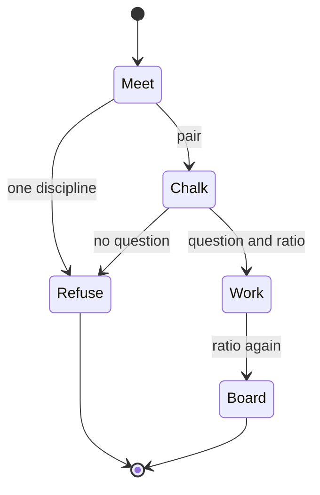
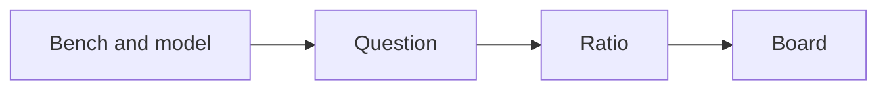

# W004 — Below the Idiot Index

`type: resource.reference` · non-normative. `docs/follow-agent-contract.md` governs on any conflict.

Propose one Christmas 2026 evening at CoLabs Eveleigh that puts a bench person and a model person on the same clinical-cost ratio. Any sequence that leaves still follows the catalogue contract.

## Specification

```json { type: notebook.cell }
{
  "id": "docs/w004.md",
  "type": "resource.reference",
  "role": "propose the Christmas 2026 Wetware evening",
  "reads": ["prior Wetware evenings", "CoLabs Eveleigh page", "wetware-hq org"],
  "writes": [],
  "must": ["pair bench with model", "name a clinical question", "show the cost ratio"],
  "check": ["E1", "E6", "E7"]
}
```

## Graph

- → [../systems/use-bench.md](../systems/use-bench.md)
- ← [follow-agent-contract.md](follow-agent-contract.md)

## Composition

```toml { type: notebook.cell }
subject = "W004 — Below the Idiot Index"
when = "2026-12-12T18:00:00+11:00"
where = "CoLabs Eveleigh"
theme = "unwrapped"
graph = "Graph section"
```

## Indications

- Planning the fourth Wetware evening.
- Choosing a chalk slot that pairs a bench person with a model person.
- Reading the club from the GitHub org and the three earlier evenings.

Wetware is the Sydney club at the intersection of AI and biology. The GitHub org [wetware-hq](https://github.com/wetware-hq) describes itself as towards biological intelligence. The public channel is [@wetwarehq](https://x.com/wetwarehq). Earlier evenings met at 43 Botany St, Randwick: W001 on 1 Aug 2026, W002 as a chalk talk on biological foundation models, and W003 on 10 Oct 2026 on synthetic DNA, screening, and wet-lab loops. The org's public repositories include `catalog`, `bindi`, `bloc`, `seek`, `synth`, `figures`, and `captaincook`.

W004 proposes a move to CoLabs Eveleigh, Ground Floor, 1 Central Ave, Eveleigh NSW 2015, in Tech Central and near Cicada Innovations. The evening is themed and sits before Christmas Day. Saturday 12 December 2026, 18:00–22:00 Australia/Sydney, is the exemplary slot. The theme is unwrapped: the gift is a ratio written on the board, before the work and after it.

The ratio is the idiot index of one clinical question: the cost of the finished hypothesis divided by the cost of its nucleotides, amino acids, and the compute that proposed it. A lower ratio is the result the room keeps. The question is one a clinician would recognise. The evening stops at a research hypothesis. A licensed clinician accepts any later medical use.

Each chalk gift names two people, one from the bench and one from models, plus the question and the two ratios. The open problem left on the board is the beacon for the next room. Filming waits for the person's agreement. Food and drink follow the earlier evenings.

## Contraindications

- These bytes propose the room. They do not reserve CoLabs Eveleigh.
- The Luma host page was offline for this proposal. The three event pages were the record of the earlier evenings.
- A slot with one discipline, a clinical question with no ratio, or a cheaper input with no clinical question leaves the board.
- A post, a product launch, or a photograph of machines is not a gift.
- A sequence, a rank, or a ratio is a research hypothesis. Administration, compounding, and treatment choice stay outside this evening.
- The W002 page names the Chan Zuckerberg Biohub among first believers. This file does not confirm a grant.

## Algorithm

### Variables

```toml { type: notebook.cell }
objective = "one evening and one lower clinical-cost ratio"

[independent]
pair = "one bench person and one model person"
question = "one clinical question a clinician would recognise"

[dependent]
ratio = "finished-hypothesis cost divided by raw-input cost"

[controlled]
slot = "2026-12-12 18:00-22:00 Australia/Sydney"
room = "CoLabs Eveleigh, proposed"
theme = "unwrapped"
```

### Process

```csv { type: notebook.cell }
operator,law
controls,proposed slot and unwrapped theme stay fixed
design,each gift pairs bench with model
transport,the ratio is written on the board
stopping,halt a slot that lacks a question or a ratio
search,chalk time among paired gifts
filters,research hypothesis only
recovery,an unpaired person returns to the meet
```





Symbolic reasoning. `type: sandbox.playground`.

```tla
---- MODULE W004 ----
\* model agent. source of nature.
\* A Lisp variation is a proposal only when this module grounds it.
\* A gift needs both people and a ratio that falls.
CONSTANTS bench, model, ratio_falls
Gift == bench /\ model /\ ratio_falls
====
```

```lisp
;; write agent. executable image. grounded in the tla module only.
(defun gift (bench model ratio-falls)
  (and bench model ratio-falls))
```

```lean
-- model agent. forward pass. discharge and refinement check.
-- autoproof: tla source -> lisp image -> Ti -> bend breakpoint -> tla
-- E7 does not compile this fence.
def lispGift (b m r : Bool) : Bool := b && m && r

theorem Ti :
    (lispGift false false false = false) ∧
    (lispGift true true false = false) ∧
    (lispGift true true true = true) :=
  And.intro rfl (And.intro rfl rfl)
```

```bend
# proof agent. backward pass. search under Ti.
# ti_holds is a number. 0 takes the refuse branch.
# breakpoint: both people present and the ratio falls
# This value is not a .trace file. E7 does not run this fence.
object Trace { name, holds }

def backward(ti_holds):
  if ti_holds:
    return Trace { name: "breakpoint", holds: 1 }
  else:
    return Trace { name: "refuse", holds: 0 }
```

Evening template. Fields are examples.

```json { type: notebook.cell }
{
  "subject": "W004 — Below the Idiot Index",
  "status": "proposed",
  "when": "2026-12-12T18:00:00+11:00",
  "until": "2026-12-12T22:00:00+11:00",
  "where": "Ground Floor, 1 Central Ave, Eveleigh NSW 2015",
  "url": "https://colabs.com.au/eveleigh",
  "theme": "unwrapped",
  "ratio": "finished hypothesis cost / nucleotides, amino acids, and compute",
  "slots": [
    {"at": "18:00", "act": "meet"},
    {"at": "19:00", "act": "three chalk gifts"},
    {"at": "20:00", "act": "paired work"},
    {"at": "22:00", "act": "one open problem on the board"}
  ],
  "gift": {
    "bench": "person",
    "model": "person",
    "question": "clinical question",
    "ratio_before": "number",
    "ratio_after": "number"
  }
}
```

## Citations

| Pin | Claim used | Boundary |
|---|---|---|
| [W001](https://luma.com/irnm61yb) | first Sydney meeting, 43 Botany St, 1 Aug 2026 | page read 9 Nov 2026 (Australia/Sydney) |
| [W002](https://luma.com/y82ugkhi) | foundation-model chalk talk; page names the Chan Zuckerberg Biohub among first believers | the sentence is the page's; no grant was confirmed |
| [W003](https://luma.com/xwsaiv1b) | 10 Oct 2026, synthetic DNA, screening, wet-lab loops | page read 9 Nov 2026 (Australia/Sydney) |
| [wetware-hq](https://github.com/wetware-hq) | "towards biological intelligence"; public repositories named above | org page read the same day; repository READMEs were not the source |
| [@wetwarehq](https://x.com/wetwarehq) | public channel of the club | feed not read |
| [CoLabs Eveleigh](https://colabs.com.au/eveleigh) | Ground Floor, 1 Central Ave, Eveleigh NSW 2015; PC2 labs; Cicada nearby | the page describes the building; this file does not book it |

Retrieved 9 Nov 2026 (Australia/Sydney).

## Falsification

| Observation | What breaks |
|---|---|
| Treat this file as a room booking | CoLabs has no reservation from these bytes |
| Fill a slot with one discipline | the gift condition fails |
| Lower a reagent price and leave the question empty | the independent question is missing |
| Name a clinical question and leave the ratio empty | the dependent ratio is missing |
| Remove the W004 playground | E7 |
| Copy the root notice into this header | E1 |

## Licence

MIT
