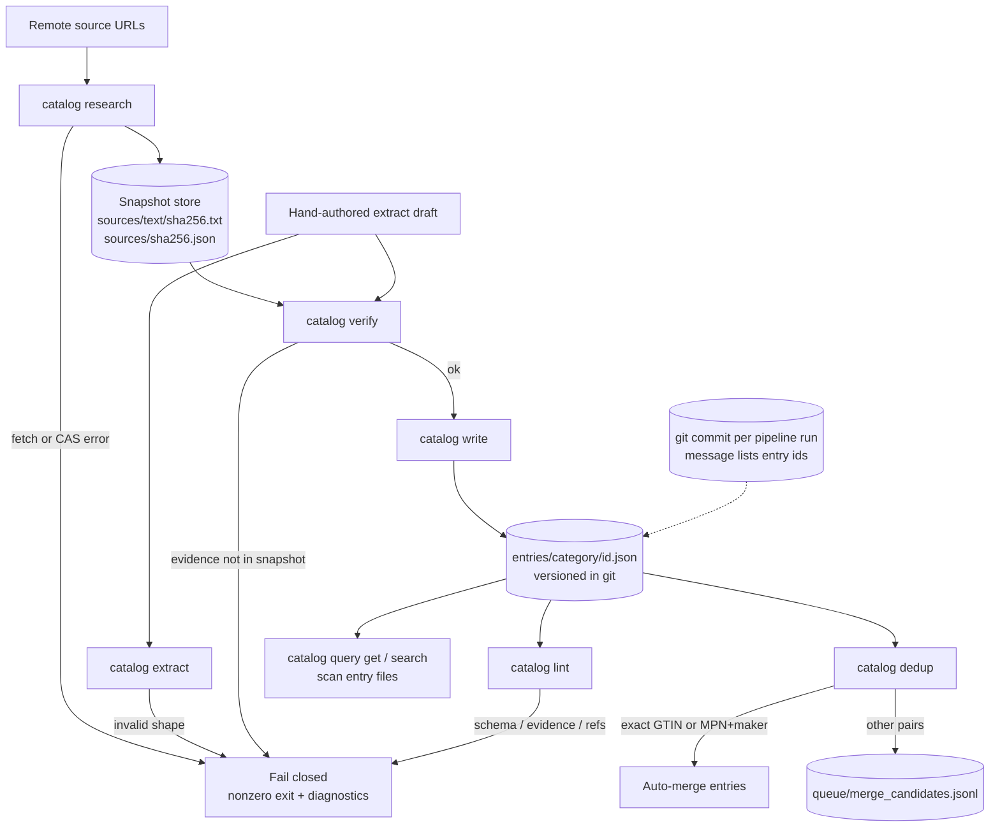

# Architecture (v0.1)

Core guarantee: every value is backed by a verbatim evidence quote that string-matches a content-addressed snapshot [2][18]. Git history is the append-only audit log (one pipeline run → one commit listing touched entry ids). Optional inline `history` on each entry records field-level supersede metadata [11].

## Requirements → verification

| Requirement | Mechanism | Test |
|---|---|---|
| R1 Content-addressed snapshots | SHA-256 names immutable text/metadata under `catalog/sources/` | `test_research_idempotent_cas` |
| R2 No source, no field | Verify rejects evidence ∉ snapshot; write runs only after verify | `test_verify_rejects_bad_evidence` |
| R3 Evidence at rest | Lint substring-checks each spec evidence quote | `test_lint_passes` |
| R4 Git as log | Documented commit convention; per-entry JSON + optional `history` | manual / review |
| R5 Strong-ID dedup | Auto-merge GTIN or MPN+maker only; else `merge_candidates.jsonl` | `test_strong_id_merge_units` |
| R6 References sync | `REFERENCES.md` matches cited `[n]` under `encyclopedia/` | `test_references_in_sync` |
| R7 Query | `get` loads one file; `search` scans all entry JSON | `test_query_get_git`, `test_query_search` |

## Modules

| File | Role |
|---|---|
| `ecatalog/io.py` | CAS I/O, paths, taxonomy, entry iteration |
| `ecatalog/pipeline.py` | research → extract → verify → write → dedup |
| `ecatalog/lint.py` | Schema, evidence, REFERENCES |
| `ecatalog/query.py` | get / search |
| `ecatalog/refs.py` | Bibliography + `REFERENCES.md` |
| `ecatalog/cli.py` | `catalog` CLI |

## Failure modes

Stages exit nonzero with line-level diagnostics; failed verify never writes an entry. Lint failure blocks CI (`scripts/ci.sh`).

## References

[2] WikiChat: Stopping the Hallucination of LLM Chatbots by Few-Shot Grounding on Wikipedia. Semnani et al., 2023. https://arxiv.org/abs/2305.14292  
[11] Zep: A Temporal Knowledge Graph Architecture for Agent Memory. Rasmussen et al., 2025. https://arxiv.org/abs/2501.13956  
[18] The AGNTCY Agent Directory Service. 2025. https://arxiv.org/abs/2509.18787  
