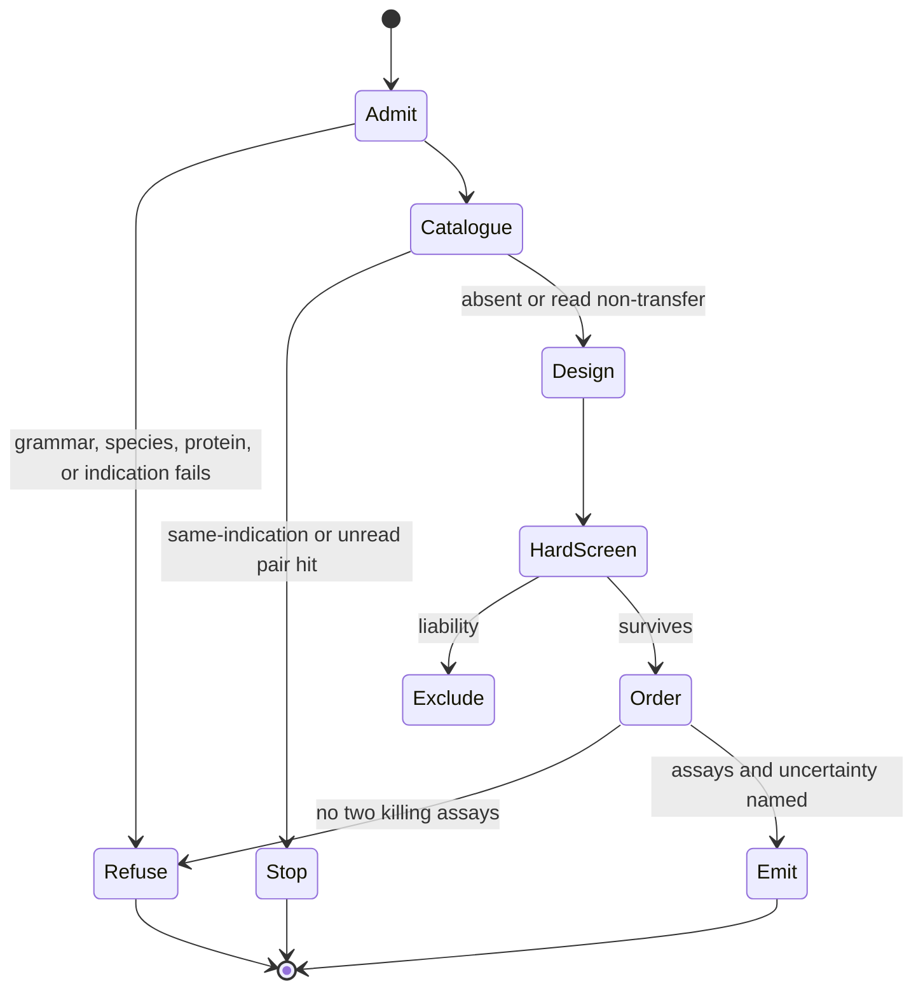

⚠️ ACADEMIC RESEARCH PURPOSES ONLY; NOT FOR MEDICAL USE WITHOUT LICENSED OVERSIGHT

# `design-binder` — de novo binder design

`type: resource.procedure` · `class: special` · `spec: agent.skill` · subordinate to `docs/follow-agent-contract.md`, which governs on any conflict.

Design and screen de novo binder hypotheses only after an indication-aware, commit-pinned catalogue gate. Survivors are experimental worklists, never therapies or catalogue rows.

## Specification

```json
{
  "id": "skills/design-binder.md",
  "type": "resource.procedure",
  "role": "generate assay-gated binder hypotheses",
  "reads": ["human target", "indication", "pinned catalogue", "pinned method benchmarks"],
  "writes": [],
  "must": ["stop on unread or same-indication evidence", "emit only with two killing assays"],
  "check": ["trace result", "independent wet-lab measurement", "E2", "E5", "E6"]
}
```

## Graph

- ← [../docs/pin-references.md](../docs/pin-references.md)
- → [../systems/record-traces.md](../systems/record-traces.md)

## Composition

| Phase | Input | Output |
|---|---|---|
| admit | target and indication | refusal or human-protein brief |
| catalogue gate | reverse index at a commit | stop, transfer rationale, or absence context |
| design | pinned methods and bounded budget | canonical sequence hypotheses |
| screen | hard liabilities then named scorer | excluded set and ordered or unranked survivors |
| emit | survivor plus assay owners | non-persistent experimental worklist |

## Indications

- Native human protein target with an explicit clinical or research indication.
- No unread `pair` hit and no read same-indication binder at the pinned catalogue revision.
- A requester who can name owners for a binding assay and a pre-registered counter-screen.
- A bounded campaign whose cheapest Pareto-minimal method is tried first.

## Contraindications

- This special procedure originates an unreported sequence; it is not a conservative catalogue procedure.
- It writes no file, cannot write `graph.json` or `proposals.json`, and cannot assign a PMID.
- A returned sequence has no demonstrated benefit, safety, or activity and must not be called a therapy.
- An unread `pair` hit, absent indication, non-human target, unsafe healthy-tissue profile, or missing assay owner stops the run.
- Prediction cannot rank clinical utility; where prediction alone separates candidates, report them unranked.

## Algorithm

### Variables

| Class | Variable | Definition |
|---|---|---|
| independent | target, indication, method, scaffold | admitted brief and distinct design routes |
| dependent | survivors and assay worklist | candidates remaining after hard screens and named ordering |
| controlled | catalogue SHA, kill gates, compute bounds | pre-registered evidence gate, safety thresholds, iterations, tokens, and spend |

### Process



### 0. Objective

Given a **native human protein target** and a **clinical or research indication**, design candidate synthetic binders, screen them, and return the survivors **ordered by a named scorer** — or, where only prediction separates them, as **unranked candidates**.

Input: `(uniprot:<accession>, indication)`. Output: the surviving binder keys — `aa:` or `helm:`, canonical per `docs/follow-agent-contract.md` §3 — each labelled **by the criterion that selected it**, with the design rationale that produced it. A specification admitting no candidate returns none and names the constraint that emptied the space (§7).

### 1. Write scope: none

**This procedure writes nothing in this repository.** Not `graph.json`, not `proposals.json`, on any branch.

The reason is structural, not a restriction to be relaxed later. `graph.json` admits a pair only when a paper reports benefit for that pair (`docs/follow-agent-contract.md` §4), and `proposals.json` requires a `pmid` on every element (`docs/follow-agent-contract.md` §9.4). A de novo design has **no paper**, so there is no element of either file it could legally occupy. A designed binder becomes catalogue-eligible only by the ordinary route: someone runs the experiment, someone publishes it, and a reader admits the row. Design is upstream of intake, and `propose-pairs` — not this procedure — is the entry point when that paper exists.

Returning the candidate to the requester is the whole output. A run that wrote a row would be asserting evidence it does not have.

### 2. Specification

The query carries three things. Only the first is a key.

- **Target** — `uniprot:` accession, admitted per §3 below.
- **Indication** — clinical or research. It is **not** stored anywhere and must not be: `docs/follow-agent-contract.md` §2 fixes the root to exactly `version`, `pair` and `preclinical`, and an indication field would have no merge law. It lives in the query.
- **Target expression in healthy tissue** — recorded with the query, because on-target off-tissue toxicity is the usual clinical killer and it is a property of the **target**, not of the binder. No design fixes it. A target expressed widely in healthy tissue constrains or refuses the brief before any sequence exists.

**Both kill conditions are pre-registered here, before the campaign runs.** They are **defaults in this file**, not parameters a run chooses. A run may override one, and then the report states the override and its reason — a run that loosened the selectivity window says so out loud instead of starting from blank. Thresholds supplied per run are the same refitting hole one level up. Kill conditions chosen while holding a candidate get fitted to it — the panel quietly becomes the one it does not cross-react with — and a screen fitted after the fact screens nothing.

- **Paralogue panel.** Every human protein at or above 30% identity to the target over the domain carrying the epitope; at or above 50%, the counter-screen is mandatory rather than optional. Fixed by the threshold, never hand-picked per target.
- **Healthy-tissue bar.** The target is disqualified outright where protein-level expression is medium or high in myocardium, lung alveolar epithelium or haematopoietic progenitors, and in CNS where the construct is designed to cross. Overridable by the indication only, and the override is written down with its reason.

These are conventions from developability and selectivity practice, **not cutoffs validated against patient outcome**. They exclude what is predictably unsafe or undevelopable. None of them predicts clinical benefit.

### 3. Target admission

Refuse before designing, naming the condition that failed:

- Target key fails `docs/follow-agent-contract.md` §3 → refuse (grammar).
- Accession is **not the human protein** → refuse (scope). `docs/follow-agent-contract.md` §8.9 accepts any valid accession, including an orthologue; this procedure does not. A mouse surrogate is a different key and fragments coverage of the human target it stands in for. One accession, one species, and here it is *Homo sapiens*.
- Target is not a protein → refuse (`docs/follow-agent-contract.md` §3, §8.8). Nucleic acids and small molecules are out of scope by design.
- Indication absent → refuse. It is not stored anywhere, and it is not decoration: it sets the required modality, route, residence time and off-target tolerance, which select the scaffold in §5.

### 4. Look it up before designing it

**Design does not fire until the catalogue has been asked and has come back empty for this target in this indication.** A campaign invented to find a molecule for a target that already has one sitting in the file is pure waste.

Build the reverse index for the target per `docs/follow-agent-contract.md` §7 — pin the read to a commit SHA or tag, never a branch name.

- **Any hit, and the gate is indication-aware.** The reverse index answers *some binder helped patients against this target*, not *against this target in this indication*. An evidenced anti-HER2 binder says nothing about anti-HER2 in a different disease or population. The indication is not in the file, so read the pair's PMID and take it from the paper — the same oracle step this skill needs anyway. Hit in this indication: **report the evidenced binder and stop.** That is the answer, and it is a better one than any design.
- **Hit in a different indication:** design may fire, and the report must name the evidenced binder, its indication, and why it does not transfer. That branch is open only after the paper has been read.
- **Hit, paper not read.** Neither branch above has been taken. The run reports every `pair` row for the target, in `docs/follow-agent-contract.md` §7 order, records verdict `hit-unread` with gloss `not-read` (`systems/record-traces.md`), and stops. It does not design. `preclinical` rows are reported separately and are not that verdict.
- **No hit:** design fires, but a target with no evidenced binder is **not** open ground. **Absence is not a negative** (`docs/follow-agent-contract.md` §7): it means no qualifying paper has been entered. At present coverage it says nothing about whether a binder exists.
- `uniprot:` cannot express an epitope. Two binders against distinct sites on one protein collapse to one target key, so the catalogue cannot tell you which site is taken. Resolve the epitope from structure, not from this file.

### 5. Design

The campaign fans its workers out over the design space in parallel, each carrying the same specification — target, epitope, indication-derived constraints — and reporting candidates in a common schema. Breadth is the point: independent scaffolds and independent methods, so the ordering in §6 compares genuinely different hypotheses rather than variations of one.

Scaffold follows the indication, never the other way round. Minibinders and designed miniproteins, nanobodies and single-domain formats, constrained peptides and macrocycles, designed ankyrin and other repeat proteins, and conventional Fv-derived formats are all admissible; a molecule needing non-standard residues, terminal caps or an explicit disulfide pattern must be written `helm:` (`docs/follow-agent-contract.md` §3, §8.8), and one expressible as plain L-chains must be written `aa:` (`docs/follow-agent-contract.md` §8.13c).

Every candidate is carried as its **sequence**. A design has no name to drift, which is why the catalogue's sequence-keying costs this procedure nothing.

#### Method selection — `EVOLVE`

The design methods are not fixed in this file, because they move faster than it does. Before fanning out, the campaign reads the current state of the art and chooses from it, under three constraints.

**Read the benchmark, and pin it.** Check current fleet and design architectures against the primary literature — arXiv and equivalent preprint and journal records — and the standing benchmarks those methods are scored on. A SOTA claim read at runtime is a **dated measurement, not a standing fact**: the same query two days apart returns a different answer. So the benchmark read is pinned exactly as the catalogue read is pinned to a SHA (§4), and the report's `generator` field records which benchmark, which version, which numbers and which date chose the method. A method selected from an unrecorded read is unreproducible, and a run nobody can reproduce is not a result.

**Name the axes before using the word frontier.** A Pareto frontier is meaningless without its axes. Here they are, at most: benchmark performance on the published task, compute and token cost per candidate, and wall-clock latency. **Cheapest-first — surface the Pareto-minimal solution before spending anything beyond it.** If the cheapest method on the frontier already meets the benchmark the brief requires, the run stops there and reports it; the expensive end of the frontier is entered only when the cheap end has been tried and has failed against a stated bar.

**No clinical axis exists.** Benchmarks score structure and affinity prediction. Not one of them scores patient benefit, so no point on this frontier is closer to clinical utility than any other, and the frontier must never be reported as though it were. Where a brief names a clinical benchmark, it is a benchmark of a *prediction*, and the report labels it so.

**Token-efficiency is a stopping rule, not a style.** The §4 lookup gate is the largest saving available and runs first. Within a run: breadth buys independent hypotheses and nothing else, so the campaign fans out once over genuinely distinct scaffolds and methods rather than iterating variations, and a candidate excluded by a stage-one screen (§6) is dropped immediately rather than carried, re-scored or argued with.

**The auto-loop needs a stopping condition or it is a hypothesis pump.** Looping `EVOLVE` is admissible only with all of: a bar stated before the loop starts, in the axes above; a bounded iteration count and token budget; and a requirement that each iteration either crosses the bar or names what it learned that changed the next one. A loop that generates candidates at zero marginal cost and never terminates is the cheapest possible way to look productive, and every candidate it emits still owes §7 two killing assays and somebody who could run them. That obligation, not the loop, is what bounds this procedure.

### 6. Screen, then order

Two stages, and they are different operations. The ordering is **computed per run and never stored** (`docs/follow-agent-contract.md` §7), and it is **not** the catalogue's ordering: `docs/follow-agent-contract.md` §7 ranks evidenced binders by citation count within one dictionary, and a designed candidate and a `pair` row are no more comparable than a `preclinical` row and a `pair` row.

**Stage one — hard screens. They exclude; they never penalise.** A candidate failing one is out, and the report names the screen.

- **Selectivity.** Exclude unless predicted or measured affinity for every panel member is at least two logs weaker than for the target. A 10-fold window is not a window.
- **Immunogenicity.** Count promiscuous predicted MHC-II binders — peptides in the top 2% against a common DRB1 allele panel that hit three or more alleles — over non-germline regions only, and exclude above a locally agreed bar. **That bar is local convention, not a figure derived from a published set of marketed therapeutic antibodies**: no such analysis is cited here because none was performed for this repository, and a number with no source behind it would read as evidence it is not. **This is the weakest screen and is reported as such:** prediction here is poor, and the real readout is an anti-drug antibody assay.
- **Developability.** Exclude on any of: an unpaired cysteine, an N-glycosylation sequon in a CDR, Asn-Gly or Asp-Pro in a CDR, or a hydrophobic patch score above the approved-antibody range.

A weighted sum cannot do this job: a total can be high for the wrong reason, and a liability that kills a molecule does not trade off against affinity.

**Stage two — order the survivors, and name the scorer.** No candidate is ordered above another without the computable quantity that chose it stated outright, with its value and its uncertainty: predicted binding free energy or interface score, structural confidence, agreement between independent predictors. Every signal is labelled **prediction** or **measurement**.

**There is no computable score for clinical utility.** Affinity, developability and epitope content are computable, and not one of them predicts patient benefit. That is the oracle, and no campaign closes it. Where the top two are separated only by prediction, the honest output is **unranked candidates**, not a confident first place; a run returning a #1 with no stated scorer is manufacturing the oracle step.

#### Screen performance, as the source reports it

The source reports median experimental success rates only for the five discriminators and three threshold strategies in the table below. It does **not** validate the stage-one hard screens, this composite procedure, or an arbitrary scorer. A report may carry a table value only when its discriminator and operating point match exactly; otherwise expected success rate is `not established`. Source: Figure 3, panel E of the ipSAE preprint, read at 600 dpi — row 9 of [`docs/pin-references.md`](../docs/pin-references.md). The x-axis groups are **`Recall = 0.2`**, **`Recall = 0.4`** and **`Max F1`**; the figure legend's "0.6" conflicts with the panel and Results prose.

| discriminator | legend AP | Recall = 0.2 | Recall = 0.4 | Max F1 |
|---|---|---|---|---|
| LIS × input_interface_sc | 0.58 | 54% | 50% | 44% |
| ipSAE_min × interface_ΔG/ΔSASA | 0.56 | 61% | 53% | 36% |
| ipSAE_min | 0.54 | 29% | 48% | 47% |
| ipTM | 0.51 | 60% | 38% | 31% |
| AF2 pAE interaction | 0.38 | 12% | 20% | 29% |

Each cell is a **median experimental success rate across 15 targets**, and the error bars are the **inter-quartile range**: at recall 0.2 the widest whiskers run from roughly **9% to 90%**, and ipSAE_min's from roughly **9% to 66%** around its 29% median. Those bounds are estimated from the axis; only bar labels are printed values. This is across-target dispersion, not repeated-order sampling noise and not a prediction interval for a new target. The targets were not sampled randomly; the direction of selection bias and generalization to an unseen target are unknown.

**Do not extrapolate the medians to an order of N.** Panel E does not report finite-order uncertainty, repeated orders against one target, or performance for an unseen target. State the exact discriminator and operating point, carry the published across-target median and IQR when available, and label finite-order and target-specific success as `not established`; never write “order 8, expect about 5 to bind” from a 60% median.

**Average precision and median success rate disagree, and the disagreement is the finding.** ipSAE_min is the best *single* feature on AP — 0.54 against ipTM's 0.51 and the AF2 pAE interaction baseline's 0.38, which is the comparison the 1.4-fold claim is made against, and the gap to ipTM is small — yet it returns **29% at recall 0.2**, below ipTM's 60% at the same stringency, and below every feature in the panel there except the AF2 baseline. The two measures answer different questions: AP scores the **whole ranking**, median success rate scores only **what you actually order at a stated stringency**. A run that quotes AP and then orders at low recall has quoted the wrong number. Report both, name the operating point, and carry the inter-quartile range beside the median.

### 7. Output

Report, and write nothing. A single binder is emitted only when §6 earns it, and then it is labelled **by the criterion that chose it**, never as *best*.

**The disclaimer travels with the sequence.** The report carries the canonical line verbatim on the same block as every binder key it hands back, not once at the top. A warning works only at the point of harm, and the thing that causes harm is the sequence, which exists to leave this repository and land on a bench. Nothing validates a report, so the obligation lives here: a warning that does not survive a copy-paste of the sequence protects nobody.

| field | content |
|---|---|
| binder | one `aa:` or `helm:` key, canonical per `docs/follow-agent-contract.md` §3 |
| target | the `uniprot:` key as admitted in §3 |
| scaffold | the format chosen, and the indication constraint that chose it |
| rationale | epitope, design method, and what separates this candidate from the runner-up — or the statement that nothing computable does |
| evidence | each ranking signal, labelled prediction or measurement |
| screens | each stage-one screen and its result, including for excluded candidates |
| scorer | the quantity that produced the order, with values and uncertainty |
| expected success rate | for an exact discriminator and operating-point match in §6, the published across-target median and IQR, explicitly not an N-order estimate or new-target prediction; otherwise `not established`. Never transfer a cell to a composite screen or different scorer. |
| killing assays | **two**, with thresholds and who could run each. A binding assay kills the affinity claim with a measured Kd. A counter-screen against the pre-registered paralogue panel and the healthy-tissue expression bar kills the safety claim even when the Kd is perfect — a binder that binds beautifully and also binds something in the myocardium is the failure mode that reaches patients. |
| generator | what produced the sequence, standing in for the citation it does not have: the run, the design and scoring models with versions, the inputs, the date, and the catalogue PMIDs that justified choosing this target |
| catalogue context | evidenced binders against this target at the pinned SHA with the indication read from each paper, or `hit-unread` naming every `pair` row when the papers were not read, or the explicit statement that none are entered and that this is not a negative. `preclinical` rows stay a separate list |

Two refusals, two verdicts, as `docs/follow-agent-contract.md` §7 requires them kept apart: a source that does not answer yields `unavailable` — retry, cache nothing; a specification admitting no candidate yields no binder and names the constraint that emptied the space. Neither is catalogue absence, and neither is reported as a resolve failure.

Nobody in this room can run a binding assay. So the output is a **worklist for an experiment**, not a database, and a candidate without both named assays, their thresholds, and somebody who could run them is not emitted at all — a hypothesis accumulated at zero cost is the cheapest way to look productive. That obligation is what makes the output falsifiable, and it is why nothing persists here: a worklist belongs where the experiment is run.

### 8. Acceptance

This procedure asserts nothing about patients and is therefore not acceptance-tested by rediscovery, as `propose-pairs` is. It passes when, for a target whose evidenced binders are already in `graph.json`, a run that is **blind to those rows** returns a candidate engaging the same epitope by an independent route. That is a test of the design process, not of the catalogue, and failing it bars no row — it tells you the ordering in §6 is not yet measuring what it claims to.

## Citations

| Pin | Claim used | Scope limit |
|---|---|---|
| [Overath et al., bioRxiv v2, doi:10.1101/2025.08.14.670059](https://doi.org/10.1101/2025.08.14.670059) | panel E success rates, panel F operating behavior, and ipSAE/ipTM comparisons | unrefereed; 15 non-random targets; no patient outcome |
| [`pin-references.md` row 9](../docs/pin-references.md) | exact text-layer digest, extraction command, figure reads, and contradiction resolution | governs every numeric claim above |
| [AI Agents That Matter, arXiv:2407.01502v1](https://arxiv.org/abs/2407.01502v1) | report cost with accuracy and repeat stochastic evaluation | coding, web, and QA agents only |
| [MAST, arXiv:2503.13657v3](https://arxiv.org/abs/2503.13657v3) | trace review must include design, coordination, and verification failures | taxonomy is observed, not exhaustive |
| [NIST.AI.200-3](https://doi.org/10.6028/NIST.AI.200-3) | combine automated checks, red teaming, and realistic user evaluation | planning framework, not biological validation |

Method selection at runtime must add its own versioned primary sources and benchmark measurements to the emitted `generator` field; this table is not a standing method leaderboard.

## Falsification

| Challenge | Failure signal |
|---|---|
| Seed the pinned catalogue with an unread `pair` hit | any generator or scoring call occurs |
| Reveal a same-indication evidenced binder | design continues instead of stopping |
| Remove indication or use a non-human accession | any candidate is produced |
| Omit either killing assay or its owner | any binder is emitted |
| Copy a sequence without its exact disclaimer | trace hash or output contract fails |
| Change the named scorer and keep the same order | ranking is not caused by its stated variable |
| Treat the across-target IQR as a new-target prediction interval | the source reports no such interval |
| Run one target twice and call the difference target variability | the test measures sampling noise instead |
| Blind the process to a known binder | failure to recover the epitope by an independent route rejects the design ordering, not a catalogue row |

The strongest break remains a wet-lab one: measured affinity above the stated threshold kills the binding claim; counter-screen binding or a disqualifying healthy-tissue profile kills the safety claim even when target affinity is excellent.

## Licence

MIT
