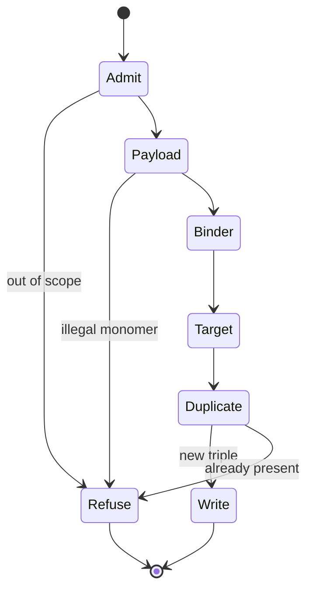
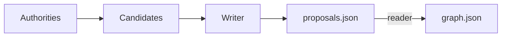

⚠️ ACADEMIC RESEARCH PURPOSES ONLY; NOT FOR MEDICAL USE WITHOUT LICENSED OVERSIGHT

# `propose-pairs` — catalogue intake

`type: resource.procedure` · `spec: agent.skill`. Write `(binder, target, pmid)` candidates to `proposals.json` only. The reader who moves a row into `graph.json` chooses `pair` or `preclinical`.

## Document graph

- → [systems/record-traces.md](../systems/record-traces.md)

## Specification card

| Role | Does | Must |
|---|---|---|
| Catalogue skill | Prepare evidence candidates | Never classify study type |
| Reads: structured authorities; catalogue | Writes: `proposals.json` | Check: recall 1.0; zero false-admits |

## composition

```yaml
steps: ["1 admit", "2 payload", "3 binder", "4 target", "5 duplicate"]
output: proposals.json
graph: "Document graph above"
```

## indications

Biological protein binder, protein target, canonical sequence, UniProt accession, and at least one `pmid:<digits>` that reports utility for that pair.

## contraindications

- Do not crawl prose, use DrugBank, or assign study type.
- Do not write ranks, scores, grades, names, labels, indications, doses, or regulatory status.
- Do not widen §3 to keep an unresolvable candidate.
- Do not write `graph.json` on any branch.

## algorithm

### variables

```yaml
independent:
  record: "structured authority row"
  catalogue: "graph.json pinned to a commit SHA"
dependent:
  proposal: "binder, target, pmid"
  refusal: "step 1-5"
controlled:
  serialiser: "contract §5"
  merge: "contract §6, add-only §8.19"
  drugbank: "refused; licence re-check dated 2026-10-29"
objective: "recall 1.0 on committed rows and a counted false-admit rate"
```

### processes

Control is the admit gate before resolution. Design emits three fields and no dictionary. Transport is one writer applying the §6 merge onto `proposals.json`. Stopping is the first refusal. Search enumerates UniProt, UniParc, ChEMBL, Thera-SAbDab, and PubMed or Europe PMC. Filter separates scope (step 1) from illegal payload (step 2). Recovery: a source error is `unavailable` and is not cached; a clean miss is `unresolved`.





### 0. Objective

Propose `(binder, target)` pairs for `graph.json` by writing them to `proposals.json`. **This procedure never writes `graph.json`**, on any branch (`docs/follow-agent-contract.md` §9). A candidate qualifies when **all** hold:

- binder and target are both **biological** and both **protein** (`docs/follow-agent-contract.md` §3, §8.8);
- the binder resolves to a canonical amino-acid sequence;
- the target resolves to a UniProt accession;
- at least one PubMed identifier reports utility for **that pair**.

The study-type classification — `pair` versus `preclinical` — is **not yours to make**. It requires reading the paper, and the reader who makes it is the one who moves the row into `graph.json`.

### 1. Non-goals

- **Do not crawl prose.** Free-text web search does not resolve binders: it returns the name without the sequence and silently substitutes near-matches (observed once, 2026-10-29: a search on a real human 40-mer returned a non-human Fab). Enumerate records; a page that asserts a pair without a resolvable sequence is not a candidate.
- **Do not use DrugBank.** Its licence was non-commercial when checked on 2026-10-29, which makes it inadmissible for this repository at any scale. That is an external fact with a date on it: re-check the licence before treating the refusal as permanent, and do not relax it without re-checking.
- Do not write ranks, scores, grades, names, labels, indications, doses or regulatory status. They are not in the schema.
- Do not widen the key grammar to admit a molecule you could not resolve. An unresolvable candidate is **dropped**, not approximated.

### 2. Sources

Enumerate structured authorities and follow their cross-references. The reachable universe is bounded and already recorded; the work is resolution, not discovery.

- **UniProt / UniParc** — target accessions; binder sequence identity by CRC64 (ISO polynomial `0xD800000000000000`) against the `checksum:` field.
- **ChEMBL** — binder–target activity records, with PubMed cross-references.
- **Thera-SAbDab** — therapeutic antibody sequences and their targets.
- **PubMed / Europe PMC** — existence and well-formedness of the citation. Reading it is the admitting reader's step, not yours.

A source that answers with an error, a timeout, or a rate limit yields **`unavailable`**: retry it, cache nothing, and never record its silence as a negative. A source that answers and holds no match yields **`unresolved`**: that is a final, cacheable answer about the record.

### 3. Per-candidate record

A candidate is emitted only with all three fields present; a missing field is a drop, never a placeholder.

| field | content |
|---|---|
| `binder` | `aa:` or `helm:` key, canonical per `docs/follow-agent-contract.md` §3, admission-gated per `docs/follow-agent-contract.md` §8.8 |
| `target` | `uniprot:` accession |
| `pmid` | one `pmid:<digits>` |

Store the **canonical** sequence, not the mature chain. Snapshot 2026-10-29 by catalog-systems against the live UniParc service, not reproducible from this checkout: of 33 mature chains, 6 did not resolve at all, and cross-reference collapse put 16 of 27 under 50 residues against canonical ranges — on that evidence a mature-chain key is both less resolvable and silently different from the molecule the record describes.

### 4. Decision procedure

Per candidate, in order. Stop at the first refusal and record which step refused.

1. **Admit gate.** `aa:` / `uniprot:` / HELM in which **every** block is `PEPTIDE` and at least one exists → continue. Anything else → **refuse: out of scope**, unexamined. Do not classify what you can refuse by namespace.
2. **Payload.** Monomers are standard residues or bracketed symbols from the 32-token protein monomer set. A SMILES fragment such as `[CCO]` inside `PEPTIDE1{…}` → **refuse: illegal payload**. This is a different refusal from step 1 and must stay distinguishable; a `d`-prefixed token is a **D-stereoisomer**, never a deoxy sugar.
3. **Resolve binder.** Sequence → CRC64 → UniParc. Batch accessions: in one timing run on 2026-10-29 (catalog-systems, one network path, not reproducible from this checkout) 307 lookups in one call took 35 s against 103 s for 41 single lookups. Batch because the ratio is large, not because of those seconds.
4. **Resolve target.** Accession must exist and be a protein.
5. **Duplicate check.** The triple must not already exist in either dictionary of `graph.json`, nor in `proposals.json`; the molecule must not already exist under a different binder key (`docs/follow-agent-contract.md` §8.13).

### 5. Write protocol

- **`proposals.json` only.** Never write `graph.json`, on any branch. A branch is a mutable name with no merge law for trust: fencing unverified rows behind a branch dissolves at the first merge and relaunders them as read-verified. A file boundary survives every merge, because `proposals.json` merges into `proposals.json`.
- **One serialiser.** Workers emit candidates; a single writer applies them. A file is one path and a path is not a merge law — concurrent writers to the same path lose rows silently.
- Apply candidates with the `docs/follow-agent-contract.md` §6 merge law, which is commutative, associative and idempotent, so a re-run of an overlapping batch is safe.
- Re-serialise per `docs/follow-agent-contract.md` §5 before committing. Never hand-edit the serialised file.
- Add-only (`docs/follow-agent-contract.md` §8.19): no existing proposal is removed or rewritten; removal happens only when a reader admits the row into `graph.json`.
- Verify the committed bytes by reading them back **through the API pinned to the commit SHA**. CDN mirrors serve stale content and will show you your own intent instead of the file.

### 6. Acceptance

A run that cannot reproduce what is already trusted does not get to extend it.

1. **Recall.** Point the criteria at the committed catalogue. A run must rediscover every pair already in it. Report the fraction; below 1.0, fix resolution before adding rows.
2. **False-admit rate.** Of the rows a run would write, the fraction a curator rejects. Report it as a number. Above zero, the oracle step is being manufactured rather than performed, and that is the cost of the gate being skipped.
3. **Refusal ledger.** Count refusals by step (1–5). A step that never fires is untested, not satisfied.

### 7. What a run does not discharge

Condition 16 is an **oracle** predicate: that a paper reports utility for a pair, and in which direction, is not decidable from bytes, from a record, or from a crawl. A passing run proves the pure conditions and nothing more. State what you verified, name what you did not, and leave the claim to the reader who moves the row into `graph.json`. Nothing this procedure writes is ever read as a catalogue.

## citations

Write boundary and key grammar: `docs/follow-agent-contract.md` §3, §5, §6, §8.8, §9. DrugBank's non-commercial licence was checked on 2026-10-29 and is an external fact with a date, not a permanent law.

## falsification

Acceptance fails when recall against the committed catalogue is below 1.0, or when a curator rejects any row the run would write. A step that never fires is untested. The naive benchmark is the number of proposals written.

## licence

MIT
