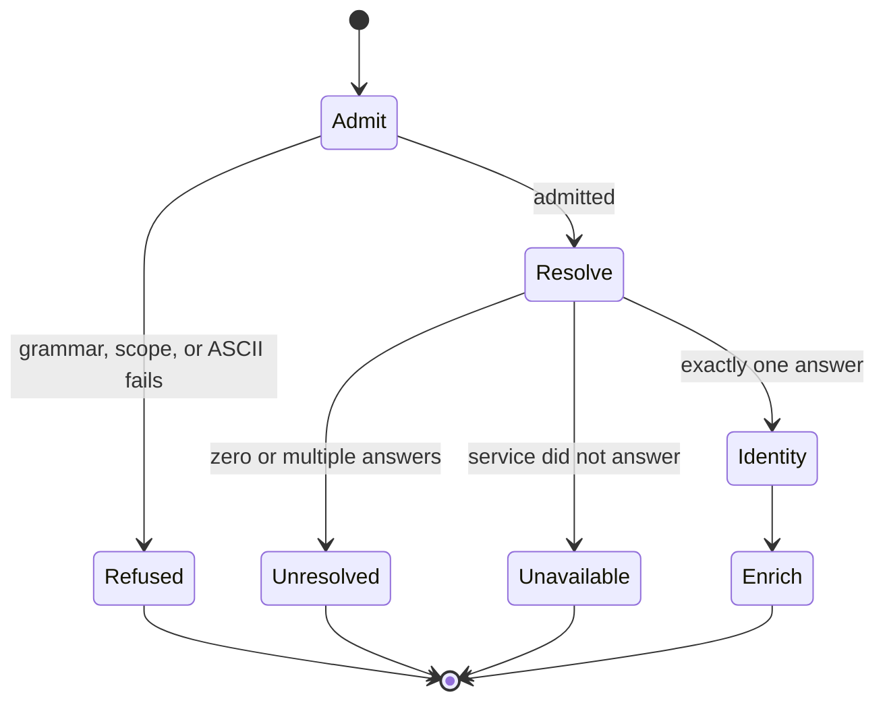
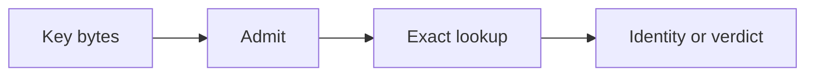

# `resolve-key` — key to labels

`type: resource.procedure` · `spec: agent.skill` · subordinate to `docs/follow-agent-contract.md`, which governs on any conflict.

Resolve one admitted protein key to a release-pinned identity or to one of two non-overlapping failure verdicts. The procedure is read-only and never substitutes free-text search for exact resolution.

## Specification

```json { type: notebook.cell }
{
  "id": "skills/resolve-key.md",
  "type": "resource.procedure",
  "role": "resolve a protein key to a release-pinned identity",
  "reads": ["aa:, helm:, or uniprot: key", "named authority release"],
  "writes": [],
  "must": ["refuse before network access", "separate unresolved from unavailable"],
  "check": ["key predicates", "trace result", "E2", "E5", "E6", "E7"]
}
```

## Graph

- ← [../docs/follow-agent-contract.md](../docs/follow-agent-contract.md)
- → [propose-pairs.md](propose-pairs.md)

## Composition

```toml { type: notebook.cell }
stages = ["admit", "resolve", "enrich"]
graph = "Graph section"
writes = "none"
```

## Indications

- Map canonical protein sequences to UniParc or UniProt identities.
- Resolve a `uniprot:` target before catalogue intake or design.
- Distinguish a completed zero/multiple-match response from an outage.

## Contraindications

- Protein only: nucleic acids, small molecules, and non-`PEPTIDE` HELM blocks are refused before classification.
- Do not recover citations from residues, align near-matches, or use web search as identity evidence.
- Do not cache `unavailable`; do not retry or reinterpret final `unresolved`.
- A resolved key can still be absent from the catalogue; absence is not a resolver verdict.

## Algorithm

### Variables

```toml { type: notebook.cell }
objective = "return one identity or one typed failure"

[independent]
key = "aa: | helm: | uniprot:"
release = "named authority snapshot"

[dependent]
identity = "accession or inn_name, source, release, retrieved"
verdict = "unresolved | unavailable | refused"

[controlled]
polynomial = "CRC64 ISO 0xD800000000000000"
path = "one exact lookup; no alignment"
monomers = "one flat PROTEIN_MONOMERS set"
```

### Process





```csv { type: notebook.cell }
operator,law
controls,one named release and the CRC64 ISO polynomial
design,admit on bytes before any lookup
transport,one exact GET and no alignment
stopping,refuse an ungrammatical key before the network
search,checksum or accession equality only
filters,drop non-protein monomers and non-ASCII keys
recovery,return unavailable on 429 or 5xx and cache nothing
```

Symbolic reasoning. `type: sandbox.playground`.

```tla
---- MODULE ResolveKey ----
CONSTANTS verdict
Admitted == verdict \in {"identity", "unresolved", "unavailable", "refused"}
Disjoint == "unresolved" # "unavailable"
====
```

```lisp
(defun admitted (verdict)
  (cond ((string= verdict "identity") t)
        ((string= verdict "unresolved") t)
        ((string= verdict "unavailable") t)
        ((string= verdict "refused") t)
        (t nil)))
```

```lean
inductive Verdict where
  | identity
  | unresolved
  | unavailable
  | refused

theorem Ti : Not (Verdict.unresolved = Verdict.unavailable) :=
  fun h => nomatch h
```

```bend
object Trace { name, holds }

def backward(ti_holds):
  if ti_holds:
    return Trace { name: "breakpoint", holds: 1 }
  else:
    return Trace { name: "refuse", holds: 0 }
```

### Folder contract

Every skill in this folder is total over its input domain, pure relative to a named authority release, and read-only unless `docs/follow-agent-contract.md` §10 grants a write scope.

```text { type: notebook.cell }
skill    : Input -> Output | Failure
total    : forall x. defined(skill(x))
pure     : (Input, Release) -> deterministic result
no_write : writes = []
```

### Types

```text { type: notebook.cell }
Key      = "aa:" Residues | "helm:" Helm | "uniprot:" Accession
Identity = { accession | inn_name, source, release, retrieved }
Failure  = unresolved | unavailable
```

`unresolved` means the authority record answered and matched zero or more than one entry; it is final and cacheable. `unavailable` means the service did not answer; retry and cache nothing. Merging the two writes outages into the catalogue as findings. No tier is computed or stored: a key is an admissible protein or it is refused.

### Stage 0 — intrinsic

```text { type: notebook.cell }
admit : Key -> { length, composition, shape } | refused
ascii(Key) := forall b in bytes(Key). b <= 0x7F /\ no_bom(Key)
ns, body := split(Key, ":", 1)
  ns == "aa"       /\ body subset_of PROTEIN_MONOMERS           -> admit
  ns == "helm"     /\ all_peptide(body) /\ monomers subset_of PROTEIN_MONOMERS -> admit
  ns == "uniprot"  /\ matches(body, contract.patterns.uniprot)  -> admit
  otherwise                                                     -> refused

vectors:
  helm:PEPTIDE1{A.dR.G}$$$$   -> admit
  helm:RNA1{R(A)P}$$$$        -> refused (scope)
  helm:PEPTIDE1{[CCO]}$$$$    -> refused (monomer)
```

Stage 0 reads bytes only, with no network call and no library dependency. Refusal is not classification: an `RNA` or `DNA` block is refused unexamined so nothing downstream sees a non-protein key. Grammar is checked here rather than at Stage 1 because an ungrammatical accession causes HTTP 400 — neither `unresolved` nor `unavailable` — which keeps Stage 1 two-valued.

`PROTEIN_MONOMERS` loads from `docs/follow-agent-contract.md` §0f (`residues`, `monomer_symbol`, and `monomer_uppercase_run_min_length`) and is not copied here. One block type and one alphabet govern every monomer; `d`-prefixed tokens (`dA`, `dR`) are D-stereoisomers, never deoxy sugars. Non-ASCII bytes (`> 0x7F` or BOM) are refused on existing bytes without re-serialisation, closing homoglyph duplication such as Cyrillic `А` versus Latin `A`.

### Stage 1 — resolve

```text { type: notebook.cell }
resolve : Key -> Identity | unresolved | unavailable
crc64 := crc64_iso(sequence, 0xD800000000000000)
GET https://rest.uniprot.org/uniparc/search?query=checksum:<crc64>
GET https://rest.uniprot.org/uniprotkb/<accession>
  status in {429, 5xx} -> unavailable
  |hits| == 1          -> Identity
  |hits| != 1          -> unresolved
```

Lookup is deterministic and exact, with no alignment and no free-text search. Compute CRC64 with the ISO polynomial `0xD800000000000000` (not the Jones variant); MD5 is published in UniParc records but was not searchable when checked on 29 Oct 2026. Store the canonical sequence rather than a mature chain. Invented `aa:` or `helm:` molecules (therapeutic antibodies or de novo binders) have no specified lookup route and return `unresolved`; candidate authorities (`WHO INN`, `Thera-SAbDab`) were untested as of 29 Oct 2026. Shard work as batches of keys rather than one key per worker.

Dated snapshot (29 Oct 2026, `catalog-systems`, live UniParc service, not reproducible from this checkout): 41/41 canonical keys matched a single UniParc entry (`P04626` canonical 1,255 aa → `39E9DFDA04DCF962` → `UPI000003F55F`; residue 100 `R->A` → `08E37566D061ED3B` → zero hits → `unresolved`). Of 33 mature chains, 27 resolved and 6 did not (`P08069`, `P25092`, `P31358`, `P40238`, `P41180`, `Q02643`), and cross-reference counts collapsed from 54–1,426 on canonical sequences to 1–336 on mature chains (16 of 27 under 50). In one timing run on that path, 307 batched accessions took 35 s against 103 s for 41 single lookups.

### Stage 2 — enrich

```text { type: notebook.cell }
enrich : Identity -> Set<{ claim, source, release, retrieved }> | unavailable
merge(A, B) := A union B
```

Enrichment takes an admitted `Identity`, never a raw `Key`; `unresolved` at Stage 1 halts enrichment fail-closed. Workers run in parallel without shared mutable state and merge findings by set union with per-worker attribution (`source`, `release`, `retrieved`), never by voting. Honour published rate limits and return `unavailable` on throttling. Never put residues into a free-text search engine: on 29 Oct 2026 (`catalog-systems`), searching a 40-mer of human `P04626` returned an unrelated mouse Fab (`PDB 1RIV`).

### Not derivable

A citation is not recoverable from residues. Names are derivable; evidence is not. `pmid:` stays stored in the database.

A test vector proves a step is specified, not that it is right.

## Citations

| Source | Use | Reproducibility limit |
|---|---|---|
| [UniProt REST API](https://www.uniprot.org/help/api_queries) | accession and UniParc query surface | live service; record release and retrieval date |
| [UniParc](https://www.uniprot.org/help/uniparc) | sequence identity archive | availability and indexing can change |
| [`follow-agent-contract.md`](../docs/follow-agent-contract.md) | key grammar and molecule identity | repository revision must be pinned |
| [`record-traces.md`](../systems/record-traces.md) | verdict carrier and source/release fields | shape does not prove the lookup occurred |

Live-service observations in the algorithm were retrieved 29 Oct 2026 (Australia/Sydney) and are explicitly snapshots, not standing benchmarks.

## Falsification

| Challenge | Expected verdict |
|---|---|
| `helm:RNA1{R(A)P}$$$$` | refusal: scope |
| `helm:PEPTIDE1{[CCO]}$$$$` | refusal: illegal monomer |
| malformed or non-ASCII accession | refusal before network access |
| one-residue mutation with zero exact UniParc hits | `unresolved` |
| HTTP 429, timeout, or 5xx | `unavailable`; cache nothing |
| multiple exact records | `unresolved`, never an arbitrary first hit |
| catalogue has no row for a resolved target | catalogue absence, not resolve failure |
| Treat the 29 Oct 2026 timing snapshot as a benchmark | those seconds are one path, not a standing rate |
| Remove the ResolveKey playground or collapse the two failure verdicts inside Ti | E7, and unresolved stays distinct from unavailable |

Break the implementation by collapsing `unresolved` and `unavailable`; the resulting cache writes outages as facts. Break it again by adding approximate alignment; the resolver can then return a different molecule than the key.

## Licence

MIT
