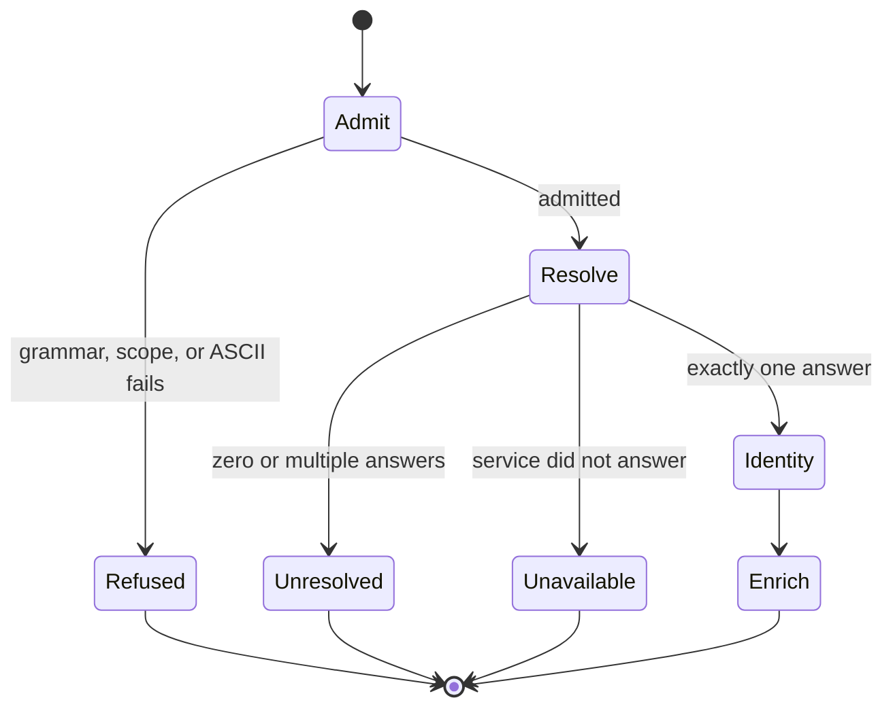

⚠️ ACADEMIC RESEARCH PURPOSES ONLY; NOT FOR MEDICAL USE WITHOUT LICENSED OVERSIGHT

# `resolve-key` — key to labels

`type: resource.procedure` · `spec: agent.skill` · subordinate to `docs/follow-agent-contract.md`, which governs on any conflict.

Resolve one admitted protein key to a release-pinned identity or to one of two non-overlapping failure verdicts. The procedure is read-only and never substitutes free-text search for exact resolution.

## Specification

```json
{
  "id": "skills/resolve-key.md",
  "type": "resource.procedure",
  "role": "resolve a protein key to a release-pinned identity",
  "reads": ["aa:, helm:, or uniprot: key", "named authority release"],
  "writes": [],
  "must": ["refuse before network access", "separate unresolved from unavailable"],
  "check": ["key predicates", "trace result", "E2", "E5", "E6"]
}
```

## Graph

- ← [../docs/follow-agent-contract.md](../docs/follow-agent-contract.md)
- → [propose-pairs.md](propose-pairs.md)

## Composition

| Layer | Input | Output |
|---|---|---|
| intrinsic admission | key bytes | shape or refusal |
| exact resolution | admitted key and release | identity, `unresolved`, or `unavailable` |
| enrichment | resolved identity | attributed findings |
| trace | acts and verdict | content-addressed run evidence |

## Indications

- Map canonical protein sequences to UniParc or UniProt identities.
- Resolve a `uniprot:` target before catalogue intake or design.
- Distinguish a completed zero/multiple-match response from an outage.

## Contraindications

- Protein only: nucleic acids, small molecules, and non-`PEPTIDE` HELM blocks are refused before classification.
- Do not recover citations from residues, align near-matches, or use web search as identity evidence.
- Do not cache `unavailable`; do not retry or reinterpret final `unresolved`.
- A resolved key can still be absent from the catalogue; absence is not a resolver verdict.

## Algorithm

### Variables

| Class | Variable | Definition |
|---|---|---|
| independent | `key`, `release` | exact key bytes and named authority snapshot |
| dependent | `Identity \| unresolved \| unavailable` | one total verdict from the exact path |
| controlled | grammar and endpoint | contract key predicates, CRC64 variant, and one authority route |

### Process



### Folder contract (all skills here)

Notation: one per folder. Blocks below are formal algorithms, not sample programs.

```
skill   : input -> output | failure
total   : every input returns; no undefined case
pure    : output depends on input + named release only
no-write: output goes to the caller, never into the database
```

### Types

```
Key       = "aa:" Residues | "helm:" Helm | "uniprot:" Accession
Identity  = { accession | inn_name , source , release , retrieved }
Failure   = unresolved        -- record answered, says nothing. final. cacheable.
          | unavailable       -- service did not answer. nothing learned. retry. cache nothing.
```

`unresolved` and `unavailable` are never merged. One value for both writes outages into the catalogue as findings.

No tier is computed and none is stored. A key is an admissible protein or it is refused.

### Stage 0 — intrinsic

```
admit : Key -> { length, composition, shape } | refused
total. no network. never fails. intrinsic: reads the bytes, needs no library and no date.

ns, body = split(Key, ':', 1)
    ns == "aa"                      -> assert body subset_of PROTEIN_MONOMERS ; admit
    ns == "helm", all blocks PEPTIDE-> assert monomers(body) subset_of PROTEIN_MONOMERS ; admit
    ns == "uniprot", body matches docs/follow-agent-contract.md §3 accession grammar -> admit
    otherwise                       -> refuse (out of scope or ungrammatical)

refuse is not a classification. an RNA or DNA block is refused unexamined;
nothing downstream ever sees a non-protein key. the refusal is recorded.

grammar is checked HERE, never at resolve. an ungrammatical accession makes the
service answer 400: not unresolved (no record answered) and not unavailable (the
service did answer). admitting it would force a third verdict. refusing it keeps
stage 1 two-valued.

PROTEIN_MONOMERS is one flat set. one block type, one alphabet, no per-block scoping.
    d-prefixed tokens are D-stereoisomers, never deoxy: dA is D-alanine, dR is D-arginine.
    with nucleic acids out of scope there is no second reading of d left to disambiguate.

alphabet : refuse-if-illegal. never classify.
    a letter test decides nothing about what a molecule is; it can only reject a
    payload whose characters fall outside PROTEIN_MONOMERS.

ascii : every byte of every Key <= 0x7F, no BOM.
    assertion over existing bytes, never a re-serialisation.
    a non-ASCII byte in a key is a wrong row, not lint: return it to verification.
    closes homoglyph duplication (Cyrillic A != Latin A, identical on screen, two keys).

vectors:
    admit  : helm:PEPTIDE1{A.dR.G}$$$$          -> admitted
    refuse : helm:RNA1{R(A)P}$$$$               -> refused, out of scope
    refuse : helm:PEPTIDE1{[CCO]}$$$$           -> refused, monomer outside PROTEIN_MONOMERS
```

### Stage 1 — resolve

```
resolve : Key -> Identity | unresolved | unavailable
total. deterministic. no free-text search. single path, never fanned out.

uniprot: / discovered sequence
    crc64 <- CRC64, ISO polynomial 0xD800000000000000   (NOT the Jones variant)
    GET https://rest.uniprot.org/uniparc/search?query=checksum:<crc64>
    GET https://rest.uniprot.org/uniprotkb/<accession>
    exact lookup. no alignment. no search engine.
    snapshot 2026-10-29, catalog-systems, against the live UniParc service. not reproducible
    from this checkout and not re-run since; treat as a record of one run, not a standing fact:
      41/41 canonical keys -> exactly one UniParc entry.
      hit  : P04626 canonical 1255 aa -> 39E9DFDA04DCF962 -> UPI000003F55F
      miss : P04626 canonical, residue 100 R->A -> 08E37566D061ED3B -> zero hits -> unresolved
             (one letter from a real protein: the lookup was exact, not approximate, on that date)
    |hit| > 1 -> unresolved. more than one answer is not an answer.
    5xx / 429 -> unavailable. cache nothing. retry.
    MD5 is published in the record and was NOT searchable when checked on 2026-10-29.
    a service can change this; re-check before relying on it. use CRC64.

    canonical is the stored string. a mature chain is a different string with its own
    UPI. snapshot 2026-10-29, catalog-systems, live service, not reproducible from this
    checkout: 27 of 33 mature chains resolved and 6 did not
    (P08069 P25092 P31358 P40238 P41180 Q02643), and no property of the key tells you
    which. cross-references collapsed under maturation (canonical 54-1426, mature 1-336,
    16 of 27 under 50), so a mature UPI keeps resolution and loses corroboration.
    store canonical; any future sequence commit declares its boundary explicitly.

aa: / helm: invented molecule (therapeutic antibody, de novo binder)
    UNMEASURED. no route specified. return unresolved.
    candidate authorities, untested as of 2026-10-29: WHO INN records, Thera-SAbDab.
    do not substitute an endpoint.

shard unit: a BATCH of keys, never one key per worker.
    timing snapshot 2026-10-29, catalog-systems, one run on one network path, not
    reproducible from this checkout: 41 single lookups = 103 s; 307 accessions batched = 35 s.
    the ratio is the point; the seconds are not a benchmark.
```

### Stage 2 — enrich

```
enrich : Identity -> Findings        -- note the domain: Identity, NOT Key
campaign. open. parallel. no coordinator. no shared mutable state.

stage 1 returning unresolved HALTS enrichment for that key. fail-closed.
no worker may put residues into a search. observed once, 2026-10-29, catalog-systems:
a real 40-mer of P04626 returned an unrelated mouse Fab (PDB 1RIV), engine verdict
"not identified". one dated observation against a live engine, not a reproducible test.

merge law: UNION with per-worker attribution. never a vote, never a collapse to
one value. N workers reading one page are not N confirmations.

every finding carries source + release + retrieved. nothing a page merely said.
rate limit: honour the service's published limit; a throttled campaign returns
unavailable, never unresolved.
```

### Not derivable

A citation is not recoverable from residues. Names are derivable; evidence is not. `pmid:` stays stored in the database.

A test vector proves a step is specified, not that it is right.

## Citations

| Source | Use | Reproducibility limit |
|---|---|---|
| [UniProt REST API](https://www.uniprot.org/help/api_queries) | accession and UniParc query surface | live service; record release and retrieval date |
| [UniParc](https://www.uniprot.org/help/uniparc) | sequence identity archive | availability and indexing can change |
| [`follow-agent-contract.md`](../docs/follow-agent-contract.md) | key grammar and molecule identity | repository revision must be pinned |
| [`record-traces.md`](../systems/record-traces.md) | verdict carrier and source/release fields | shape does not prove the lookup occurred |

Live-service observations in the algorithm were retrieved 29 Oct 2026 (Australia/Sydney) and are explicitly snapshots, not standing benchmarks.

## Falsification

| Challenge | Expected verdict |
|---|---|
| `helm:RNA1{R(A)P}$$$$` | refusal: scope |
| `helm:PEPTIDE1{[CCO]}$$$$` | refusal: illegal monomer |
| malformed or non-ASCII accession | refusal before network access |
| one-residue mutation with zero exact UniParc hits | `unresolved` |
| HTTP 429, timeout, or 5xx | `unavailable`; cache nothing |
| multiple exact records | `unresolved`, never an arbitrary first hit |
| catalogue has no row for a resolved target | catalogue absence, not resolve failure |

Break the implementation by collapsing `unresolved` and `unavailable`; the resulting cache writes outages as facts. Break it again by adding approximate alignment; the resolver can then return a different molecule than the key.

## Licence

MIT
