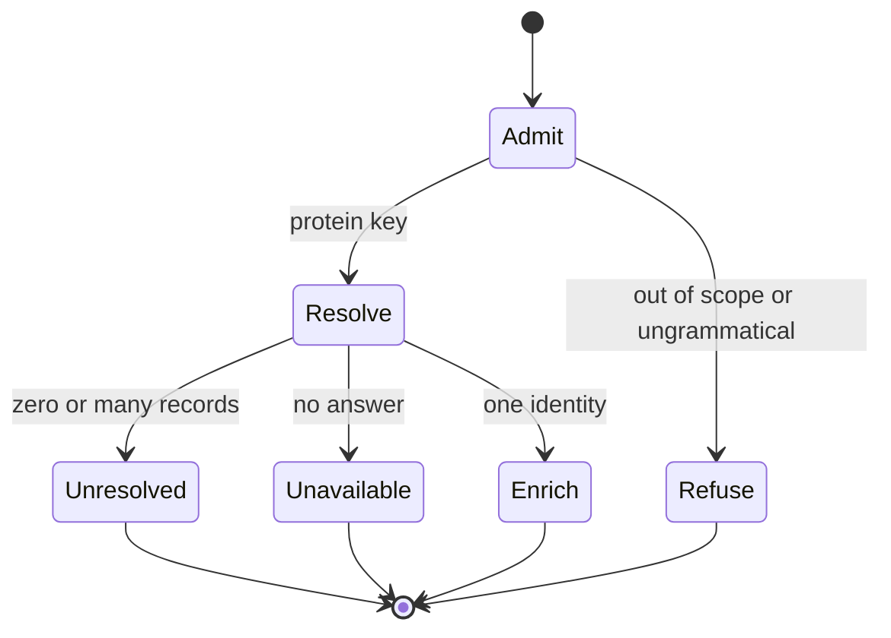
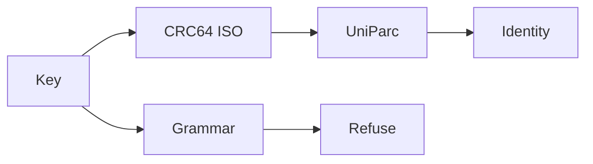

⚠️ ACADEMIC RESEARCH PURPOSES ONLY; NOT FOR MEDICAL USE WITHOUT LICENSED OVERSIGHT

# `resolve-key` — key to labels

`type: resource.procedure` · `spec: agent.skill`. Resolve one protein key to an identity, read-only. `unresolved` is a final record answer; `unavailable` means the service did not answer.

## Document graph

- → [skills/propose-pairs.md](propose-pairs.md)

## Specification card

| Role | Does | Must |
|---|---|---|
| Read-only skill | Map protein key to identity | `unresolved` ≠ `unavailable` |
| Reads: key; named release | Writes: none | Check: key predicates; trace |

## composition

```yaml
stages: ["0 admit", "1 resolve", "2 enrich"]
graph: "Document graph above"
writes: none
```

## indications

Protein keys only: `aa:`, `helm:` whose blocks are all `PEPTIDE`, and `uniprot:` accessions that match the contract grammar.

## contraindications

- Nucleic-acid keys are refused unexamined, not classified.
- Free-text search is out of scope. Residues do not go into a search engine.
- The two failure verdicts are never merged, and this procedure never writes the catalogue.
- A citation is not recoverable from residues.

## algorithm

### variables

```yaml
independent:
  key: "aa: | helm: | uniprot:"
  release: "named service release"
dependent:
  identity: "accession or inn_name, source, release, retrieved"
  verdict: "unresolved | unavailable | refused"
controlled:
  polynomial: "CRC64 ISO 0xD800000000000000"
  path: "one exact lookup; no alignment"
  monomers: "one flat PROTEIN_MONOMERS set"
objective: "one identity, or one typed failure"
```

### processes

Control runs grammar at stage 0, before any request. Design is CRC64 against UniParc `checksum:`, exact lookup. Transport is a batch of keys on one path. Stopping: stage-1 `unresolved` halts enrichment for that key. Search is the checksum query, not an engine. Filter is the monomer set, ASCII bytes, and PEPTIDE blocks. Recovery: HTTP 5xx or 429 is `unavailable`, cache nothing, retry.





### Folder contract (all skills here)

Notation: one per folder. Blocks below are formal algorithms, not sample programs.

```
skill   : input -> output | failure
total   : every input returns; no undefined case
pure    : output depends on input + named release only
no-write: output goes to the caller, never into the database
```

### Types

```
Key       = "aa:" Residues | "helm:" Helm | "uniprot:" Accession
Identity  = { accession | inn_name , source , release , retrieved }
Failure   = unresolved        -- record answered, says nothing. final. cacheable.
          | unavailable       -- service did not answer. nothing learned. retry. cache nothing.
```

`unresolved` and `unavailable` are never merged. One value for both writes outages into the catalogue as findings.

No tier is computed and none is stored. A key is an admissible protein or it is refused.

### Stage 0 - intrinsic

```
admit : Key -> { length, composition, shape } | refused
total. no network. never fails. intrinsic: reads the bytes, needs no library and no date.

ns, body = split(Key, ':', 1)
    ns == "aa"                      -> assert body subset_of PROTEIN_MONOMERS ; admit
    ns == "helm", all blocks PEPTIDE-> assert monomers(body) subset_of PROTEIN_MONOMERS ; admit
    ns == "uniprot", body matches docs/follow-agent-contract.md §3 accession grammar -> admit
    otherwise                       -> refuse (out of scope or ungrammatical)

refuse is not a classification. an RNA or DNA block is refused unexamined;
nothing downstream ever sees a non-protein key. the refusal is recorded.

grammar is checked HERE, never at resolve. an ungrammatical accession makes the
service answer 400: not unresolved (no record answered) and not unavailable (the
service did answer). admitting it would force a third verdict. refusing it keeps
stage 1 two-valued.

PROTEIN_MONOMERS is one flat set. one block type, one alphabet, no per-block scoping.
    d-prefixed tokens are D-stereoisomers, never deoxy: dA is D-alanine, dR is D-arginine.
    with nucleic acids out of scope there is no second reading of d left to disambiguate.

alphabet : refuse-if-illegal. never classify.
    a letter test decides nothing about what a molecule is; it can only reject a
    payload whose characters fall outside PROTEIN_MONOMERS.

ascii : every byte of every Key <= 0x7F, no BOM.
    assertion over existing bytes, never a re-serialisation.
    a non-ASCII byte in a key is a wrong row, not lint: return it to verification.
    closes homoglyph duplication (Cyrillic A != Latin A, identical on screen, two keys).

vectors:
    admit  : helm:PEPTIDE1{A.dR.G}$$$$          -> admitted
    refuse : helm:RNA1{R(A)P}$$$$               -> refused, out of scope
    refuse : helm:PEPTIDE1{[CCO]}$$$$           -> refused, monomer outside PROTEIN_MONOMERS
```

### Stage 1 - resolve

```
resolve : Key -> Identity | unresolved | unavailable
total. deterministic. no free-text search. single path, never fanned out.

uniprot: / discovered sequence
    crc64 <- CRC64, ISO polynomial 0xD800000000000000   (NOT the Jones variant)
    GET https://rest.uniprot.org/uniparc/search?query=checksum:<crc64>
    GET https://rest.uniprot.org/uniprotkb/<accession>
    exact lookup. no alignment. no search engine.
    snapshot 2026-10-29, catalog-systems, against the live UniParc service. not reproducible
    from this checkout and not re-run since; treat as a record of one run, not a standing fact:
      41/41 canonical keys -> exactly one UniParc entry.
      hit  : P04626 canonical 1255 aa -> 39E9DFDA04DCF962 -> UPI000003F55F
      miss : P04626 canonical, residue 100 R->A -> 08E37566D061ED3B -> zero hits -> unresolved
             (one letter from a real protein: the lookup was exact, not approximate, on that date)
    |hit| > 1 -> unresolved. more than one answer is not an answer.
    5xx / 429 -> unavailable. cache nothing. retry.
    MD5 is published in the record and was NOT searchable when checked on 2026-10-29.
    a service can change this; re-check before relying on it. use CRC64.

    canonical is the stored string. a mature chain is a different string with its own
    UPI. snapshot 2026-10-29, catalog-systems, live service, not reproducible from this
    checkout: 27 of 33 mature chains resolved and 6 did not
    (P08069 P25092 P31358 P40238 P41180 Q02643), and no property of the key tells you
    which. cross-references collapsed under maturation (canonical 54-1426, mature 1-336,
    16 of 27 under 50), so a mature UPI keeps resolution and loses corroboration.
    store canonical; any future sequence commit declares its boundary explicitly.

aa: / helm: invented molecule (therapeutic antibody, de novo binder)
    UNMEASURED. no route specified. return unresolved.
    candidate authorities, untested as of 2026-10-29: WHO INN records, Thera-SAbDab.
    do not substitute an endpoint.

shard unit: a BATCH of keys, never one key per worker.
    timing snapshot 2026-10-29, catalog-systems, one run on one network path, not
    reproducible from this checkout: 41 single lookups = 103 s; 307 accessions batched = 35 s.
    the ratio is the point; the seconds are not a benchmark.
```

### Stage 2 - enrich

```
enrich : Identity -> Findings        -- note the domain: Identity, NOT Key
campaign. open. parallel. no coordinator. no shared mutable state.

stage 1 returning unresolved HALTS enrichment for that key. fail-closed.
no worker may put residues into a search. observed once, 2026-10-29, catalog-systems:
a real 40-mer of P04626 returned an unrelated mouse Fab (PDB 1RIV), engine verdict
"not identified". one dated observation against a live engine, not a reproducible test.

merge law: UNION with per-worker attribution. never a vote, never a collapse to
one value. N workers reading one page are not N confirmations.

every finding carries source + release + retrieved. nothing a page merely said.
rate limit: honour the service's published limit; a throttled campaign returns
unavailable, never unresolved.
```

### Not derivable

A citation is not recoverable from residues. Names are derivable; evidence is not. `pmid:` stays stored in the database.

A test vector proves a step is specified, not that it is right.

## citations

Grammar and verdict law: `docs/follow-agent-contract.md` §3 and §7. The 2026-10-29 UniParc counts in stage 1 are one live snapshot, not a pin, and are not reproducible from this checkout.

## falsification

Exact lookup is refuted if a one-letter mutant of a canonical sequence returns a hit. The recorded miss (P04626 residue 100 R to A, zero hits on 2026-10-29) is the supporting observation, not a permanent measurement. The naive benchmark is a fuzzy-match score.

## licence

MIT
