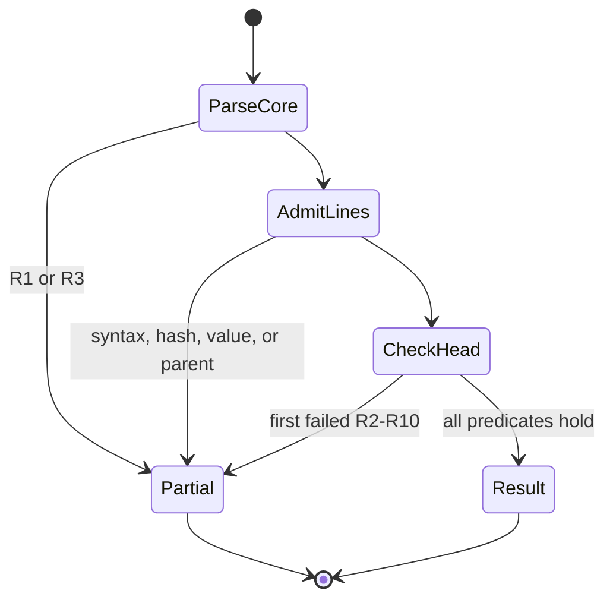
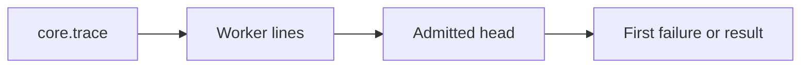

# `TRACES` — act log

`type: agent.system` · `spec: fleet.campaign` · subordinate to `docs/follow-agent-contract.md`, which governs on any conflict.

Define the content-addressed act log for one bounded `fleet.campaign` run and the byte-level decision procedure for accepting it. The same store ramifies a fleet or swarm DAG into one Merkle tree. A valid trace proves shape and causal linkage, not that an act occurred or a paper supports a claim.

## Specification

```json
{
  "id": "systems/record-traces.md",
  "type": "agent.system",
  "role": "content-address campaign acts and ramify structure DAGs",
  "reads": ["core.trace", "worker trace heads", "carrier block in this file", "fleet and swarm structure images"],
  "writes": [".trace files outside the repository"],
  "must": ["derive ids from bytes", "end on one halt", "keep oracle not-discharged", "ramify each structure DAG into one Merkle tree"],
  "check": ["runtime falsifier trace judgement", "R1-R10", "fleet merkle root", "E4", "E5", "E6", "E7"]
}
```

## Graph

- ← [../skills/design-binder.md](../skills/design-binder.md)
- ← [../skills/propose-pairs.md](../skills/propose-pairs.md)
- → [seal-og.md](seal-og.md)

## Composition

```toml
files = ["core.trace", "<worker>.trace", "merkle.trace"]
answer = ["result", "partial"]
structure = ["merkle", "merkle-mismatch", "merkle-absent"]
graph = "Graph section"
```

## Indications

- Audit calls, pins, control passes, refusals, proposals, context verdicts, emissions, and halt for one run.
- Merge independently written worker traces without a coordinator.
- Recompute run and act identities from exact bytes.
- Recompute the Merkle root of a structure image. A campaign store carries the fleet root in `merkle.trace`.
- Expand `carrier sets` when judging a trace. Leave that label closed when the task does not name a trace.

## Contraindications

- A trace is not event sourcing: it is discarded, is not authoritative state, and replay is not defined.
- A hash proves byte identity, not occurrence, truth, provenance, clinical evidence, or patient benefit.
- Scores, ranks, grades, tiers, study types, and utilities have no production in this grammar.
- `result` never discharges the paper oracle or verifies that the pinned catalogue was fetched.

## Algorithm

### Variables

```toml
objective = "pure shape judgement with the paper oracle fixed"

[independent]
skill = "resolve-key | propose-pairs | design-binder"
bound_n = "positive integer without a leading zero"
bound_tok = "positive integer without a leading zero"

[dependent]
id = "SHA-256 of the act preimage"
answer = "result | partial"
merkle = "one root of the ramified image"

[controlled]
run = "SHA-256 of core.trace bytes"
oracle = "not-discharged"
disclaimer = "DISCLAIMER line inside the emit preimage"
```

### Process





```csv
operator,law
controls,keep oracle not-discharged and bounds equal to the core
design,admit an act by its hash and ramify each image into one tree
transport,merge worker files by set union on id
stopping,return the first failure from R1 through R10
search,resolve each parent inside the admitted head
filters,reject scores tiers and unknown acts
recovery,partial refuses the line and result does not repair it
```

Symbolic reasoning. `type: sandbox.playground`.

```tla
---- MODULE Traces ----
\* model agent. source of nature.
\* A Lisp variation is a proposal only when this module grounds it.
\* The oracle string stays not-discharged. A tree has one more vertex than it has edges.
\* 7 and 23 are the ramified cardinalities in section 7.
EXTENDS Integers
CONSTANTS oracle, v, e
Safe == oracle = "not-discharged" /\ e + 1 = v
====
```

```lisp
;; write agent. executable image. grounded in the tla module only.
(defun safe (oracle v e)
  (and (string= oracle "not-discharged") (= (+ e 1) v)))
```

```lean
-- model agent. forward pass. discharge and refinement check.
-- autoproof: tla source -> lisp image -> Ti -> bend breakpoint -> tla
-- E7 does not compile this fence.
def lispSafe (oracle : String) (v e : Nat) : Bool :=
  decide (oracle = "not-discharged") && decide (e + 1 = v)

theorem Ti :
    lispSafe "not-discharged" 7 6 = true ∧
    lispSafe "not-discharged" 23 22 = true ∧
    lispSafe "discharged" 7 6 = false ∧
    lispSafe "not-discharged" 7 5 = false := by
  decide
```

```bend
# proof agent. backward pass. search under Ti.
# ti_holds is a number. 0 takes the refuse branch.
# breakpoint: oracle not-discharged, with ramified cardinalities 7 and 23
# This value is not a .trace file. E7 does not run this fence.
object Trace { name, holds }

def backward(ti_holds):
  if ti_holds:
    return Trace { name: "breakpoint", holds: 1 }
  else:
    return Trace { name: "refuse", holds: 0 }
```

### 0. Lines

A file is UTF-8. A file that is not valid UTF-8, or that contains a NUL or a carriage return, is refused. No byte is rewritten as U+FFFD.

`core.trace` is these four lines, each ending in a newline. The bounds are positive integers with no leading zero. The skill is one of `resolve-key`, `propose-pairs`, `design-binder`. The spec is 40 lowercase hex digits.

```text
%trace-core/1
bound-n:"<bound-n>"
bound-tok:"<bound-tok>"
skill:"<skill>"
spec:"<40 lowercase hex digits>"
```

A worker file is one header and then one act per line. The header is `%trace/1 core=<64 lowercase hex digits> spec=<40 lowercase hex digits>`. An act line is:

`<act> <id> <parent> run=<64 lowercase hex digits> skill=<skill> key:"value" …`

| piece | what it is |
|---|---|
| act | `call`, `pin`, `control`, `refuse`, `unresolved`, `unavailable`, `propose`, `context`, `emit`, or `halt` |
| id | 64 lowercase hex digits |
| parent | `^0`, or `^` plus 64 lowercase hex digits |
| key | a lowercase letter, then lowercase letters, digits, or hyphens, in ascending byte order on the line |
| value | double quotes around a non-empty UTF-8 string of at most 4096 bytes, with no quotation mark and no ASCII control (`U+0000`–`U+001F`, `U+007F`) |

`subject` is that value at at most 1024 bytes, or the literal `unencodable`, or the literal `unquotable`. A worker basename is a lowercase letter, then up to 31 lowercase letters, digits, or hyphens, and the file is that name plus `.trace`. A file ends on the newline of its last line and does not end on a blank line.

The preimage of a line is that line with the id and the final newline removed. `H` is SHA-256, 64 lowercase hex digits, of the UTF-8 preimage. `run` is `H` of the core file's exact bytes.

### 1. Allowed values

The carrier block is the closed list, in the collapsible fence `carrier sets`. Expand that label to load it. The runtime falsifier loads it and does not restate it. A token that is not in the block is refused.

### Carrier sets

<details>
<summary>carrier sets</summary>

```json
{
  "skills": [
    "resolve-key",
    "propose-pairs",
    "design-binder"
  ],
  "acts": {
    "resolve-key": [
      "call",
      "refuse",
      "unresolved",
      "unavailable",
      "halt"
    ],
    "propose-pairs": [
      "call",
      "pin",
      "refuse",
      "unresolved",
      "unavailable",
      "propose",
      "halt"
    ],
    "design-binder": [
      "call",
      "pin",
      "context",
      "control",
      "refuse",
      "unresolved",
      "unavailable",
      "emit",
      "halt"
    ]
  },
  "gates": {
    "resolve-key": [
      "grammar",
      "scope",
      "ascii"
    ],
    "propose-pairs": [
      "out-of-scope",
      "illegal-payload",
      "duplicate-triple",
      "duplicate-molecule"
    ],
    "design-binder": [
      "grammar",
      "species",
      "not-protein",
      "indication-absent",
      "positive-control",
      "selectivity",
      "immunogenicity",
      "developability",
      "no-assay"
    ]
  },
  "pre_pin_gates": [
    "grammar",
    "species",
    "not-protein",
    "indication-absent"
  ],
  "steps": {
    "resolve-key": [
      "resolve"
    ],
    "propose-pairs": [
      "3",
      "4"
    ],
    "design-binder": [
      "catalogue",
      "generator",
      "model"
    ]
  },
  "fields": {
    "call": [],
    "pin": [
      "path",
      "rev"
    ],
    "control": [
      "target",
      "verdict"
    ],
    "refuse": [
      "gate",
      "subject"
    ],
    "unresolved": [
      "key",
      "release",
      "retrieved",
      "source",
      "step"
    ],
    "unavailable": [
      "key",
      "release",
      "retrieved",
      "source",
      "step"
    ],
    "propose": [
      "binder",
      "pmid",
      "target"
    ],
    "emit": [
      "binder",
      "disclaimer",
      "kind",
      "target"
    ],
    "halt": [
      "bound-n",
      "bound-tok",
      "oracle"
    ]
  },
  "context": {
    "hit-same-indication": {
      "gloss": "stop",
      "fields": [
        "binder",
        "gloss",
        "pmid",
        "target",
        "verdict"
      ]
    },
    "hit-other-indication": {
      "gloss": "transfers-not",
      "fields": [
        "binder",
        "gloss",
        "pmid",
        "target",
        "verdict"
      ]
    },
    "hit-unread": {
      "gloss": "not-read",
      "fields": [
        "binder",
        "gloss",
        "pmid",
        "target",
        "verdict"
      ]
    },
    "absent": {
      "gloss": "not-a-negative",
      "fields": [
        "gloss",
        "target",
        "verdict"
      ]
    }
  },
  "value_max_bytes": 4096,
  "subject_max_bytes": 1024,
  "forbidden_fields": [
    "auc",
    "auroc",
    "dict",
    "dictionary",
    "grade",
    "kd",
    "pair",
    "pose",
    "preclinical",
    "rank",
    "score",
    "scores",
    "tier",
    "utility"
  ],
  "literals": {
    "path": "graph.json",
    "oracle": "not-discharged",
    "kind": "hypothesis",
    "control_verdict": "pass",
    "subject_sentinels": [
      "unencodable",
      "unquotable"
    ]
  },
  "shape": {
    "control_after": [
      "absent",
      "hit-other-indication"
    ],
    "no_control_on": [
      "hit-same-indication",
      "hit-unread"
    ],
    "failed_control_gate": "positive-control"
  },
  "patterns": {
    "core": "%trace-core/1\\nbound-n:\"([1-9][0-9]*)\"\\nbound-tok:\"([1-9][0-9]*)\"\\nskill:\"(resolve-key|propose-pairs|design-binder)\"\\nspec:\"([0-9a-f]{40})\"\\n\\Z",
    "header": "%trace/1 core=([0-9a-f]{64}) spec=([0-9a-f]{40})\\Z",
    "worker": "^[a-z][a-z0-9-]{0,31}\\.trace\\Z",
    "hex64": "^[0-9a-f]{64}\\Z",
    "token64": "^[A-Za-z0-9._:/-]{1,64}\\Z",
    "day": "^[0-9]{4}-[0-9]{2}-[0-9]{2}\\Z",
    "parent": "^\\^[0-9a-f]{64}\\Z",
    "rev": "[0-9a-f]{40}",
    "bound": "[1-9][0-9]*"
  }
}
```
</details>

The tables below are the same lists. Acts, gates, and steps are sets. Field arrays and context rows are ordered.

| skill | acts |
|---|---|
| `resolve-key` | `call`, `refuse`, `unresolved`, `unavailable`, `halt` |
| `propose-pairs` | `call`, `pin`, `refuse`, `unresolved`, `unavailable`, `propose`, `halt` |
| `design-binder` | `call`, `pin`, `context`, `control`, `refuse`, `unresolved`, `unavailable`, `emit`, `halt` |

| skill | gates |
|---|---|
| `resolve-key` | `grammar`, `scope`, `ascii` |
| `propose-pairs` | `out-of-scope`, `illegal-payload`, `duplicate-triple`, `duplicate-molecule` |
| `design-binder` | `grammar`, `species`, `not-protein`, `indication-absent`, `positive-control`, `selectivity`, `immunogenicity`, `developability`, `no-assay` |

For `design-binder`, the gates `grammar`, `species`, `not-protein`, and `indication-absent` parent the call. The other gates parent the pin.

| skill | step | the `key` field is |
|---|---|---|
| `resolve-key` | `resolve` | a binder or a target |
| `propose-pairs` | `3` | a binder |
| `propose-pairs` | `4` | a target |
| `design-binder` | `catalogue` | a target |
| `design-binder` | `generator` | a target |
| `design-binder` | `model` | a binder |

| act | fields, in this order |
|---|---|
| `call` | none |
| `pin` | `path`, `rev` |
| `control` | `target`, `verdict` |
| `refuse` | `gate`, `subject` |
| `unresolved` | `key`, `release`, `retrieved`, `source`, `step` |
| `unavailable` | `key`, `release`, `retrieved`, `source`, `step` |
| `propose` | `binder`, `pmid`, `target` |
| `emit` | `binder`, `disclaimer`, `kind`, `target` |
| `halt` | `bound-n`, `bound-tok`, `oracle` |

| verdict | gloss | fields, in this order |
|---|---|---|
| `hit-same-indication` | `stop` | `binder`, `gloss`, `pmid`, `target`, `verdict` |
| `hit-other-indication` | `transfers-not` | `binder`, `gloss`, `pmid`, `target`, `verdict` |
| `hit-unread` | `not-read` | `binder`, `gloss`, `pmid`, `target`, `verdict` |
| `absent` | `not-a-negative` | `gloss`, `target`, `verdict` |

These field names have no production: `auc`, `auroc`, `dict`, `dictionary`, `grade`, `kd`, `pair`, `pose`, `preclinical`, `rank`, `score`, `scores`, `tier`, `utility`.

`gloss` belongs only to its context row. A context `verdict` is one of the four rows above. A `control` verdict is only `pass`, and its target is the admitted control target. `path` is `graph.json`. `oracle` is `not-discharged`. `kind` is `hypothesis`. `disclaimer` is the single line of `DISCLAIMER`, byte for byte.

`binder` holds when the value satisfies `docs/follow-agent-contract.md` §8.7 and §8.8. `target` holds when it satisfies §8.9. `pmid` holds when it satisfies §8.10. The checker calls those predicates. It does not restate them. `subject` is not sent through them.

`source` and `release` are 1 to 64 characters from letters, digits, and `._:/-`. `release` may be the literal `unspecified`. `retrieved` is a real Gregorian date `YYYY-MM-DD`, the UTC day, with no zone suffix. `rev` is 40 lowercase hex digits. `bound-n` and `bound-tok` are positive integers and equal the core.

### 2. Parents

The call's id is `H` of the text `call ^0 run=<run> skill=<skill>`, with no trailing newline. A line's parent is the first row below that applies.

| | when | parent |
|---|---|---|
| P1 | the act is `call` | `^0` |
| P2 | the act is `pin` | `^` plus the call's id |
| P3 | the skill is `resolve-key` and the act is not `call` | `^` plus the call's id |
| P4 | the skill is `design-binder`, the act is `refuse`, and the gate is one of `grammar`, `species`, `not-protein`, `indication-absent` | `^` plus the call's id |
| P5 | the skill is `design-binder`, the act is `halt`, and the head has no pin | `^` plus the call's id |
| P6 | the head has exactly one pin | `^` plus that pin's id |

Any other shape has no parent.

`sameMolecule` is `docs/follow-agent-contract.md` §8.13 on the binder strings of `propose` lines: equal `aa:` multisets, equal `helm:` payloads after polymer-index normalisation, or an `aa:` key and a plain-L-chain `helm:` key with that sequence. One string used twice is one key.

### 3. What the checker decides

A line is admitted on its own. R1–R10 are said of the head of admitted lines. The checker returns the first failure in the order below, otherwise `result`.

A line is admitted when every row below holds. The code is the first that fails.

| code | condition |
|---|---|
| `syntax` | the line matches §0, keys sorted, each value inside its byte cap |
| `hash` | the id is `H` of the preimage |
| `run` | the line's `run` equals the core's run |
| `skill` | the line's `skill` equals the core's skill |
| `act` | the act is in that skill's list (§1) |
| `fields` | the keys are the act's list (§1), or the context row when the act is `context` |
| `value` | every value meets §1, and a `halt` uses the core's bounds |
| `parent` | the parent is `^0` or `^` plus 64 hex digits, and it equals P1–P4 where those rows do not read the head. A line shaped like P6 has a `^` plus 64 hex digits that is not `^0` and is not the call. A `design-binder` `halt` may parent the call or some other id. |

The file is well formed when the core basename is `core.trace`, every worker basename matches §0 and is not `merkle.trace`, every header is `%trace/1 core=<run> spec=<spec>` for this core, and every line is admitted. `merkle.trace` is judged only by §7. Otherwise the checker returns `partial` and `R1` when the core does not match §0, `partial` and `R3` when a name or header fails, and `partial` and `admit` when a line is not admitted. Line failures are reported before R1–R10. A line that is not admitted is not in the head.

On a head whose file is well formed:

| id | holds when |
|---|---|
| R1 | the core matches §0 and `run` is `H` of its bytes |
| R2 | every line in the head carries that run and that skill |
| R3 | every worker header matches §0 for this core, every worker basename matches §0, and `merkle.trace` is not read as a worker |
| R4 | the head contains one `call`, and its id is the call id from §2 |
| R5 | the head contains one `halt`; its bounds equal the core; its oracle is `not-discharged`; its parent is the call when there is no pin, the pin's id when there is one pin, and there is no legal parent when there is more than one pin |
| R6 | every parent id other than `^0` is the id of a line in the head |
| R7 | every line's act is in the skill's list and its parent is the one §2 names |
| R8 | every value in the head meets §1 |
| R9 | no two distinct `propose` binders are one molecule under `sameMolecule` |
| R10 | the skill shape below |

**`propose-pairs`.** Exactly one pin, and it parents the call. Every other line that is not the call parents that pin. No `context` line and no `emit` line.

**`resolve-key`.** No pin, no proposal, no context, no emit. Every line that is not the call parents the call.

**`design-binder`, no pin.** At least one refusal whose gate is `grammar`, `species`, `not-protein`, or `indication-absent`. No context and no emit. Every line that is not the call parents the call.

**`design-binder`, one pin.** Exactly one context, and it parents the pin. The halt parents the pin. Every control, emit, and post-pin refusal parents the pin. A control line is allowed only after verdict `absent` or `hit-other-indication`, and at most one exists. Every emit requires exactly one control line with verdict `pass`. A `positive-control` refusal means there is no control line and no emit. A context verdict of `hit-same-indication` or `hit-unread` also means there is no control line and no emit. Every emit has kind `hypothesis` and the disclaimer. `hit-unread` means `pair` already cites the target and the paper was not read. The binder on that line is one key. It is not a claim that the indication matches, and it is not a claim that the binder fails to transfer.

The head is a result when the file is well formed and R1 through R10 all hold. The checker prints `result` and the run, or `partial` and the first code. It does not print a fraction.

Merge of workers is set union on `Id`. Identical bytes are one line. Union is associative, commutative, and idempotent because `Id` is `H` of the preimage.

### 4. What a passing check does not decide

A checker that returns `result` has not decided any of the following.

- A line's act is an event that occurred. Admission decides shape.
- The catalogue blob named by `rev` was fetched. `decide` does not open `graph.json`.
- `docs/follow-agent-contract.md` §8.16. The only derived oracle string is `not-discharged`. A `hit-unread` line does not decide the indication. `hit-same-indication` and `hit-other-indication` are the shapes for a reader who did. The checker does not know which reader ran.
- Patient benefit. A result on a design head is a hypothesis carrying the disclaimer, or a named refusal. The disclaimer sits inside the preimage, so a line with the disclaimer removed has a different id and fails `hash`.
- Any area under a curve. The checker's answer is `result`, not a number.
- The Merkle root. A matching `merkle.trace` decides the tree of the fleet image. It does not decide that the run followed that image, and it does not decide the bench DAG.

A `.trace` byte string is not a `proposals.json` element and not a `.bench` line. `%trace/` is not a `%bench/` line.

### 5. Witness

Illustration. `spec` is forty `a`s and `rev` is forty `b`s. The proposal `aa:ACD` / `uniprot:P12345` / `pmid:1` is a shape fixture, not a claim of benefit. `H` of the core bytes is `run`. `H` of a line with its second token removed is that line's id.

`core.trace`:

```text
%trace-core/1
bound-n:"1"
bound-tok:"8000"
skill:"propose-pairs"
spec:"aaaaaaaaaaaaaaaaaaaaaaaaaaaaaaaaaaaaaaaa"
```

`run` = `d2066050893688b4fc69def4b3c03ffa9ee8b06ef14858786224a7adf2684853`.

`a1.trace`:

<details>
<summary>witness: a1.trace</summary>

```text
%trace/1 core=d2066050893688b4fc69def4b3c03ffa9ee8b06ef14858786224a7adf2684853 spec=aaaaaaaaaaaaaaaaaaaaaaaaaaaaaaaaaaaaaaaa
call 82d0bb98077f59cb3544536e2023d4cf99699408e57250de2ce20d3e0b20a294 ^0 run=d2066050893688b4fc69def4b3c03ffa9ee8b06ef14858786224a7adf2684853 skill=propose-pairs
pin 2f3f7335675c72766882db3b0dea24b20818183f1934fd10eb131a10ba13fba4 ^82d0bb98077f59cb3544536e2023d4cf99699408e57250de2ce20d3e0b20a294 run=d2066050893688b4fc69def4b3c03ffa9ee8b06ef14858786224a7adf2684853 skill=propose-pairs path:"graph.json" rev:"bbbbbbbbbbbbbbbbbbbbbbbbbbbbbbbbbbbbbbbb"
refuse 4d25814dcfdc011016c4c4126bb3a220e4a69e52d7517a9d7b395a8c7d40dfbe ^2f3f7335675c72766882db3b0dea24b20818183f1934fd10eb131a10ba13fba4 run=d2066050893688b4fc69def4b3c03ffa9ee8b06ef14858786224a7adf2684853 skill=propose-pairs gate:"illegal-payload" subject:"helm:PEPTIDE1{[CCO]}$$$$"
propose 179014b62688af1357af3e8dad3f4dd0fcf0e4675426115a52390b8e02ae4b46 ^2f3f7335675c72766882db3b0dea24b20818183f1934fd10eb131a10ba13fba4 run=d2066050893688b4fc69def4b3c03ffa9ee8b06ef14858786224a7adf2684853 skill=propose-pairs binder:"aa:ACD" pmid:"pmid:1" target:"uniprot:P12345"
halt 9d2001abc00391ea2c66714740c2ba9ec5c279405495498f51a72db31be4d6a3 ^2f3f7335675c72766882db3b0dea24b20818183f1934fd10eb131a10ba13fba4 run=d2066050893688b4fc69def4b3c03ffa9ee8b06ef14858786224a7adf2684853 skill=propose-pairs bound-n:"1" bound-tok:"8000" oracle:"not-discharged"
```
</details>

`decide` of this pair of files is `result`.

### 6. Status

Licensed oversight is required for any use of this system; none has been performed to date.

The runtime falsifier decides this file and loads the carrier block in §1. It does not keep a second list.
A campaign executor writes act lines from this Markdown grammar, writes `merkle.trace` from §7, and hands every completed run to that falsifier; no repository-local fleet
program owns the write path. Extension predicate E4 decides the bijection between
`docs/follow-agent-contract.md` §11 and the files `systems/*.md`. The identity line above is
extension predicate E5 (`docs/follow-agent-contract.md` §0c). Neither decision is §8.16.

### 7. Ramify

A structure image is a DAG. The trace commits a tree. Ramify copies a DAG node once for each path from a root, then hashes that tree as one Merkle tree. `H` is the SHA-256 of §0. The preimage is UTF-8 and has no trailing newline. This tree is not the bench Merkle DAG: bench nodes may be shared, and a node here has one parent. It is not the context seal in [`seal-og.md`](seal-og.md), whose preimage heads are `og-leaf/1`, `og-branch/1`, and `og-root/1`.

The image atom is `agent_fleet` or `agent_swarm`. A root is an indegree-zero node, taken in ascending byte order. A path starts at a root and follows edges. Its text is the atoms joined by `/`. A path whose last node has no successor is a leaf. Any other path is a branch. Successors are taken in ascending atom order, not hash order.

A leaf preimage is `merkle-leaf/1 image=<atom> path:"<path>"`. A branch preimage is `merkle-branch/1 image=<atom> path:"<path>"` followed by one ` child=<id>` per successor. That id is `H` of the path extended by the successor. The root preimage is `merkle-root/1 image=<atom>` followed by one ` child=<id>` per DAG root. That id is `H` of the one-node path. The Merkle root is `H` of the root preimage.

The ramified graph adds one synthetic root. The parent of a longer path is its prefix. The parent of a one-node path is the synthetic root. The graph is a tree: one indegree-zero node, every other node has indegree one, and `|E| = |V| - 1`. The fleet image has 6 paths, so the tree has `|V| = 7` and `|E| = 6`. The swarm image has 22 paths, so the tree has `|V| = 23` and `|E| = 22`.

`merkle.trace` is reserved. It is not a worker, and R3 does not open it. A campaign store writes the fleet tree as these two lines and no other bytes. The structure answer is `merkle` when the file is those bytes. It is `merkle-mismatch` when the file is present and differs. It is `merkle-absent` when the file is missing. The act answer does not read the file. The witness in §5 has no structure answer.

```text
%merkle/1 image=agent_fleet
cbc8a4c3a1178d47421942d29c55712619964102aaf25f33f7fcb3d803a12ceb
```

The same function on `agent_swarm` yields `8d71ad3b8feb53d6a15200688165f84330722f2ec1c2849e7dead8062ca35a5d`. A campaign file does not carry that root. Fleet node `trace` is the two leaves `core/trace` and `core/worker/trace`. Swarm node `literals` is one leaf per path. `document/literals` is `db7203829eb2105eb7dbbdddaacddd10527cbffaa44cd46421c31a70ff78ebea` and `document/decide/literals` is `f1c1cb69b8c1d9b8f6c5b0bac7fdbcdc5023e8f692969bac5bd559322f29e59e`.

The first fence below is the fleet preimages, bottom-up. The id of a line is `H` of that line with the newline removed. The second fence is those ids, in the same order. Its last line is the Merkle root.

```text
merkle-leaf/1 image=agent_fleet path:"core/halt"
merkle-leaf/1 image=agent_fleet path:"core/trace"
merkle-leaf/1 image=agent_fleet path:"core/worker/bench"
merkle-leaf/1 image=agent_fleet path:"core/worker/trace"
merkle-branch/1 image=agent_fleet path:"core/worker" child=e3986c1a93207f1478b6dbe4959bc23747c9985e721d7ad7d9fd97069ee648f9 child=e899b50d8ca83ab5440e2c97e726f110f48ebba66c1ba1c6d0b39a2e73089f3d
merkle-branch/1 image=agent_fleet path:"core" child=27f7b6e625c7f4c63ef11186660cc0513d0da7f94c304422468f6b6e87180b7d child=08836e6522e0be759b32e5e4116e4873b8551b9d8dacce93d9ccccba83e0aeb9 child=e451d396e41a3237d6f97b186b8c90a6dc37bd63237c75eb7a3c4fcdf72c7238
merkle-root/1 image=agent_fleet child=450953b7743b684754d4caaf47e86df8e1795617ac8c04a5a5eb166596795071
```

```text
27f7b6e625c7f4c63ef11186660cc0513d0da7f94c304422468f6b6e87180b7d
08836e6522e0be759b32e5e4116e4873b8551b9d8dacce93d9ccccba83e0aeb9
e3986c1a93207f1478b6dbe4959bc23747c9985e721d7ad7d9fd97069ee648f9
e899b50d8ca83ab5440e2c97e726f110f48ebba66c1ba1c6d0b39a2e73089f3d
e451d396e41a3237d6f97b186b8c90a6dc37bd63237c75eb7a3c4fcdf72c7238
450953b7743b684754d4caaf47e86df8e1795617ac8c04a5a5eb166596795071
cbc8a4c3a1178d47421942d29c55712619964102aaf25f33f7fcb3d803a12ceb
```

No pin beyond the FIPS 180-4 row is required. The construction is repository-local.

## Citations

| Pin | Claim used | Boundary |
|---|---|---|
| [W3C PROV-DM Recommendation](https://www.w3.org/TR/2013/REC-prov-dm-20130430/) | distinguish entities, activities, agents, use, generation, and responsibility | provenance does not prove truth |
| [W3C Trace Context 1.0 Recommendation](https://www.w3.org/TR/2021/REC-trace-context-1-20211123/) | propagate trace identity across system boundaries | trace ids do not authenticate events |
| [CloudEvents `ce@v1.0.2`, `fc1f6f3`](https://github.com/cloudevents/spec/blob/fc1f6f31f5f011a72183f1bcea20c987cb683ade/cloudevents/spec.md) | interoperable event envelope and context | no ordered store or replay semantics |
| [OpenTelemetry GenAI conventions `244465e`](https://github.com/open-telemetry/semantic-conventions-genai/tree/244465e94b9d7167fa5ed5c31a4b2b49ab6ddee5) | current agent, tool, and MCP span vocabulary | marked Development, not stable |
| [FIPS 180-4](https://doi.org/10.6028/NIST.FIPS.180-4) | SHA-256 digest algorithm | digest identity is not semantic evidence |

Retrieved 1 Nov 2026 (Australia/Sydney). These sources explain adjacent interchange and provenance conventions; the carrier sets and parent rules remain repository-local.

## Falsification

| Mutation | Expected first failure |
|---|---|
| change an act field without recomputing its id | `hash` |
| attach a line to a missing parent | R6 |
| emit after `hit-unread` or `hit-same-indication` | R10 |
| add `score`, `tier`, or `study-type` | `fields` |
| use two pins or two halts | R5 |
| omit the design disclaimer | `value:disclaimer` |
| use an unregistered control failure instead of gate `positive-control` | `value:gate` |
| emit without one `control` line whose verdict is `pass` | R10 |
| emit beside a `positive-control` refusal | R10 |
| claim `oracle=discharged` | `value:oracle` |
| duplicate one molecule under `aa:` and plain-chain HELM | R9 |
| copy a valid trace and assert its events occurred | no checker predicate supports the assertion |
| omit `merkle.trace` from a campaign store | `merkle-absent` |
| change one fleet edge and keep the pinned root | `merkle-mismatch` |
| hash one fleet preimage with its newline kept | the id differs from the pin |
| treat the bench Merkle DAG as this tree | no predicate equates the two |
| delete the Traces playground or move Ti off the ramified cardinalities | E7, and section 7 still has 7 and 23 vertices |

The witness above is a `result`. Every mutation in the table fails for its named reason.

## Licence

MIT
