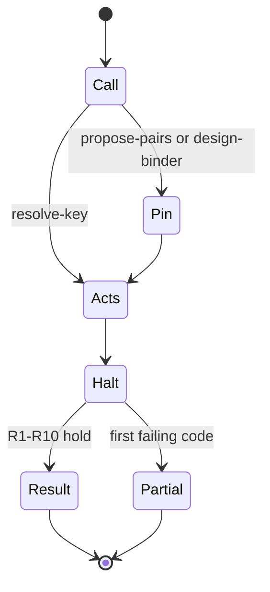
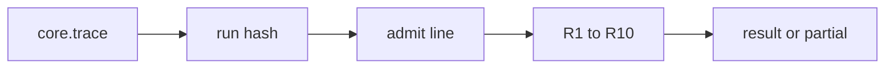

⚠️ ACADEMIC RESEARCH PURPOSES ONLY; NOT FOR MEDICAL USE WITHOUT LICENSED OVERSIGHT

# `TRACES` — act log

`type: agent.system` · `spec: fleet.campaign`. This file is the act-log law for one run; `verifier/verify.py --trace` decides shape from bytes. The answer is `result` or `partial`, and §8.16 stays undischarged.

## Document graph

- → [systems/run-campaign.md](run-campaign.md)

## Specification card

| Role | Does | Must |
|---|---|---|
| Campaign system | Content-address run acts | `oracle=not-discharged`; no scores |
| Reads: core; worker traces | Writes: `.trace` outside repo | Check: `verify.py --trace` |

## composition

```yaml
files: ["core.trace", "<worker>.trace"]
answer: ["result", "partial"]
graph: "Document graph above"
```

## indications

One `fleet.campaign` run recording pin, call, refusal, proposal, emission, and halt for `resolve-key`, `propose-pairs`, or `design-binder`.

## contraindications

- No field for an area, rank, grade, score, tier, study type, or utility.
- `result` does not establish that an event occurred, that `rev` was fetched, or that a patient benefited.
- A `.trace` line is not a `proposals.json` element and not a `.bench` line.

## algorithm

### variables

```yaml
independent:
  skill: "resolve-key | propose-pairs | design-binder"
  bound_n: "positive integer, no leading zero"
  bound_tok: "positive integer, no leading zero"
dependent:
  id: "SHA-256 of the preimage"
  answer: "result | partial"
controlled:
  run: "SHA-256 of core.trace bytes"
  oracle: "not-discharged"
  disclaimer: "banner byte string, inside the emit preimage"
objective: "a pure shape judgement with the oracle fixed"
```

### processes

Control admits each line before R1–R10. Design parents follow P1–P6; any other shape has no parent. Transport is set union on `Id`. Stopping is one `halt` whose bounds equal the core. Search is the hard-coded act, gate, and field lists. Filter drops a token that is not in its list. Recovery: `unavailable` may be recorded; it does not invent a catalogue row.





### 0. Lines

A file is UTF-8. A file that is not valid UTF-8, or that contains a NUL or a carriage return, is refused. No byte is rewritten as U+FFFD.

`core.trace` is these four lines, each ending in a newline. The bounds are positive integers with no leading zero. The skill is one of `resolve-key`, `propose-pairs`, `design-binder`. The spec is 40 lowercase hex digits.

```
%trace-core/1
bound-n:"<bound-n>"
bound-tok:"<bound-tok>"
skill:"<skill>"
spec:"<40 lowercase hex digits>"
```

A worker file is one header and then one act per line. The header is `%trace/1 core=<64 lowercase hex digits> spec=<40 lowercase hex digits>`. An act line is:

`<act> <id> <parent> run=<64 lowercase hex digits> skill=<skill> key:"value" …`

| piece | what it is |
|---|---|
| act | `call`, `pin`, `refuse`, `unresolved`, `unavailable`, `propose`, `context`, `emit`, or `halt` |
| id | 64 lowercase hex digits |
| parent | `^0`, or `^` plus 64 lowercase hex digits |
| key | a lowercase letter, then lowercase letters, digits, or hyphens, in ascending byte order on the line |
| value | double quotes around a non-empty UTF-8 string of at most 4096 bytes, with no quotation mark and no ASCII control (`U+0000`–`U+001F`, `U+007F`) |

`subject` is that value at at most 1024 bytes, or the literal `unencodable`, or the literal `unquotable`. A worker basename is a lowercase letter, then up to 31 lowercase letters, digits, or hyphens, and the file is that name plus `.trace`. A file ends on the newline of its last line and does not end on a blank line.

The preimage of a line is that line with the id and the final newline removed. `H` is SHA-256, 64 lowercase hex digits, of the UTF-8 preimage. `run` is `H` of the core file's exact bytes.

### 1. Allowed values

The checker hard-codes these lists. A token that is not in its list is refused.

| skill | acts |
|---|---|
| `resolve-key` | `call`, `refuse`, `unresolved`, `unavailable`, `halt` |
| `propose-pairs` | `call`, `pin`, `refuse`, `unresolved`, `unavailable`, `propose`, `halt` |
| `design-binder` | `call`, `pin`, `context`, `refuse`, `unresolved`, `unavailable`, `emit`, `halt` |

| skill | gates |
|---|---|
| `resolve-key` | `grammar`, `scope`, `ascii` |
| `propose-pairs` | `out-of-scope`, `illegal-payload`, `duplicate-triple`, `duplicate-molecule` |
| `design-binder` | `grammar`, `species`, `not-protein`, `indication-absent`, `selectivity`, `immunogenicity`, `developability`, `no-assay` |

For `design-binder`, the gates `grammar`, `species`, `not-protein`, and `indication-absent` parent the call. The other gates parent the pin.

| skill | step | the `key` field is |
|---|---|---|
| `resolve-key` | `resolve` | a binder or a target |
| `propose-pairs` | `3` | a binder |
| `propose-pairs` | `4` | a target |
| `design-binder` | `catalogue` | a target |
| `design-binder` | `generator` | a target |
| `design-binder` | `model` | a binder |

| act | fields, in this order |
|---|---|
| `call` | none |
| `pin` | `path`, `rev` |
| `refuse` | `gate`, `subject` |
| `unresolved` | `key`, `release`, `retrieved`, `source`, `step` |
| `unavailable` | `key`, `release`, `retrieved`, `source`, `step` |
| `propose` | `binder`, `pmid`, `target` |
| `emit` | `binder`, `disclaimer`, `kind`, `target` |
| `halt` | `bound-n`, `bound-tok`, `oracle` |

| verdict | gloss | fields, in this order |
|---|---|---|
| `hit-same-indication` | `stop` | `binder`, `gloss`, `pmid`, `target`, `verdict` |
| `hit-other-indication` | `transfers-not` | `binder`, `gloss`, `pmid`, `target`, `verdict` |
| `hit-unread` | `not-read` | `binder`, `gloss`, `pmid`, `target`, `verdict` |
| `absent` | `not-a-negative` | `gloss`, `target`, `verdict` |

`gloss` and `verdict` belong to the context row they are written on, and to no other row. `path` is `graph.json`. `oracle` is `not-discharged`. `kind` is `hypothesis`. `disclaimer` is the first non-blank line of this file, byte for byte.

`binder` holds when the value satisfies `docs/follow-agent-contract.md` §8.7 and §8.8. `target` holds when it satisfies §8.9. `pmid` holds when it satisfies §8.10. The checker calls those predicates. It does not restate them. `subject` is not sent through them.

`source` and `release` are 1 to 64 characters from letters, digits, and `._:/-`. `release` may be the literal `unspecified`. `retrieved` is a real Gregorian date `YYYY-MM-DD`, the UTC day, with no zone suffix. `rev` is 40 lowercase hex digits. `bound-n` and `bound-tok` are positive integers and equal the core.

### 2. Parents

The call's id is `H` of the text `call ^0 run=<run> skill=<skill>`, with no trailing newline. A line's parent is the first row below that applies.

| | when | parent |
|---|---|---|
| P1 | the act is `call` | `^0` |
| P2 | the act is `pin` | `^` plus the call's id |
| P3 | the skill is `resolve-key` and the act is not `call` | `^` plus the call's id |
| P4 | the skill is `design-binder`, the act is `refuse`, and the gate is one of `grammar`, `species`, `not-protein`, `indication-absent` | `^` plus the call's id |
| P5 | the skill is `design-binder`, the act is `halt`, and the head has no pin | `^` plus the call's id |
| P6 | the head has exactly one pin | `^` plus that pin's id |

Any other shape has no parent.

`sameMolecule` is `docs/follow-agent-contract.md` §8.13 on the binder strings of `propose` lines: equal `aa:` multisets, equal `helm:` payloads after polymer-index normalisation, or an `aa:` key and a plain-L-chain `helm:` key with that sequence. One string used twice is one key.

### 3. What the checker decides

A line is admitted on its own. R1–R10 are said of the head of admitted lines. The checker returns the first failure in the order below, otherwise `result`.

A line is admitted when every row below holds. The code is the first that fails.

| code | condition |
|---|---|
| `syntax` | the line matches §0, keys sorted, each value inside its byte cap |
| `hash` | the id is `H` of the preimage |
| `run` | the line's `run` equals the core's run |
| `skill` | the line's `skill` equals the core's skill |
| `act` | the act is in that skill's list (§1) |
| `fields` | the keys are the act's list (§1), or the context row when the act is `context` |
| `value` | every value meets §1, and a `halt` uses the core's bounds |
| `parent` | the parent is `^0` or `^` plus 64 hex digits, and it equals P1–P4 where those rows do not read the head. A line shaped like P6 has a `^` plus 64 hex digits that is not `^0` and is not the call. A `design-binder` `halt` may parent the call or some other id. |

The file is well formed when the core basename is `core.trace`, every worker basename matches §0, every header is `%trace/1 core=<run> spec=<spec>` for this core, and every line is admitted. Otherwise the checker returns `partial` and `R1` when the core does not match §0, `partial` and `R3` when a name or header fails, and `partial` and `admit` when a line is not admitted. Line failures are reported before R1–R10. A line that is not admitted is not in the head.

On a head whose file is well formed:

| id | holds when |
|---|---|
| R1 | the core matches §0 and `run` is `H` of its bytes |
| R2 | every line in the head carries that run and that skill |
| R3 | every worker header matches §0 for this core, and every basename matches §0 |
| R4 | the head contains one `call`, and its id is the call id from §2 |
| R5 | the head contains one `halt`; its bounds equal the core; its oracle is `not-discharged`; its parent is the call when there is no pin, the pin's id when there is one pin, and there is no legal parent when there is more than one pin |
| R6 | every parent id other than `^0` is the id of a line in the head |
| R7 | every line's act is in the skill's list and its parent is the one §2 names |
| R8 | every value in the head meets §1 |
| R9 | no two distinct `propose` binders are one molecule under `sameMolecule` |
| R10 | the skill shape below |

**`propose-pairs`.** Exactly one pin, and it parents the call. Every other line that is not the call parents that pin. No `context` line and no `emit` line.

**`resolve-key`.** No pin, no proposal, no context, no emit. Every line that is not the call parents the call.

**`design-binder`, no pin.** At least one refusal whose gate is `grammar`, `species`, `not-protein`, or `indication-absent`. No context and no emit. Every line that is not the call parents the call.

**`design-binder`, one pin.** Exactly one context, and it parents the pin. The halt parents the pin. Every emit parents the pin. Every refusal whose gate is not one of those four parents the pin. A verdict of `hit-same-indication` or `hit-unread` means there is no emit. Every emit has kind `hypothesis` and the disclaimer. `hit-unread` means `pair` already cites the target and the paper was not read. The binder on that line is one key. It is not a claim that the indication matches, and it is not a claim that the binder fails to transfer.

The head is a result when the file is well formed and R1 through R10 all hold. The checker prints `result` and the run, or `partial` and the first code. It does not print a fraction.

Merge of workers is set union on `Id`. Identical bytes are one line. Union is associative, commutative, and idempotent because `Id` is `H` of the preimage.

### 4. What a passing check does not decide

A checker that returns `result` has not decided any of the following.

- A line's act is an event that occurred. Admission decides shape.
- The catalogue blob named by `rev` was fetched. `decide` does not open `graph.json`.
- `docs/follow-agent-contract.md` §8.16. The only derived oracle string is `not-discharged`. A `hit-unread` line does not decide the indication. `hit-same-indication` and `hit-other-indication` are the shapes for a reader who did. The checker does not know which reader ran.
- Patient benefit. A result on a design head is a hypothesis carrying the disclaimer, or a named refusal. The disclaimer sits inside the preimage, so a line with the disclaimer removed has a different id and fails `hash`.
- Any area under a curve. The checker's answer is `result`, not a number.

A `.trace` byte string is not a `proposals.json` element and not a `.bench` line. `%trace/` is not a `%bench/` line.

### 5. Witness

Illustration. `spec` is forty `a`s and `rev` is forty `b`s. The proposal `aa:ACD` / `uniprot:P12345` / `pmid:1` is a shape fixture, not a claim of benefit. `H` of the core bytes is `run`. `H` of a line with its second token removed is that line's id.

`core.trace`:

```
%trace-core/1
bound-n:"1"
bound-tok:"8000"
skill:"propose-pairs"
spec:"aaaaaaaaaaaaaaaaaaaaaaaaaaaaaaaaaaaaaaaa"
```

`run` = `d2066050893688b4fc69def4b3c03ffa9ee8b06ef14858786224a7adf2684853`.

`a1.trace`:

```
%trace/1 core=d2066050893688b4fc69def4b3c03ffa9ee8b06ef14858786224a7adf2684853 spec=aaaaaaaaaaaaaaaaaaaaaaaaaaaaaaaaaaaaaaaa
call 82d0bb98077f59cb3544536e2023d4cf99699408e57250de2ce20d3e0b20a294 ^0 run=d2066050893688b4fc69def4b3c03ffa9ee8b06ef14858786224a7adf2684853 skill=propose-pairs
pin 2f3f7335675c72766882db3b0dea24b20818183f1934fd10eb131a10ba13fba4 ^82d0bb98077f59cb3544536e2023d4cf99699408e57250de2ce20d3e0b20a294 run=d2066050893688b4fc69def4b3c03ffa9ee8b06ef14858786224a7adf2684853 skill=propose-pairs path:"graph.json" rev:"bbbbbbbbbbbbbbbbbbbbbbbbbbbbbbbbbbbbbbbb"
refuse 4d25814dcfdc011016c4c4126bb3a220e4a69e52d7517a9d7b395a8c7d40dfbe ^2f3f7335675c72766882db3b0dea24b20818183f1934fd10eb131a10ba13fba4 run=d2066050893688b4fc69def4b3c03ffa9ee8b06ef14858786224a7adf2684853 skill=propose-pairs gate:"illegal-payload" subject:"helm:PEPTIDE1{[CCO]}$$$$"
propose 179014b62688af1357af3e8dad3f4dd0fcf0e4675426115a52390b8e02ae4b46 ^2f3f7335675c72766882db3b0dea24b20818183f1934fd10eb131a10ba13fba4 run=d2066050893688b4fc69def4b3c03ffa9ee8b06ef14858786224a7adf2684853 skill=propose-pairs binder:"aa:ACD" pmid:"pmid:1" target:"uniprot:P12345"
halt 9d2001abc00391ea2c66714740c2ba9ec5c279405495498f51a72db31be4d6a3 ^2f3f7335675c72766882db3b0dea24b20818183f1934fd10eb131a10ba13fba4 run=d2066050893688b4fc69def4b3c03ffa9ee8b06ef14858786224a7adf2684853 skill=propose-pairs bound-n:"1" bound-tok:"8000" oracle:"not-discharged"
```

`decide` of this pair of files is `result`.

### 6. Status

Licensed oversight is required for any use of this system; none has been performed to date.

`verifier/verify.py --trace` decides this file. `fleet/fleet.py` writes the lines through the
verifier's own `trace_emit`, then hands every completed run back to that checker. Extension
predicate E4 decides the bijection between `docs/follow-agent-contract.md` §11 and the files
`systems/*.md`. The identity line above is extension predicate E5
(`docs/follow-agent-contract.md` §0c). Neither decision is §8.16.

## citations

Predicates §8.7–§8.10 are called, not restated: `docs/follow-agent-contract.md`. Parent and skill shape are §§1–3 of this file. The witness in §5 is a shape fixture, not a claim of benefit.

## falsification

A halt whose oracle is anything but `not-discharged` must not verify. Removing the disclaimer from an emit changes the preimage, so the old id fails `hash`. The naive benchmark prints a fraction instead of `result`.

## licence

MIT
