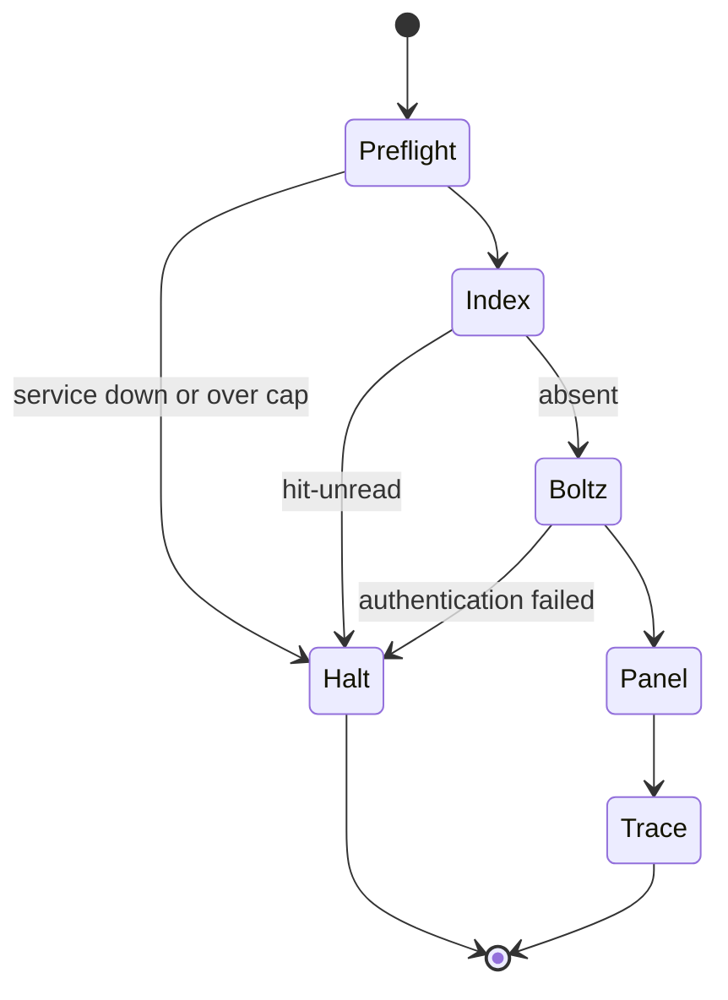
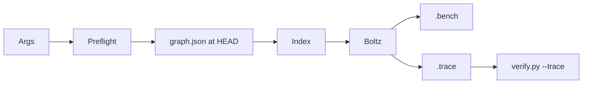

⚠️ ACADEMIC RESEARCH PURPOSES ONLY; NOT FOR MEDICAL USE WITHOUT LICENSED OVERSIGHT

# run a campaign

`type: agent.system` · `spec: fleet.campaign`. `fleet/fleet.py` preflights and runs `design-binder`, then hands the trace to `--trace`. An unread `pair` hit halts before Boltz and before the advisory panel.

## Document graph

- ← [systems/record-traces.md](record-traces.md)

## Specification card

| Role | Does | Must |
|---|---|---|
| Campaign system | Preflight and run `design-binder` | Catalogue hit stops before spend |
| Reads: bounds; pinned catalogue; services | Writes: `.bench`, `.trace` outside repo | Check: fleet tests; trace `result` |

## composition

```toml
commands = ["preflight", "run", "verify"]
stores = [".bench", ".trace"]
graph = "Document graph above; this file is the sink"
```

## indications

One run with explicit bounds, a human UniProt target, a pinned catalogue SHA, and Boltz as the design engine.

## contraindications

- No flag above has a default. A missing bound is a refusal.
- Workers do not read one another's bench lines.
- `agent.swarm` and `agent.fleet` are not specs. Literature about local messages or a centralized fleet manager is a different object from this run.
- OpenRouter does not substitute for hosted Boltz.

## algorithm

### variables

```toml
objective = "halt before paid design when pair already cites the target"

[independent]
budget_usd = "caller argument"
target = "uniprot:"
models = "caller argument"
candidates = "caller argument"
length_window = "min-aa and max-aa on the Boltz request only"

[dependent]
launch = "true only when services and projection are inside the cap"
context = "hit-unread | absent"

[controlled]
pin = "checkout HEAD sha, never a branch name"
oracle = "not-discharged"
organism = "Homo sapiens"
```

### processes

Control is preflight: UniProt, NCBI, Boltz, Modal, and the OpenRouter key budget. Design runs only after context verdict `absent`. Transport writes both stores outside this repository and writes neither catalogue file. Stopping: `launch=false`, unread `pair` hit, or failed Boltz authentication before the advisory panel. Search builds the target reverse index from the pinned file. Filter: grammar, species, not-protein, and indication-absent parent the call. Recovery records `unavailable` with the source and status, not a response body.





### preflight

```bash
python3 fleet/fleet.py preflight \
  --budget-usd 2.00 \
  --target uniprot:P01111 \
  --models vendor/model \
  --candidates 3 \
  --min-aa 45 --max-aa 110 \
  --prompt-tokens 700 --completion-tokens 1400
```

Every flag above is an argument. None of them has a default: a missing bound is a refusal, not a standing policy. The model id is the caller's. Preflight is read-only and submits no compute. It pins `graph.json` at a commit SHA — the checkout's HEAD, never a branch name — checks UniProt and NCBI, authenticates Boltz and Modal, reads the OpenRouter key budget, prices the models named on the command, and returns `launch=false` when any required service is unavailable or the projection crosses the cap. Boltz is required. OpenRouter is an advisory panel and never substitutes for the hosted Boltz design engine. NCBI is probed with a pmid taken from the pinned catalogue. Vendor bases and the Modal app name come from the environment; the harness embeds none.

### run

```bash
python3 fleet/fleet.py run \
  --target uniprot:P01111 \
  --indication "research" \
  --out /tmp/catalog-fleet \
  --models vendor/model \
  --candidates 3 \
  --bound-tok 60000 \
  --max-tokens 2600 \
  --timeout 180 \
  --min-aa 45 --max-aa 110 \
  --live
python3 fleet/fleet.py verify /tmp/catalog-fleet
```

`--min-aa` and `--max-aa` are sent only on the Boltz design request. They are not a grammar gate: `docs/follow-agent-contract.md` §3 bounds the alphabet, not the length. The harness admits the target when UniProt names the organism *Homo sapiens* and pins `graph.json` to the checkout SHA. It builds the target reverse index. If `pair` has any binder for that target, the context verdict is `hit-unread` and the run halts. The paper was not read, so the harness does not record `hit-same-indication` or `hit-other-indication`, and it does not call Boltz or the advisory panel. The context line carries the §7 rank winner and that binder's first `pmid`. The report lists every `pair` row in that order, and any `preclinical` rows under `preclinical_rows`. If `pair` has no binder for the target, the context verdict is `absent`. Only then does the harness authenticate and estimate the Boltz request and fan out the advisory panel. A failed Boltz authentication records `unavailable` with `step:"generator"` and halts before that panel. Candidate sequences are hypotheses; nothing writes `graph.json` or `proposals.json`.

A `grammar` refusal parents the call. For `design-binder`, grammar, species, not-protein, and indication-absent parent the call even when the candidate was produced after the pin (`systems/record-traces.md`).

A service failure records the source and the status. It does not record a response body.

`core.trace` and one `<worker>.trace` per worker implement TRACES. `core.bench` and one
`<worker>.bench` per worker implement BENCH; even an empty worker head is represented by a
header-only file. The core bench file is `%bench-core/1`, because its hash is the bench-store id and so
cannot appear inside itself (`systems/use-bench.md`). The campaign id is the hash of `core.trace`. The bench
core records that hash as `trace`. Every trace is decided at the end of the run.
`result` proves only trace shape, not that an event occurred, not paper inclusion, and not patient benefit.

### tests

```bash
python3 fleet/tests/test_fleet.py
python3 verifier/tests/test_verify.py
python3 verifier/verify.py graph.json --repo .
```

The harness suite is hermetic. It covers content-addressed BENCH lines, tier refusal, binder admission,
the named developability motifs, JSON parsing, pre-pin refusal, Boltz fail-closed behaviour, budget
preflight, full worker-file materialization, an unread `pair` hit that halts before Boltz and before
the advisory panel, and an end-to-end `result` trace with live calls faked.

## citations

Skill executed: `skills/design-binder.md`. Stores: `systems/use-bench.md` and `systems/record-traces.md`. Run vocabulary and the 1 Nov 2026 (Australia/Sydney) re-check of the three PDFs: `docs/follow-agent-contract.md` §11.

## falsification

This harness is refuted by a `pair` hit that still calls Boltz or the advisory panel. A `result` trace proves shape only. The naive benchmark is a run that reaches the panel and treats that as evidence.

## licence

MIT
