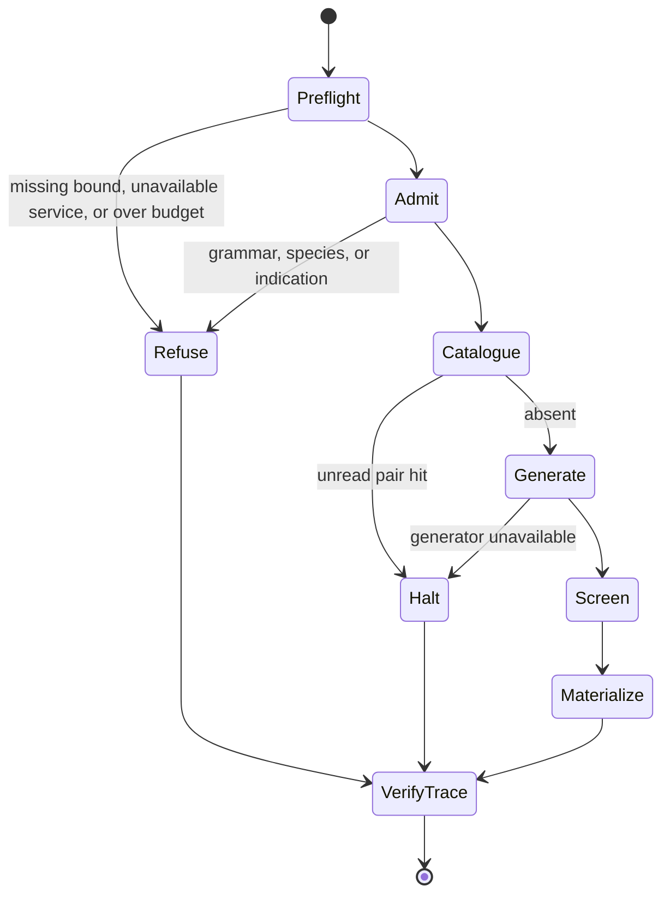

⚠️ ACADEMIC RESEARCH PURPOSES ONLY; NOT FOR MEDICAL USE WITHOUT LICENSED OVERSIGHT

# run a campaign

`type: agent.system` · `spec: fleet.campaign` · subordinate to `docs/follow-agent-contract.md`, which governs on any conflict.

Preflight and execute one bounded `fleet.campaign`, materialize BENCH and TRACES outside the repository, and return the trace to the verifier. A catalogue hit or unavailable required service stops the run before unnecessary compute.

## Specification

```json
{
  "id": "systems/run-campaign.md",
  "type": "agent.system",
  "role": "preflight and execute one bounded design campaign",
  "reads": ["target", "indication", "explicit bounds", "pinned graph.json", "required services"],
  "writes": [".bench and .trace files outside the repository"],
  "must": ["stop on catalogue hit", "fail closed on required services", "verify every trace"],
  "check": ["fleet tests", "trace result", "E4", "E5", "E6"]
}
```

## Graph

- ← [record-traces.md](record-traces.md)
- ← [use-bench.md](use-bench.md)

## Composition

| Component | Responsibility |
|---|---|
| `fleet/fleet.py preflight` | pin inputs, probe services, price named models, enforce spend cap |
| `fleet/fleet.py run` | apply admission and catalogue gates, invoke bounded generation, write worker artifacts |
| BENCH | run-scoped tiered partial work |
| TRACES | content-addressed acts ending in one halt |
| verifier handoff | decide trace shape as `result` or `partial` |

One run has one trace core, one campaign hash, explicit bounds, and one halt. Workers are campaign members; `agent.swarm` and `agent.fleet` are not local specs.

## Indications

- Execute `design-binder` for an admitted human target and explicit indication.
- Prove before launch that required services and the caller's spend/token bounds are available.
- Exercise the catalogue-stop behavior and trace/bench formats under hermetic tests.

## Contraindications

- Do not launch with a missing bound, moving catalogue branch, unread `pair` hit, or unavailable required generator.
- The advisory panel never substitutes for the hosted design engine.
- Workers in this harness do not read one another's BENCH lines; do not call this centralized bounded run a swarm.
- A verified trace proves format, not service execution, paper inclusion, molecular binding, safety, or benefit.

## Algorithm

### Variables

| Class | Variable | Definition |
|---|---|---|
| independent | target, indication, models, services | caller brief and explicitly named execution dependencies |
| dependent | launch, artifacts, and trace verdict | fail-closed decision plus bounded run outputs |
| controlled | SHA, candidates, tokens, timeout, spend | pinned catalogue and pre-registered resource limits |

### Process



### Preflight

```bash
python3 fleet/fleet.py preflight \
  --budget-usd 2.00 \
  --target uniprot:P01111 \
  --models vendor/model \
  --candidates 3 \
  --min-aa 45 --max-aa 110 \
  --prompt-tokens 700 --completion-tokens 1400
```

Every flag above is an argument. None of them has a default: a missing bound is a refusal, not a standing policy. The model id is the caller's. Preflight is read-only and submits no compute. It pins `graph.json` at a commit SHA — the checkout's HEAD, never a branch name — checks UniProt and NCBI, authenticates Boltz and Modal, reads the OpenRouter key budget, prices the models named on the command, and returns `launch=false` when any required service is unavailable or the projection crosses the cap. Boltz is required. OpenRouter is an advisory panel and never substitutes for the hosted Boltz design engine. NCBI is probed with a pmid taken from the pinned catalogue. Vendor bases and the Modal app name come from the environment; the harness embeds none.

### Run

```bash
python3 fleet/fleet.py run \
  --target uniprot:P01111 \
  --indication "research" \
  --out /tmp/catalog-fleet \
  --models vendor/model \
  --candidates 3 \
  --bound-tok 60000 \
  --max-tokens 2600 \
  --timeout 180 \
  --min-aa 45 --max-aa 110 \
  --live
python3 fleet/fleet.py verify /tmp/catalog-fleet
```

`--min-aa` and `--max-aa` are sent only on the Boltz design request. They are not a grammar gate: `docs/follow-agent-contract.md` §3 bounds the alphabet, not the length. The harness admits the target when UniProt names the organism *Homo sapiens* and pins `graph.json` to the checkout SHA. It builds the target reverse index. If `pair` has any binder for that target, the context verdict is `hit-unread` and the run halts. The paper was not read, so the harness does not record `hit-same-indication` or `hit-other-indication`, and it does not call Boltz or the advisory panel. The context line carries the §7 rank winner and that binder's first `pmid`. The report lists every `pair` row in that order, and any `preclinical` rows under `preclinical_rows`. If `pair` has no binder for the target, the context verdict is `absent`. Only then does the harness authenticate and estimate the Boltz request and fan out the advisory panel. A failed Boltz authentication records `unavailable` with `step:"generator"` and halts before that panel. Candidate sequences are hypotheses; nothing writes `graph.json` or `proposals.json`.

A `grammar` refusal parents the call. For `design-binder`, grammar, species, not-protein, and indication-absent parent the call even when the candidate was produced after the pin (`systems/record-traces.md`).

A service failure records the source and the status. It does not record a response body.

`core.trace` and one `<worker>.trace` per worker implement TRACES. `core.bench` and one
`<worker>.bench` per worker implement BENCH; even an empty worker head is represented by a
header-only file. The core bench file is `%bench-core/1`, because its hash is the bench-store id and so
cannot appear inside itself (`systems/use-bench.md`). The campaign id is the hash of `core.trace`. The bench
core records that hash as `trace`. Every trace is decided at the end of the run.
`result` proves only trace shape, not that an event occurred, not paper inclusion, and not patient benefit.

### Tests

```bash
python3 fleet/tests/test_fleet.py
python3 verifier/tests/test_verify.py
python3 verifier/verify.py graph.json --repo .
```

The harness suite is hermetic. It covers content-addressed BENCH lines, tier refusal, binder admission,
the named developability motifs, JSON parsing, pre-pin refusal, Boltz fail-closed behaviour, budget
preflight, full worker-file materialization, an unread `pair` hit that halts before Boltz and before
the advisory panel, and an end-to-end `result` trace with live calls faked.

## Citations

| Pin | Claim used | Boundary |
|---|---|---|
| [Multi-Agent Coordination, arXiv:2502.14743v2](https://arxiv.org/abs/2502.14743v2) | a multi-agent system can contain multiple independent interactive decision-makers | does not define this campaign |
| [Signalling and Social Learning in Swarms of Robots, arXiv:2411.11616v2](https://arxiv.org/abs/2411.11616v2) | the adopted swarm definition uses decentralized local coordination | this harness is centrally bounded and is not a swarm |
| [RobotFleet, arXiv:2510.10379v1](https://arxiv.org/abs/2510.10379v1) | one fleet architecture uses a centralized fleet manager | does not standardize `agent.fleet` |
| [MAST, arXiv:2503.13657v3](https://arxiv.org/abs/2503.13657v3) | multi-agent traces expose system-design, coordination, and verification failures | benchmark domains are not binder design |
| [`pin-references.md`](../docs/pin-references.md) | hashes, retrieval dates, and read status for these claims | local terms still govern |

The three arXiv versions and recorded PDF digests were re-checked 1 Nov 2026 (Australia/Sydney). MCP and A2A describe external tool/context and agent-to-agent protocols respectively; this harness claims conformance with neither.

## Falsification

| Challenge | Expected break |
|---|---|
| omit any CLI bound | preflight refuses |
| project spend above `--budget-usd` | `launch=false`, no compute |
| inject an unread `pair` target | no Boltz or advisory-panel call |
| fail Boltz authentication | `unavailable` at `generator`, panel not called |
| return a non-human UniProt organism | pre-pin species refusal |
| append an untiered BENCH line | receiver refuses it |
| remove one worker file | full materialization test fails |
| alter a trace line after hashing | trace decision is `partial` |
| fake all live calls but preserve bytes | trace may be `result`, demonstrating that shape is not occurrence |

Run `python3 fleet/tests/test_fleet.py`, `python3 verifier/tests/test_verify.py`, and `python3 verifier/verify.py graph.json --repo .`. The hermetic end-to-end case must finish with one halt and a `result` trace while every fail-closed case proves that downstream calls did not occur.

## Licence

MIT
