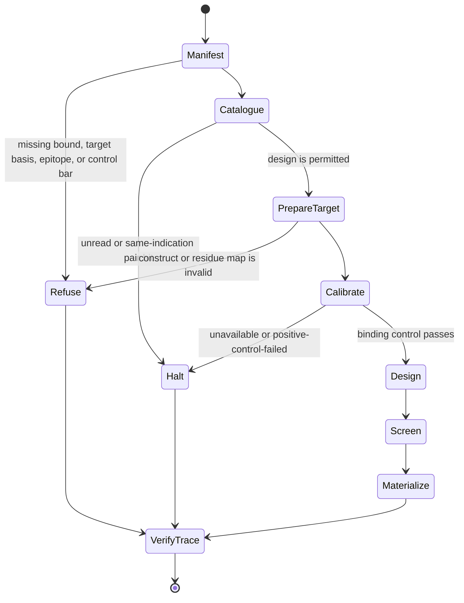

⚠️ ACADEMIC RESEARCH PURPOSES ONLY; NOT FOR MEDICAL USE WITHOUT LICENSED OVERSIGHT

# run a campaign

`type: agent.system` · `spec: fleet.campaign` · subordinate to `docs/follow-agent-contract.md`, which governs on any conflict.

Specify one bounded design campaign in Markdown, from catalogue gate through positive-control calibration, epitope-conditioned generation, reporting, and trace verification. Agents execute this file directly; no repository-local fleet program supplies hidden defaults or request bodies.

## Specification

```json
{
  "id": "systems/run-campaign.md",
  "type": "agent.system",
  "role": "execute one calibrated epitope-conditioned design campaign",
  "reads": ["caller manifest", "pinned graph.json", "target structures", "current provider schema"],
  "writes": [".bench and .trace files outside the repository"],
  "must": ["calibrate before novel design", "condition on a mapped epitope", "halt when the binding control fails"],
  "check": ["positive-control verdict", "trace result", "E4", "E5", "E6", "E7"]
}
```

## Graph

- ← [record-traces.md](record-traces.md)
- ← [use-bench.md](use-bench.md)

## Composition

```toml
authority = "this Markdown file; no repository-local fleet executable"
phases = ["preflight", "catalogue gate", "target preparation", "positive control", "design", "screen", "verify"]
stores = [".bench", ".trace"]
graph = "Graph section; this file is the sink"
```

## Indications

- Execute `design-binder` for an admitted human target and explicit indication.
- Compare a new design configuration only after the same configuration passes a blinded positive control with a known target structure and interface.
- Materialize predictions and acts in disposable BENCH and TRACES stores outside this repository.

## Contraindications

- Do not launch novel-target generation with a missing bound, moving catalogue read, unread `pair` hit, unavailable required service, or failed positive control.
- Do not represent an available structured epitope as a template-free full-length target. A whole-receptor `no_template` request with no epitope or hotspot restriction is a configuration failure, not a broad search.
- Do not substitute sequence validity, length compliance, structure generation, `structure_confidence`, `iptm`, or interface PAE for the pre-registered binding-control criterion.
- Language-model workers may inspect evidence, choose methods, and audit outputs; text they invent is not a designed sequence. Candidate sequences must come from the named design engine.
- A verified trace proves format, not service execution, molecular binding, safety, paper inclusion, or benefit.

## Algorithm

### Variables

```toml
objective = "recover a known interface before spending on an unknown one"

[independent]
target = "human uniprot:"
indication = "explicit caller input"
target_basis = "immutable structure artifact when available, otherwise a documented sequence construct"
epitope = "non-empty mapped target-residue set"
positive_control = "known co-structure hidden from the generator as a binder"
bounds = "spend, tokens, calls, candidates, length, wall time, and iterations"

[dependent]
launch = "true only after preflight, catalogue gate, and positive-control pass"
control_verdict = "pass | positive-control-failed | unavailable"
candidates = "engine-produced hypotheses that cross the registered binding gate"

[controlled]
catalogue_pin = "40-hex commit SHA; resolve a tag before the run"
provider_request = "priced bytes equal submitted bytes"
primary_control_metric = "binding criterion fixed before generation"
oracle = "not-discharged"
```

### Process



#### 0. Markdown is the runtime authority

The caller supplies a run manifest; the executing agent reads this file at a pinned commit and follows it. There is no repository-local fleet executable, generated configuration module, default model panel, default length range, or vendor request body. A runtime may use any current client or tool that can satisfy the semantics below, but it may not weaken them because a provider schema differs.

The manifest fixes before any paid call:

| class | required value |
|---|---|
| identity | target key, indication, pinned specification commit, and catalogue revision |
| target | selected construct and canonical sequence map; structure artifact, digest, chain, crop, and structure-residue map when available; epitope residues and any non-binding surface |
| control | co-structure, hidden reference binder, interface-contact rule, primary binding metric and pass bar |
| generation | provider, engine and version, modality, candidate count, sequence-length range, random seeds where exposed |
| bounds | spend, tokens, calls, wall time, polling time, iterations, and worker count |
| output | external run directory, BENCH heads, TRACE workers, and assay owners required by `design-binder` |

A missing item is a refusal. Defaults exposed by a provider are copied into the manifest before pricing; an omitted field is not an invisible choice.

#### 1. Preflight and catalogue gate

Pin `graph.json` to the specification commit or another explicit 40-hex commit SHA. Resolve a tag to that SHA before creating the run core; never put a tag or branch name in the trace. Admit the target and indication under `skills/design-binder.md`, build the reverse index, and stop on an unread or same-indication `pair` hit before any design call. A different-indication branch opens only after the paper is read. Catalogue absence remains `absent`, never a negative.

Resolve the current provider schema, authentication, quota, and model version. Build the complete epitope-conditioned control request, then estimate the exact request that would be submitted. Redact credentials, but retain the request, provider response identifiers, schema retrieval date, and cost estimate in the run report. If estimate and submission differ in any design-bearing field, stop and re-price.

#### 2. Prepare the target construct and epitope

The catalogue target remains the whole `uniprot:` key; the design target is a documented construct of that protein. When a structure is available, map every selected structure residue back to the canonical sequence, record missing residues and index conventions, and reject ambiguous mappings. Crop to the smallest independently folded construct that contains the intended epitope and required structural context. Without a suitable structure, record the sequence interval and canonical-residue map that define the construct. Do not send signal peptide, transmembrane, cytosolic, or unrelated extracellular sequence merely because it occurs under the same accession.

The epitope is non-empty and structural:

1. derive its target residues from a pinned co-structure, competition data, or a separately justified hotspot analysis;
2. record the derivation, contact cutoff or other rule, chain, author residue ids, insertion codes, and provider indices;
3. prove every epitope index lies in the selected crop and no index also appears in the non-binding set;
4. inspect the materialized request and fail if the epitope field disappeared during client serialization.

Template-free target mode is admissible only when no suitable structure exists and the provider can still encode the mapped epitope. If the provider cannot express the required epitope, record `unavailable`; never fall back to unconstrained whole-target design.

#### 3. Calibrate with a blinded positive control

Every engine, modality, target-preparation rule, and scoring configuration must first run against a positive control chosen before the novel target. The generator receives the control target construct and epitope but not the reference binder sequence, binder chains, or catalogue answer. Use the same candidate count, length window, modality, filters, scoring path, and compute bounds proposed for the novel run. This tests independent recovery of an interface, not sequence rediscovery.

The regression control that prompted this revision is human IL-4Rα (`uniprot:P24394`) with the dupilumab Fab co-structure PDB `6WGL`. Use receptor chain C from the structure, not the reported 825-residue full-length receptor sequence. Derive the epitope from contacts between receptor chain C and Fab chains A/B, convert those receptor residues through an explicit structure-to-provider index map, and omit A/B from the generator input. The structure proves where to condition; it is not a binder template.

For the Boltz binder schema retrieved 2 Nov 2026 (Australia/Sydney), the semantic mapping is:

| requirement | documented request concept |
|---|---|
| binder-design mode | top-level `type: "binder"` |
| structured target | `from_template` on an immutable structure template |
| domain-sized construct | selected chain plus `crop_residues` |
| desired interface | non-empty `epitope_residues` |
| discouraged surface | `non_binding_residues` where justified |
| de novo binder | a binder specification that does not include the reference Fab chains |
| library size | `num_proteins` inside the provider range, copied into the manifest before pricing |

Target annotations index the original template chain. They do not index positions inside `crop_residues`. A crop-relative epitope is a different request and fails the materialized-request audit. These names are not a permanent API pin: reconcile them at execution and preserve the semantics. While PDB `6WGL` is available, a legacy `{target: {type: "no_template"}}` body over the 825-residue receptor does not satisfy this section, whether or not a sequence-index epitope is attached to that full-length chain. Template-free mode remains admissible only for a target with no suitable structure, and only when the mapped epitope is present on both the priced bytes and the submitted bytes.

The control passes only if at least one engine-generated candidate:

- crosses the pre-registered primary binding-confidence bar;
- satisfies the pre-registered geometric contact rule on the mapped epitope;
- stays inside all sequence, modality, and developability constraints; and
- is not selected by a supporting fold metric in place of either condition above.

A missing binding metric is not zero and is not a pass; it is `unavailable`. A completed control with no candidate across the bar is `positive-control-failed`, a specification refusal parented to the catalogue pin. Halt before the novel target and report the configuration as uncalibrated.

#### 4. Interpret the failed IL-4Rα run correctly

The reported 30-design run is a fixed regression case. All sequences being 88–108 residues inside a requested 45–110 window, avoiding alphabet echoes and 18-mers, and producing structures establishes only that transport, length control, and generation worked.

Its binding result is negative: reported `binding_confidence` had maximum `0.011` and was `0.000` for 20 of 30 designs. The best-folded candidate is this 88-residue helical bundle:

`MLEEMEEQFKKFAEALAKSKAPSLGADAAHELAQLGRVLSQDPAFRGLGLGLLNLAHATFDRYAPENLEVARALGLMRRYAELLLAEK`

Reported scores for that chain were `structure_confidence=0.429`, `iptm=0.754`, and interface PAE `5.14`. Under the registered primary criterion it is a folded non-binder, so it is not emitted and it is not a seed for the next request. Three other candidates cluster with it on fold quality (`iptm` 0.70–0.73, interface PAE 5.3–5.9) and do not change the verdict. The remaining low-confidence extended beta predictions, with interface PAE 11–23, are noise. The current binder metric names include `binding_confidence`, `structure_confidence`, `iptm`, and `min_interaction_pae`. Store the field name the provider actually returned. Do not rename a missing field onto one of these reported numbers, and do not fill an absent `binding_confidence` with zero.

This run must therefore materialize `positive-control-failed`, emit no binder, and halt before any novel-target spend. The first configuration change to test is the one isolated by the request audit: replace the full-length template-free target with the 6WGL chain-C construct and explicit epitope conditioning. Do not call the run successful because its sequence and structure plumbing passed.

#### 5. Generate, screen, and report

Only a passed control opens the novel-target design call. Fan out over genuinely distinct design methods or scaffold families while preserving the same target construct, residue map, epitope, non-binding surface, and registered gates. A language-model panel may recommend or criticize those choices, but its literal sequences are excluded unread.

Record every returned candidate, not only the apparent winner. Validate the caller's length and alphabet constraints, then preserve the provider's binding and structural metrics as tier-2 predictions in BENCH. Apply `design-binder` stage-one exclusions. The primary binding metric decides whether the control and candidate binding claims survive; supporting metrics diagnose fold and interface geometry but do not overrule it. When prediction alone separates surviving candidates, report them unranked.

The report carries:

- the exact redacted control and novel-target requests, response ids, provider/model versions, prices, and timestamps;
- structure artifact digests, chain/crop choices, both residue-numbering systems, and the mapped epitope;
- every sequence with every returned metric and no silent zero-filling;
- separate operational, fold, interface, and binding verdicts;
- the positive-control result before the novel-target result;
- every refusal and unavailable source;
- the two killing assays and owners required by `design-binder`; and
- BENCH heads, TRACE files, and the final trace judgement.

Every sequence that leaves the run carries the repository disclaimer in its own block. No candidate is emitted without both killing assays, regardless of prediction.

#### 6. Materialize and verify

Write `core.bench`, `core.trace`, and one worker head per participating worker outside the repository under `systems/use-bench.md` and `systems/record-traces.md`. A failed control records a `refuse` act with gate `positive-control`, then one `halt`; an unavailable provider records `unavailable` at `generator`. Verify every completed trace with:

```bash
python3 verifier/verify.py --trace /path/to/core.trace /path/to/worker.trace
```

Run repository conformance checks with:

```bash
python3 verifier/tests/test_verify.py
python3 verifier/verify.py graph.json --repo .
```

There is intentionally no fleet-runtime unit suite: the runtime is this Markdown contract, and provider execution is evidenced by its materialized requests, responses, control result, and trace rather than by mocks of a removed hardcoded client.

## Citations

| Pin | Claim used | Boundary |
|---|---|---|
| [Boltz protein-design guide](https://api.boltz.com/docs/api/guides/protein-design/) retrieved 2 Nov 2026 (Australia/Sydney) | binder mode separates target and binder; structured targets expose crop, epitope, and non-binding residues; those target annotations index the original template chain | mutable vendor documentation; reconcile and date the schema at every run |
| [PDB 6WGL](https://doi.org/10.2210/pdb6wgl/pdb) | dupilumab Fab chains A/B are co-structured with human IL-4Rα chain C | a structure does not establish that this pipeline can design another binder |
| [Lieu et al., PLOS ONE 15:e0232311](https://doi.org/10.1371/journal.pone.0232311) | primary citation for the Crystal Kappa Fab-complex structures including 6WGL | crystallization method, not a de novo-design benchmark |
| [Overath et al., bioRxiv v2](https://doi.org/10.1101/2025.08.14.670059) | interface-focused metrics and operating-point performance vary strongly by target | unrefereed; no universal control threshold |
| [`pin-references.md` row 9](../docs/pin-references.md) | exact extraction, metric reads, and uncertainty limits | no clinical outcome and no substitute for this run's control |

The 30-design IL-4Rα metrics in §4 are the runtime feedback supplied 2 Nov 2026 (Australia/Sydney). They are a regression observation, not an independently reproduced benchmark, and the original result bundle must accompany any later quantitative comparison.

## Falsification

| Challenge | Expected break |
|---|---|
| submit full-length IL-4Rα as `no_template` with no epitope | preflight refuses before pricing |
| omit or ambiguously map one epitope residue | target preparation refuses |
| let the client drop `epitope_residues` | materialized-request audit fails |
| index epitope residues inside the crop instead of the original template chain | materialized-request audit fails |
| emit or reseed the reported 88-residue helical bundle | positive control stays failed and no binder is emitted |
| pass the control on length compliance or structure generation | verdict remains `positive-control-failed` |
| replace failed `binding_confidence` with high `iptm` or low interface PAE | metric-substitution check fails |
| repeat the reported 30-design metrics | no binder is emitted and novel-target generation does not start |
| cross the control bar but miss the mapped epitope | positive control fails |
| generate a candidate in prose rather than the design engine | candidate is excluded unread |
| add a repository-local fleet executable or hidden default | Markdown ceases to be the sole runtime authority |
| preserve trace shape while faking provider calls | trace may be `result`, exposing why requests and control outputs must also be retained |

The strongest break remains experimental: failure of the measured binding assay or binding to the pre-registered counter-screen panel kills the hypothesis even after a calibrated computational run.

## Licence

MIT
