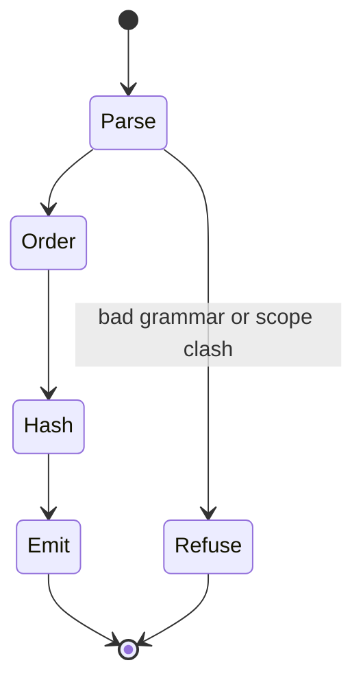
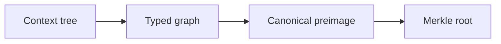

# `OG` — context-tree seal

`type: agent.system` · `spec: fleet.campaign` · subordinate to `docs/follow-agent-contract.md`, which governs on any conflict.

Seal one context tree to one Merkle root for a web3 commitment. Parsing yields a typed scoped graph, and the rulebook fixes the canonical preimage whose hash is that root.

## Specification

```json { type: notebook.cell }
{
  "id": "systems/seal-og.md",
  "type": "agent.system",
  "role": "seal one context tree to one Merkle root",
  "reads": [".og context tree", "rulebook in this file"],
  "writes": ["og.root outside the repository"],
  "must": ["parse scope and edge type", "canonicalize by the rulebook", "emit only the Merkle root"],
  "check": ["root recomputation", "E4", "E5", "E6", "E7"]
}
```

## Graph

- ← [record-traces.md](record-traces.md)
- → [run-campaign.md](run-campaign.md)

## Composition

```toml { type: notebook.cell }
input = ".og context tree"
output = "og.root"
shape = "tree"
rulebook = ["hierarchy", "address"]
graph = "Graph section"
```

## Indications

- Seal one finite typed context tree to a root a caller may anchor.
- Recompute the witness pins, including the one-node tree.
- Confirm that sibling source order is absent from the root.

## Contraindications

- The root is a commitment. It is not ciphertext. The pipeline takes no key and no nonce. Identical trees share a root, which is content addressing, and that equality is why the root is not semantic encryption.
- The root does not prove a catalogue row, a paper reading, a campaign, authorship, or occurrence.
- Do not write the root into `graph.json`, `proposals.json`, a `.bench` store, or a `.trace` store.
- Do not treat this tree as the fleet ramification or the bench Merkle DAG. Those preimage heads are different.
- This file does not select a chain, a contract, an account, or a signature. Anchoring the 32 bytes is the caller's act.

## Algorithm

### Variables

```toml { type: notebook.cell }
objective = "one Merkle root of one context tree"

[independent]
tree = "one finite typed context tree"

[dependent]
root = "lowercase hex SHA-256 of the synthetic root preimage"
emit = "two-line og.root file"

[controlled]
hash = "SHA-256"
newline = "excluded from every preimage"
oracle = "not-discharged"
```

### Process





```csv { type: notebook.cell }
operator,law
controls,SHA-256 and the three preimage heads stay fixed
design,order children by edge type then atom
transport,emit the two-line root and keep the tree off-chain
stopping,refuse a second root a scope clash or a bad token
search,resolve each parent from indentation
filters,reject a ciphertext claim and a fleet preimage
recovery,a refusal returns no root and does not rewrite the source
```

Symbolic reasoning. `type: sandbox.playground`.

```tla
---- MODULE Seal ----
EXTENDS Integers
CONSTANTS roots, v, e
Safe == roots = 1 /\ e + 1 = v
====
```

```lisp
(defun safe (roots v e)
  (and (= roots 1) (= (+ e 1) v)))
```

```lean
def lispSafe (roots v e : Nat) : Bool :=
  decide (roots = 1) && decide (e + 1 = v)

theorem Ti :
    lispSafe 1 2 1 = true ∧
    lispSafe 2 2 1 = false ∧
    lispSafe 1 2 2 = false := by
  decide
```

```bend
object Trace { name, holds }

def backward(ti_holds):
  if ti_holds:
    return Trace { name: "breakpoint", holds: 1 }
  else:
    return Trace { name: "refuse", holds: 0 }
```

### 0. Pipeline

`.og` is the superformat. One grammar covers every finite tree in the token alphabet. It is not a catalogue dialect and not a chain format.

The toolstack is three pure functions, written outside this repository from this file.

1. The parser reads `T` and returns `G = (V, E, λ, ρ)`.
2. The canonicalizer returns `C(G)` from the rulebook below.
3. The hasher returns `H(C(G))` and writes `og.root`.

`H` is SHA-256 of the UTF-8 preimage (§3). No function writes a file in this repository. The construction is a Merkle commitment. It is not an encryption scheme.

### 1. Parse

A file is UTF-8. A file that is not valid UTF-8, or that contains a NUL or a carriage return, is refused. No byte is rewritten. Every line ends in one newline. There is no blank line, no trailing space, and no second newline after the last line.

The first line is `%og/1`. Each later line is a node. Indentation is spaces, and the count is divisible by 2. Depth is that count divided by 2. A tab is refused. A node line's depth is at most one greater than the previous node line's depth.

A token matches `^[a-z][a-z0-9_]*$`. The depth-0 line is one token, the atom, and it is the only depth-0 line. The first node line is that root. A deeper line is exactly two tokens separated by one space: the edge type `λ`, then the atom. Any other shape is refused.

`V` is one vertex per node line. `E` contains one edge from the parent to that vertex. The parent is the nearest earlier line whose depth is one less. `λ` maps that edge to the child's type token. The root has indegree zero and no edge type. `ρ` maps each vertex to the atoms from the root through that vertex, joined by `/`. The root scope is its atom.

A repeated scope is refused. The parsed graph is a tree: one indegree-zero vertex, every other vertex has indegree one, and `|E| = |V| - 1`.

### 2. Rulebook

The rulebook is the whole of `C`. Two families, hierarchy and address. Each clause is stated for every finite tree in the token alphabet. None names a catalogue prefix, a fleet atom, or a chain. No clause follows from the others. Falsification breaks one clause at a time: the root moves, or the file is refused. A corollary is not a clause. There is no escape production. A token cannot contain a quote, a space, or a newline, so an escape rule would never fire.

**H1. Parent.** The parent is the indentation ancestor in §1. A parent id written on the line is not read. Three tokens are refused.

**H2. Scope.** `ρ` is the atom path from §1. Replacing the path with the bare atom changes `C`.

**H3. Type stays on the edge.** `λ` is not written into `ρ`. Folding `λ` into the scope changes `C`.

**H4. Injective scope.** A repeated `ρ` is refused. It is not merged and it is not hashed.

**H5. Sibling order.** The children of a vertex are ordered by ascending byte order of `(λ, atom)`, type first, then atom. Source order is not an input. Hash order is not an input.

**A1. Slots.** A leaf preimage is `og-leaf/1 scope:"<ρ>"`. A branch preimage is `og-branch/1 scope:"<ρ>"` followed by one ` child=<λ>:<id>` per child, in H5 order. That id is `H` of the child preimage. The type is inside the parent slot. Dropping it changes `C`.

**A2. Separated root.** `C(G)` is `og-root/1 child=<id>` where that id is `H` of the root vertex preimage. The Merkle root is `H(C(G))`. It is not the root vertex id, and it is not `H` of the source file.

**A3. Emission.** The web3 file is the two lines in §4 and no other bytes. The witness is not that file.

Equal subtrees under different scopes have different ids, because `ρ` is inside the preimage. That follows from H2 and A1. It is not an extra clause. Source order follows from H5 the same way. The canonical graph does not share nodes: one parent each, `|E| = |V| - 1` on the context tree. The published object adds one synthetic root, so the Merkle tree has `|V| + 1` vertices and `|V| edges`.

### 3. Hash

`H` is SHA-256 over the preimage bytes. The preimage has no trailing newline. Lowercase hex is the spelling of an id. A newline kept on any preimage, including `C(G)`, is a different digest. No pin beyond the FIPS 180-4 row is required. The grammar is repository-local.

`H(C(G))` is not `H` of the witness concatenation. Parent lines name child ids. They do not name sibling text.

### 4. Emission

The executor writes `og.root` outside the repository:

```text { type: notebook.cell }
%og-root/1
<64 lowercase hex digits>
```

Each line ends in one newline. There is no other byte. The hex digits are the Merkle root. Those 32 bytes are the commitment a caller may anchor. The tree stays off the file. This specification does not open a socket.

### 5. Witness

The one-node source is the first pin. Its scope is `catalog`. Its leaf id is `c647190fb811a42be00caf5a49593bd536033541fd12b2896696a7a947cd35cf`. Its Merkle root is `5271b568f3a02bb43e1fe455434e17727bf33ce54d968b28b767f2242888aab2`.

```text { type: notebook.cell }
%og/1
catalog
```

```text { type: notebook.cell }
og-leaf/1 scope:"catalog"
og-root/1 child=c647190fb811a42be00caf5a49593bd536033541fd12b2896696a7a947cd35cf
```

```text { type: notebook.cell }
%og-root/1
5271b568f3a02bb43e1fe455434e17727bf33ce54d968b28b767f2242888aab2
```

The nested witness has two sources. Sibling lines are exchanged. Both files hash differently, and both seals are one root. `H` of the first source is `157067cd10e54aaa8e02fdf5dae8e10b7245dd0ced2936c4c9e3c9b741c70054`. `H` of the second source is `20dac7d95dbf1611ea13ab6709ac4b2a2e02491d0af402b0c037bc9a76c19ac9`.

```text { type: notebook.cell }
%og/1
catalog
  zeta later
  alpha first
    holds leaf
```

```text { type: notebook.cell }
%og/1
catalog
  alpha first
    holds leaf
  zeta later
```

`ρ` values are `catalog`, `catalog/first`, `catalog/first/leaf`, and `catalog/later`. Canonical child order at `catalog` is `(alpha, first)` then `(zeta, later)`, which is not the first source's line order. The first fence is the preimages in postorder, then `C(G)`. The id of a line is `H` of that line. The second fence lists those ids. Its last line is the Merkle root `5c1038795ee09c437ecee7fdeeea26837f8856987829cfa6bee1cf87380b28a5`.

```text { type: notebook.cell }
og-leaf/1 scope:"catalog/first/leaf"
og-branch/1 scope:"catalog/first" child=holds:ecc0d47a64782ae0681d361791f6811cf09fa714ed23680590c031e4e3966214
og-leaf/1 scope:"catalog/later"
og-branch/1 scope:"catalog" child=alpha:79f3c7b4ec675f5e065c8418a04691e3b4e9969caaadca2cc1aad4c4acc8470d child=zeta:bcb6385d37bf6594f6165a04363fdf2185a3e958a566d363164408ecc3d38c13
og-root/1 child=c5602896e77f36e68f7628e8f192afe4d8648a13fa84c822370734f1310f8de6
```

```text { type: notebook.cell }
ecc0d47a64782ae0681d361791f6811cf09fa714ed23680590c031e4e3966214
79f3c7b4ec675f5e065c8418a04691e3b4e9969caaadca2cc1aad4c4acc8470d
bcb6385d37bf6594f6165a04363fdf2185a3e958a566d363164408ecc3d38c13
c5602896e77f36e68f7628e8f192afe4d8648a13fa84c822370734f1310f8de6
5c1038795ee09c437ecee7fdeeea26837f8856987829cfa6bee1cf87380b28a5
```

```text { type: notebook.cell }
%og-root/1
5c1038795ee09c437ecee7fdeeea26837f8856987829cfa6bee1cf87380b28a5
```

The root vertex id is `c5602896e77f36e68f7628e8f192afe4d8648a13fa84c822370734f1310f8de6`. Publishing that id skips A2.

### 6. Status

The notice is `DISCLAIMER`. No licensed oversight has been performed.

This Markdown file is the seal authority. An executor parses, canonicalizes, and hashes outside the repository, writes `og.root` there, and does not write a program into this repository. Receivers recompute `H(C(G))` and refuse a file that is not the two lines in §4.

## Citations

| Pin | Claim used | Boundary |
|---|---|---|
| [FIPS 180-4](https://doi.org/10.6028/NIST.FIPS.180-4) | SHA-256 digest algorithm | digest identity is not encryption and not evidence; this file did not re-download the standard |
| [`record-traces.md`](record-traces.md) | a structure image ramifies to one Merkle tree | `merkle-leaf/1` and `og-leaf/1` are different grammars; the roots are not interchangeable |
| [RFC 8785](https://www.rfc-editor.org/rfc/rfc8785) | deterministic serialization enables reproducible hashing | this canonicalization is local and is not JCS |

Stated 9 Nov 2026 (Australia/Sydney). The witness hashes were computed outside this repository the same day. The script is not in this tree.

## Falsification

| Mutation | Expected break |
|---|---|
| Exchange the nested sibling lines | the root stays `5c1038795ee09c437ecee7fdeeea26837f8856987829cfa6bee1cf87380b28a5` while the two source hashes differ |
| Order children by source order | the root becomes `5ba7a9c6de540c8c0ab4c366c62fc72e27ec98d9dcbfb36953dbe902adc0e375` |
| Fold `λ` into `ρ` | the root becomes `d9ff78ffee350b8f49716019c23f5b48b6f5beee6c0c8c990d4450b2d549f47a` |
| Use the bare atom as the whole scope | the root becomes `805249c05eab2ac3433a538c6daa6e52e77535bf794eda98cab26af288aa3b9f` |
| Drop `λ` from the child slot | the root becomes `967a12629da4a1d098a00348b9d98c64d2f34553158441fafb2ed3fd43d7f585` |
| Publish the root vertex id | the id is `c5602896e77f36e68f7628e8f192afe4d8648a13fa84c822370734f1310f8de6`, not the Merkle root |
| Keep the newline on `C(G)` | the digest is `8eee667018d2c35f1df355b4fbeac0312f1a54a892077f50185b65c0d1d14cca` |
| Hash the first nested source and call it the root | the digest is `157067cd10e54aaa8e02fdf5dae8e10b7245dd0ced2936c4c9e3c9b741c70054` |
| Repeat one atom under two edge types | H4 refuses the file and emits no root |
| Put a parent id on the node line | H1 refuses the third token and emits no root |
| Write the witness into `og.root` | A3 refuses the file; §4 allows two lines only |
| Add a key, a nonce, or a ciphertext field | no clause has an input for it |
| Parse a `merkle-leaf/1` line as an og leaf | the heads differ and the pins do not match |

## Licence

MIT
