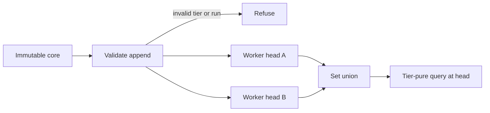

⚠️ ACADEMIC RESEARCH PURPOSES ONLY; NOT FOR MEDICAL USE WITHOUT LICENSED OVERSIGHT

# `BENCH` — a shared append-only commons for a campaign

`type: agent.system` · `spec: fleet.campaign` · subordinate to `docs/follow-agent-contract.md`, which governs on any conflict.

Provide one run-scoped, append-only commons where workers exchange immutable partial work by set union. BENCH is disposable working space, and nothing in it is admissible to the catalogue.

## Specification

```json
{
  "id": "systems/use-bench.md",
  "type": "agent.system",
  "role": "merge tiered campaign work without coordination",
  "reads": ["core.bench", "worker heads", "one explicit evidence tier"],
  "writes": [".bench files outside the repository"],
  "must": ["merge by set union", "never pool tiers", "bind every node to one core"],
  "check": ["fleet tests", "content hashes", "E4", "E5", "E6", "E7"]
}
```

## Graph

- ← [../docs/follow-agent-contract.md](../docs/follow-agent-contract.md)
- → [run-campaign.md](run-campaign.md)

## Composition

```toml
files = ["core.bench", "<worker>.bench"]
merge = "set union on content hashes"
graph = "Graph section"
```

## Indications

- Share partial measurements, predictions, and experimental outcomes within one bounded campaign.
- Merge retries, redelivery, and out-of-order worker output without locks.
- Query causal ancestors or tier-pure aggregates at an explicit head.

## Contraindications

- BENCH is not a catalogue, proposal file, durable record, truth oracle, or cross-run cache.
- Never pool measurement, prediction, and experimental-result tiers.
- A declared tier can be dishonest; syntax cannot establish provenance or truth.
- Set union does not provide total order, exactly-once effects, deduplicated work, garbage collection, or termination.
- Pose distance is not a metric and must not feed metric-tree indexes.

## Algorithm

### Variables

```toml
objective = "join-semilattice merge and tier-pure answers at a named head"

[independent]
tier = "1 measurement | 2 prediction | 3 experiment"
payload = "key-value fields"
parents = "zero or more earlier ids"

[dependent]
id = "prefix of SHA-256 of the canonical line"
head = "set of admitted ids"

[controlled]
run = "SHA-256 of core.bench bytes"
order = "keys sorted; numbers in shortest round-trip form"
```

### Process



### 0. Scope

- **Read:** this file, `docs/follow-agent-contract.md`, the run's own `.bench` files.
- **Write:** `.bench` files inside a run directory, which lives outside this repository.
- **Refuse:** `graph.json`, `proposals.json`, and every other file in this repository. This directory holds the `fleet.campaign` specifications. This file's write scope is `.bench` files inside a run directory. The harness code that appends them lives under `fleet/` and is specified by `systems/run-campaign.md`; it is outside this file's write scope (§11).

**`systems/` and `skills/`.** `skills/*.md` are *procedures*: a named thing an agent does, registered in `docs/follow-agent-contract.md` §10, each with a signature and a write scope. `systems/*.md` are the `fleet.campaign` specifications registered in §11. This file is a substrate: a format, a merge law and an invariant list. A system is not a skill, declares no signature over catalogue keys, and is not registered in §10. A skill may use a system; a system never discharges a skill's obligations, and neither widens `docs/follow-agent-contract.md` §0.

### 1. Structure

A grow-only set of immutable nodes, each named by the hash of its own content, forming a Merkle DAG. Replication is state-based: an agent sends nodes, a receiver merges by **set union**.

- `H` is SHA-256 over the node's canonical bytes (§3). A node's name is its content; identical content written twice by two agents is one node.
- Parent edges point only to the past — a parent's name is fixed before a child's can be computed — so the graph is acyclic by construction, and the edges are the causal history. No vector clock is kept and none is needed.
- A worker's **head** is the set of node names it has admitted. The commons is the union of all heads.
- Nothing is deleted or edited. A correction is a new node that supersedes an old one; the old one stays readable.

Order comes from the merge, not from a schedule. That buys: no coordinator, no lock, no queue; workers may be added or killed mid-run; retries, redelivery and out-of-order arrival need no handling, because the merge is a join (§5). It costs: readers legitimately see different worlds, so **every answer carries the head it was computed at**, and an answer without one is not reproducible and is not a result; there is no total order and therefore no "latest"; and nothing prevents two workers doing the same expensive work, because preventing that is coordination.

### 2. Evidence tier, and the rule against pooling

Every record declares a tier.

| tier | meaning |
|---|---|
| `1` | a measurement taken from the external world |
| `2` | a model's prediction |
| `3` | an experimental result |

The tier is the **first token of the line** (§3). A line that does not begin with `1`, `2` or `3` is not a line of this format: it is never hashed, and the append never happens. An untiered record is not an invalid record; it is not a record.

**No query or aggregation pools tiers.** Every aggregate takes a tier and returns a per-tier result; a summary across tiers is three results printed as three, never one. The reason is the failure this field exists to prevent: an append-only commons is exactly the structure that quietly turns predictions into evidence, because a model output carries a number, a unit, a provenance and a timestamp and reads like data at a glance. The tier makes averaging across kinds a parse-level refusal rather than a judgement call.

The same separation `docs/follow-agent-contract.md` §1 holds between `pair` and `preclinical` is held here between tiers, and for the same reason: the two are never merged and never ranked against each other.

### 3. The `.bench` line

Extension **`.bench`**. One node per line, newline-terminated, UTF-8. A run directory holds `core.bench` and one `<worker>.bench` per worker, each append-only. The version is `1`.

`core.bench` does not contain its own hash, because that hash is the run id (§6.1). It is a header line `%bench-core/1` and then one parameter per line, keys sorted ascending, each `key:"value"`. A worker file is different. Its first line is `%bench/1 core=<hash>`, and that hash is `H` of the core file's exact bytes. The records follow.

A record line is the tier, then the id, then the parents, then zero or more `key:value` fields, separated by single spaces.

| piece | what it is |
|---|---|
| tier | `1`, `2`, or `3`. Required. First token. |
| id | at least four lowercase hex digits. A prefix of `H` of the canonical line. |
| parents | `^0` for the core alone, or `^` plus ids separated by commas. |
| key | a lowercase letter, then lowercase letters, digits, or hyphens. |
| value | a number, a token, a quoted string, a list, or a pose. |

A number is an optional minus, digits, an optional decimal fraction, and an optional exponent (`e` or `E`, optional sign, digits). A token starts with a letter or a digit and then uses letters, digits, or `-_./:`. A string is written in double quotes, and only when the value needs a space. A list is `[` values separated by commas `]`. A pose is `M(` and eight comma-separated numbers `)`, a rigid-body transform (§8). Hex digits are `0`–`9` and `a`–`f`.

Canonical bytes, which `H` is taken over: the line with fields sorted by key, single spaces, numbers in shortest round-trip form, no trailing space, the `id` elided. The name is therefore a function of the content alone, and a tampered line fails to verify instead of being accepted.

**Namespaces.** BENCH mints none. A record is opaque to BENCH, but where a value names a molecule, a target or a paper it uses the `docs/follow-agent-contract.md` §3 prefixes verbatim — `aa:`, `helm:`, `uniprot:`, `pmid:` — case-sensitive, no synonyms, no abbreviations, exactly as §3 requires. Those four are grammar, not style, and a scratchpad does not get a dialect of them. BENCH's own tokens — the leading tier digit, `^`, `M(…)` — are structure, not a namespace, and carry no colon-prefixed name.

Worked example:

```text
%bench/1 core=9f2a1b7c4d
1 a3f1c0 ^0 w:a1 s:12 obs:0.712 sd:0.041 unit:uM dev:inst-4 ts:1761790001
2 b7c2e9 ^a3f1c0 w:a2 s:13 score:0.883 model:mx-7 pose:M(0.92388,0.0,0.0,0.38268,0.0,1.5,-0.25,0.0)
2 c91d44 ^a3f1c0 w:a3 s:13 score:0.814 model:mx-9 pose:M(0.9211,0.01,0.0,0.389,0.0,1.48,-0.26,0.0)
3 d04b17 ^b7c2e9,c91d44 w:a1 s:14 outcome:pass n:3 cv:0.09 note:"replicate 2 drifted"
```

A tier-1 measurement rooted at the core; two tier-2 predictions derived from it by workers running concurrently, which disagree and both stay; a tier-3 result whose parents are both predictions.

**Measured token cost.** The same ten records encoded in `.bench` and in JSON, counted with `tiktoken` (`o200k_base`): 602 tokens against 739 for compact one-object-per-line JSON, a ratio of **1.23×**. Stated honestly, because the other available figure is not: against *pretty-printed* JSON the ratio is 2.00×, and that mostly measures indentation. The saving also shrinks toward 1.0 as string payloads lengthen, because the win is per-field punctuation. 1.23× is the number; the format's other justifications are the tier the line requires and line-oriented diffs.

### 4. Admissibility: nothing here reaches `graph.json`

`docs/follow-agent-contract.md` §4 is a **semantic oracle**: a row enters `graph.json` only because a reader read the paper and judged the study type. Nothing a campaign writes to a scratchpad touches that gate, and this specification does not amend it.

- No `.bench` node, head, query answer or aggregate is a candidate row for `graph.json` or for `proposals.json`. A tier-3 record is an experimental result in a run's working notes; it is not a published paper, and `docs/follow-agent-contract.md` §3 admits citations only as bare `pmid:<digits>`.
- A tier-2 record is a model prediction and is categorically ineligible by `docs/follow-agent-contract.md` §10's `special` test: it originates a claim no source has reported.
- BENCH is not a proposals file and must not be read as one. The file boundary in `docs/follow-agent-contract.md` §9.3 stands: trust is carried by the file, and `.bench` is not one of the two files that carry it.
- A fact discovered in a run enters the catalogue the ordinary way and no other: someone publishes it, `propose-pairs` proposes it, a reader admits it.

### 5. Merge

Let `N` be the set of all possible nodes. Merge is `A ⊔ B = A ∪ B` on `(P(N), ⊆)`.

- **Associative** — `(A ∪ B) ∪ C = A ∪ (B ∪ C)`.
- **Commutative** — `A ∪ B = B ∪ A`.
- **Idempotent** — `A ∪ A = A`.

So merge is a join on a complete join-semilattice with bottom `∅`, and the induced partial order is exactly `A ⊑ B ⟺ A ⊆ B`: "B has seen everything A has seen". **What converges** is each worker's head, monotonically, to the union of all appended nodes, in any merge order, with duplicates and reordering. **What does not converge** is anything computed over the set; two readers at different heads give different correct answers, which is why §1 requires the head on every answer.

Hash naming is what makes this work without identity metadata: "same node" is decidable from the bytes.

### 6. The immutable core

`core.bench` holds the run's pre-registered parameters. It is read-only, and that is structural, not a convention:

1. **The run id is the core's hash.** `run = H(core bytes)`. One changed byte is a different hash, hence a different run. The core cannot be modified, only replaced by a core that is not this run's. That `run` names this store. The campaign id is the hash of `core.trace` (`systems/record-traces.md`). `core.bench` records that hash as the parameter `trace`.
2. **Every node names the run**, inside the bytes its own name covers, so a node cannot be moved between runs or have its run rewritten without changing its own name.
3. **The receiver validates, not the sender.** On merge, a node whose run is not this run's core hash is refused, as is a node without a tier. This rule is load-bearing rather than decorative (§9).
4. **There is no write path.** `append` requires at least one parent; the core is the only parentless node and is written once by the initialiser, before any agent starts. No agent interface can produce a parentless node.

A run whose core changed is not a tainted run to be discarded by policy; it is arithmetically a different run, and anyone can recompute the hashes and see so. The report states the core hash.

### 7. Index and query surface

Per worker, local, derived, rebuildable, never shared: an inverted index over `key:value` terms, sorted arrays per numeric key, and the DAG adjacency. All three are **add-only**, which is the only reason concurrent search works — the node set only grows, so the index only gains postings, with no tombstones and no reader invalidation. Segments merge on a size ladder.

```text
at <head>                                every query is evaluated at a head
where tier=T and <key> <op> <value>      op ∈ { =, !=, <, <=, >, >=, ~ }
ancestors(<id>) / descendants(<id>)
near(pose, M(...), <radius>)             linear scan only, §8
count | mean | sd | top-k  BY tier       aggregates are per tier, always
```

No joins, no subqueries, no cross-tier aggregate, no "latest". Appending costs one posting insert per field, cheaper than hashing the node; segment merging is amortised `O(log n)`. **Freshness is not a safety property here; soundness is.** The index may lag the store, and the only guarantee is that it never returns a node the store does not hold. A worker needing a fresh view merges, then queries; that sequence is the only synchronisation BENCH has.

### 8. Pose, and the one place geometric algebra earns its place

A record may carry a rigid-body transform as `pose:M(...)`: a **motor** in 3D projective geometric algebra `Cl(3,0,1)`, eight coefficients, composing rotation and translation in one object, compared by `d(M,N) = ‖log(M̃N)‖` over the screw parameters — rotation angle about the screw axis, translation along it. It earns its place because workers produce transforms independently and the system must compare them, and this comparison is invariant under a change of either frame. The numbers in this section come from a run made outside this repository on 2026-10-30: a standard-library Python script, seed `20261030`, which is not in this tree because agents may not commit scripts here (`docs/follow-agent-contract.md` §0). Treat them as a dated snapshot, not a check this repository can re-run. Over 20,000 random pairs it reported `max |d(AM,AN) - d(M,N)| = 4.663e-15` and `max |d(MA,NA) - d(M,N)| = 4.177e-15`, while the obvious alternative — comparing rotation angle and translation vector separately — drifts by `2.301e+00` and `3.201e+00` under the same change of frame. An earlier draft of this file quoted `1e-13` and `5e-3` for these; that run did not reproduce `5e-3`, and the figures above are what it actually printed.

Two findings that must travel with it:

- **It is not a metric.** It is bi-invariant, symmetric and zero on the diagonal, and it **violates the triangle inequality** — `22` of 20,000 random triples at seed `20261030`, worst excess `3.894e-01`, from the same 2026-10-30 run. (An earlier draft said 434; that number is not reproduced. Three other seeds give 24, 30 and 34, so the rate is tens per 20,000, not hundreds, for this sampling — uniform rotations and translations in [-1,1]^3. The rate depends on the sampling; that violations exist at all is the finding, and it does not depend on the count.) That is not a defect to fix: there is no bi-invariant metric on SE(3), so invariance and the triangle inequality cannot both be had. Therefore `near(pose, …)` is a **linear scan**, and poses must **never** enter a VP-tree, a ball tree, or any index that assumes a metric space. This is precisely the assumption an implementer makes without examining it.
- **The algebra buys concepts, not arithmetic.** The even subalgebra of `Cl(3,0,1)` is isomorphic to the dual quaternions; the implementation is dual-quaternion arithmetic. Calling it geometric algebra makes nothing faster.

This is the only use of geometric algebra in BENCH. It contributes nothing to the merge, the lattice, the index, the line format or the tier rules, and nothing elsewhere is expressed in it.

### 9. Verification status

The concurrency model was checked with TLC (TLA+) in an off-repo run on 2026-10-29 by catalog-systems. **The model is not in this repository** — there is no `.tla` or `.cfg` here — so nothing below is reproducible from this checkout, and the table records what that run reported rather than a property this repository can demonstrate. The configuration was: two agents, byte-level staging, a derived index, tier-pure aggregation, the immutable core, an untiered record and a record from a foreign run.

| rule | result |
|---|---|
| no write is lost | holds |
| merge converges regardless of order | holds, with the three §5 laws — associativity, commutativity, idempotence — checked over the full powerset |
| no agent reads a torn or partial write | holds |
| no untiered record is ever appended | holds |
| no aggregation pools tiers | holds |
| the immutable core is never written | holds |
| the index never returns what the store lacks | holds |

That run reported 198 distinct states and 887 steps with every rule above holding, and the same model with receiver-side validation switched off broke "no untiered record" and "no foreign record" in **one step each** — which is why §6.3 is called load-bearing rather than decorative, and a check that cannot fail proves nothing. Until the model is committed here, that reasoning rests on a run nobody else can repeat.

### 10. Known weaknesses

Stated here rather than in a design note, because a reader of this file is the person they would mislead.

1. **No garbage collection.** A grow-only set has no inverse, so the commons grows without bound within a run, and there is no compaction that does not violate "nothing is lost".
2. **Quiescence is not termination.** Convergence is checked at quiescence, which is a predicate over the whole system that no single agent can evaluate. In practice a run must be ended by an iteration bound, not by detecting that it is done.
3. **The line format guarantees a tier is declared, never that it is honest.** Mislabelling a prediction as a measurement is a successful line. There is no mechanism here for truthfulness and none is claimed.
4. **The model has two agents.** N-agent behaviour is argued from the merge being a set union, not checked. For the index and aggregation rules the TLC result is evidence, not proof.
5. **`CoreNeverWritten` is near-trivially true in the model**, because no action assigns the core. That is the design claim — there is no write path — but as a check it confirms the model matches the claim, not that an implementation would.
6. **The token saving is 1.23×**, not transformational, and smaller still on prose-heavy records.
7. **Pose comparison is a linear scan** by necessity (§8): adequate for thousands of poses, not for millions.

### 11. Status

Licensed oversight is required for any use of this system; none has been performed to date.

Implemented by [`fleet/fleet.py`](../fleet/fleet.py) as a run-directory writer: immutable core, one
worker file per configured worker, tier-first records, content-derived ids, parent edges and the run
hash on every node. Its hermetic tests include canonical field ordering and refusal of an
untiered line. The query index, replication protocol, pose distance and garbage collection remain
unimplemented. The off-repo TLA+ report from 2026-10-29 (§9) remains unreproducible here.

## Citations

| Pin | Claim used | Boundary |
|---|---|---|
| [Merkle-CRDTs, arXiv:2004.00107v2](https://arxiv.org/abs/2004.00107v2) | content-addressed DAGs can encode causal history and support convergent CRDT designs | an arbitrary hash DAG does not converge by itself |
| [RFC 8785](https://www.rfc-editor.org/rfc/rfc8785) | deterministic serialization enables reproducible hashing | `.bench` canonicalization is local and is not JCS |
| [TLA+](https://lamport.azurewebsites.net/tla/tla.html) | state exploration can falsify concurrency invariants | the cited model is not committed, so its result is not reproducible here |
| [FIPS 180-4](https://doi.org/10.6028/NIST.FIPS.180-4) | SHA-256 content identity | hashes do not establish evidence tier or truth |
| [`record-traces.md`](record-traces.md) | campaign trace identity carried by `core.bench` | traces and bench nodes remain separate formats |

Retrieved or re-checked 1 Nov 2026 (Australia/Sydney). The measured token ratio, pose experiment, and TLA+ state counts remain dated off-repository observations, not claims reproduced by this checkout.

## Falsification

| Challenge | Expected break |
|---|---|
| append a record without tier `1`, `2`, or `3` | receiver refuses before hashing |
| move a valid node to a different core | run-hash validation fails |
| merge heads in every permutation with duplicates | node set remains the same union |
| aggregate tiers `1` and `2` together | query is unrepresentable |
| query without recording the head | result is not reproducible |
| mutate core bytes after one append | the core hash names a different run |
| index a pose with a metric tree | triangle-inequality counterexamples invalidate pruning |
| label a prediction as tier `1` | syntax passes, exposing the truthfulness limit |
| run forever waiting for quiescence | no local termination predicate exists |

The hermetic implementation tests cover canonical ordering, tier refusal, and run binding. Claims about replication, indexing, pose distance, and the off-repo TLA+ model remain falsification targets until executable fixtures are committed.

## Licence

MIT
