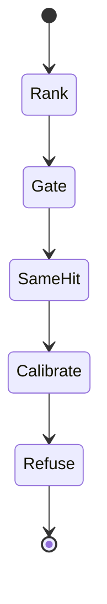

⚠️ ACADEMIC RESEARCH PURPOSES ONLY; NOT FOR MEDICAL USE WITHOUT LICENSED OVERSIGHT

# EGFR campaign record

`type: record` · one pinned calibration.

Select uniprot:P00533 by descending in-scope pair count. Catalogue gate returns hit-same-indication on pmid:16467544. Blinded 1YY9 calibration fails the binding bar and emits nothing.

## Specification

```json
{
  "id": "tmp/record-egfr-calibration.md",
  "type": "record",
  "role": "record one EGFR calibration verdict",
  "reads": ["systems/use-bench.md", "systems/run-campaign.md", "pinned graph.json"],
  "writes": [],
  "must": ["rank inside pair", "withhold reference chains", "emit nothing below the bar"],
  "check": ["binding_confidence", "trace result", "E1", "E6", "E7"]
}
```

## Graph

- → [../systems/run-campaign.md](../systems/run-campaign.md)
- ← [../systems/use-bench.md](../systems/use-bench.md)

## Composition

```toml
target = "uniprot:P00533"
dictionary = "pair"
pdb = "1YY9"
provider = "Boltz"
pipeline = "boltzprot"
verdict = "positive-control-failed"
oracle = "not-discharged"
```

## Indications

| parameter | value |
|---|---|
| spec | `4108e940ee5f8c8aad7d8e1ae173bbe166c718cb` |
| rank | `pair` ∩ {oncology, immunology}; in_scope desc; target asc |
| select | `uniprot:P00533` EGFR |
| gate | hit-same-indication · `pmid:16467544` cetuximab · spend 0 |
| context | hit-other-indication · epitope recovery, not a new clinical claim |
| crop | author 310–514 = UniProt 334–538 · offset author+24 |
| withhold | chains C, D · catalogue Fab sequences withheld |
| epitope | 22 residues · contact ≤ 4.5 Å |
| design | peptide 12..18 · n=10 · exclude C · `boltzprot` 1.0 |
| bar | `binding_confidence` ≥ 0.7 · geometry ≥ 8/22 does not pass |
| estimate | USD 0.2500 · request `b615e910dbf792b808e0a0639a7e057c38934418f510c4e75daeae33f089d944` |
| run | `prot_des_6SDannvhmPSi293YAsJ2` succeeded |
| best | `pres_Bxgm7DvSbKwlNY7MP4yd` `SLSEAEQKLLDEVKSLS` · 0.10832766083050813 · 15/22 |
| emitted | 0 · positive-control-failed |
| traces | gate `f941afe146343fab22fff05cab5ebacf416b9dcfa84ae07cd5a490fd27094695` · calibration `d0c39db694ec49716002d67433092e0053a3b527f53b263a2b93c4ab73a468c5` · both result |
| oracle | not-discharged |

## Contraindications

- `REFUSE` catalogue write, prescription, and oracle discharge.
- `REFUSE` iptm, structure_confidence, min_interaction_pae, or contact count as a substitute pass.
- `REFUSE` reading hit-same-indication as permission to emit a new binder.

## Algorithm

### Variables

```toml
objective = "pass the binding bar or emit nothing"

[independent]
areas = ["oncology", "immunology"]
crop = "1YY9:310-514"
length = "12..18"
n = 10

[dependent]
gate = "hit-same-indication"
control = "positive-control-failed"
emitted = 0
best = 0.10832766083050813

[controlled]
metric = "binding_confidence"
bar = 0.7
geometry = "8/22 at 4.5A"
withhold = "1YY9 chains C and D"
oracle = "not-discharged"
spec = "4108e940ee5f8c8aad7d8e1ae173bbe166c718cb"
```

### Process

```text
RANK pair FILTER area:oncology|immunology ORDER in_scope:desc,target:asc
SELECT uniprot:P00533
HALT hit-same-indication pmid:16467544
CALIBRATE pdb:1YY9 withhold:C,D crop:310-514 bar:binding_confidence>=0.7
VERDICT positive-control-failed emitted:0
```

```json
{
  "name": "catalog-biofleet-egfr",
  "description": "Descriptive card of a finished run. Not a live endpoint.",
  "version": "1.0.0",
  "supportedInterfaces": [
    {
      "url": "https://github.com/wetware-hq/catalog/blob/main/tmp/record-egfr-calibration.md",
      "protocolBinding": "HTTP+JSON",
      "protocolVersion": "1.0"
    }
  ],
  "capabilities": {"streaming": false, "pushNotifications": false},
  "defaultInputModes": ["application/json"],
  "defaultOutputModes": ["application/json", "text/markdown"],
  "skills": [
    {
      "id": "rank-pair",
      "name": "Rank pair",
      "description": "Count in-scope oncology or immunology pmids. Tie-break target ascending.",
      "tags": ["pair", "rank"]
    },
    {
      "id": "blind-calibrate",
      "name": "Blind calibrate",
      "description": "Withhold 1YY9 chains C and D. Emit none unless binding_confidence >= 0.7.",
      "tags": ["egfr", "positive-control"]
    }
  ]
}
```




```csv
operator,law
controls,binding_confidence bar 0.7 and oracle not-discharged
design,pair rank then blinded peptide calibration
transport,Boltz run prot_des_6SDannvhmPSi293YAsJ2
stopping,emit none when the bar fails
search,oncology and immunology inside pair
filters,withhold 1YY9 chains C and D
recovery,do not substitute iptm for the binding bar
```

## Citations

A2A Project (no date) ‘Agent2Agent protocol’, v1.0.1, commit 3303592. Available at: https://github.com/a2aproject/A2A/tree/3303592588e388e62e0f69f701af531d2f4e3991 (Accessed: 4 November 2026).

Boltz (no date) ‘Protein design concepts’. Available at: https://api.boltz.com/docs/api/guides/concepts/ (Accessed: 4 November 2026).

Bonner, J.A. et al. (2006) ‘Radiotherapy plus cetuximab for squamous-cell carcinoma of the head and neck’, *The New England Journal of Medicine*, 354(6), pp. 567–578. doi:10.1056/NEJMoa053422. pmid:16467544.

Li, S. et al. (2005) ‘Structural basis for inhibition of the epidermal growth factor receptor by cetuximab’, *Cancer Cell*, 7(4), pp. 301–311. doi:10.1016/j.ccr.2005.03.003. pmid:15837620.

Thatcher, N. et al. (2015) ‘Necitumumab plus gemcitabine and cisplatin versus gemcitabine and cisplatin alone as first-line therapy in patients with stage IV squamous non-small-cell lung cancer (SQUIRE): an open-label, randomised, controlled phase 3 trial’, *The Lancet Oncology*, 16(7), pp. 763–774. doi:10.1016/S1470-2045(15)00021-2. pmid:26045340.

UniProt (no date) ‘P00533 · EGFR_HUMAN’. Available at: https://www.uniprot.org/uniprotkb/P00533/entry (Accessed: 4 November 2026).

wetware-hq (2026) ‘catalog’, commit 4108e940ee5f8c8aad7d8e1ae173bbe166c718cb. Available at: https://github.com/wetware-hq/catalog/commit/4108e940ee5f8c8aad7d8e1ae173bbe166c718cb (Accessed: 4 November 2026).

## Falsification

A candidate on request `b615e910dbf792b808e0a0639a7e057c38934418f510c4e75daeae33f089d944` with `binding_confidence` ≥ 0.7, or any emitted sequence, contradicts `positive-control-failed`.

## Licence

MIT
